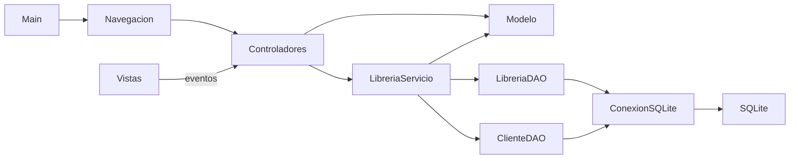

# Guía del TPO del grupo 5

Relevamiento del 17/11/2026. Rama `tpo-grupo5`, commit `ad55cbc2d74e5e697c6f42335bf05c90e75d3fc3`. El estado inicial de Git estaba limpio. Se trabajó sobre el árbol abierto, sin checkout, commits ni modificaciones de código o de la base real.

## Criterio vigente de alcance

Los faltantes se evalúan contra TP_Final_Consignas.docx. Por decisión del grupo, el PDF y el UML anteriores son antecedentes anecdóticos y no generan obligaciones funcionales. Se rehacerán después de ajustar el código. Las diferencias históricas descritas abajo no implican tareas pendientes. El plan vigente está en [ESTADO_Y_PENDIENTES.md](ESTADO_Y_PENDIENTES.md).

## 1. Cómo ejecutar el proyecto

El punto de entrada es [Main](../src/aplicacion/Main.java): inicia en el EDT de Swing, construye el servicio, carga SQLite y abre Inicio. Requiere JDK 17 o superior y `lib/sqlite-jdbc-3.50.3.0.jar`; se verificó con OpenJDK 26.0.2.1. No usa Maven, Gradle ni JUnit. En IntelliJ marcar `src` y `test` como raíces y agregar el JAR como dependencia. Directorio de trabajo: `grupo 5`.

[SQLITE.md](SQLITE.md) se conserva como manual operativo: comandos Unix y Windows, configuración, datos iniciales, persistencia, pruebas y ejemplo de consola. El [script](../ejecutar-sqlite.sh) ejecuta **EjemploSQLite**, no la interfaz, y requiere shell Unix (classpath con `:`). El ejemplo puede insertar clientes; no usar la base de entrega para practicar.

PowerShell, desde la raíz:

```powershell
$jdkTpo = 'C:/Users/facub/.jdks/openjdk-26.0.2.1/bin'
$fuentesTpo = @(Get-ChildItem src,test -Recurse -Filter *.java | ForEach-Object FullName)
New-Item -ItemType Directory -Force out | Out-Null
& "$jdkTpo/javac.exe" -encoding UTF-8 -cp 'lib/*' -d out $fuentesTpo
& "$jdkTpo/java.exe" --enable-native-access=ALL-UNNAMED '-Dtpo.db=datos/practica.db' -cp 'out;lib/*' aplicacion.Main
```

La propiedad `tpo.db` selecciona el archivo; sin ella se usa `datos/libreria.db`. El servicio crea tablas y ejemplos al arrancar. Un archivo nuevo recibe 56 libros, 13 clientes ficticios y un empleado. El archivo existente no garantiza contener ese catálogo antes del primer arranque. No se abrió la base real en escritura durante este relevamiento.

## 2. Mapa del sistema



`vista` construye formularios y tablas; `controlador` conecta eventos, convierte entradas y muestra errores. `modelo` concentra estados, cantidades, dinero e invariantes. `servicio` coordina operaciones y mantiene los objetos de la sesión. `persistencia` transforma filas en objetos y escribe transacciones. `aplicacion` ensambla dependencias; `excepciones` expresa errores de negocio.

MVC se evidencia en VentaVista → VentaControlador → Venta. El servicio realiza el rol de coordinador de casos de uso. LibreriaDAO y ClienteDAO cumplen el acceso y reconstrucción típicos de Repository, pero **no hay interfaz Repository ni implementación desacoplada por contrato**: son DAO concretos. No presentar ese nombre como una clase existente.

GRASP Experto: DetalleVenta calcula subtotal y Venta suma y descuenta, porque poseen los datos. GRASP Creador: Venta crea sus detalles. Separación de responsabilidades: Swing no ejecuta SQL y el modelo no importa Swing ni JDBC. Encapsulación: estados sin setter libre y listas defensivas; detalle, pago y devolución preservan datos históricos. Composición: Venta contiene detalles; Libro referencia autores, editorial y categoría. Herencia real: vistas extienden PanelVista/JPanel y excepciones extienden RuntimeException. No existe la herencia Persona/Producto del UML original. Polimorfismo: listeners Swing, Runnable y Operacion<T> permiten ejecutar comportamientos a través de contratos; no hay jerarquía de medios de pago, se usa enum y fábricas estáticas.

Dinero: BigDecimal, escala 2 y HALF_UP; comparar por compareTo. Ejemplo histórico vigente: 10.05 − HOTSALE 1.01 = 9.04. DNI es texto de dígitos (conserva ceros), sin restricción de longitud ni UNIQUE en clientes. ISBN no valida dígito verificador; SQLite exige unicidad. Se controla overflow con Math.addExact. Los IDs pueden ser null antes de persistir; Venta admite asignación única del ID retornado por SQL.

### Fuentes y diferencias

- [Consigna general](TP_Final_Consignas.docx): mínimos académicos, formato y fechas; final 18/11/2026 y defensa 04/12/2026. Los días de semana escritos para parciales no son consistentes con todas las fechas: confirmar calendario docente.
- [Teams](Consigna%20Teams.png): avance del 01/11; exige 4 pantallas ABM, 3 prácticas implementadas y persistencia inicial. Su excepción temporal de dos pantallas de negocio, dialogs e informe no exime la entrega final.
- [Propuesta PDF](Sistema%20de%20gestión%20de%20una%20librería%20comercial.pdf), pp. 3–7: productos/papelería, compras, proveedores, roles y ABM; contado y cliente obligatorio; excluye devoluciones. Leído por extracción de texto, sin auditoría visual de su diagramación.
- [UML original](UML%20-%20TPO.svg): Persona, Producto, ArticuloPapeleria, Compra, DetalleCompra, Proveedor, RolEmpleado y SistemaLibreria no existen en src. Actualmente Libro es independiente, autores son objetos, cliente es opcional en efectivo, hay cuatro estados de venta y se agregaron descuentos, devoluciones y préstamos. Se inspeccionaron textos del SVG; no se validó gráficamente cada multiplicidad.
- [Modelo histórico](IMPLEMENTACION_MODELO.md): conserva decisiones y 88 casos de prueba, pero las rutas `src/TPO`, SQL Server futuro, IDs todos finales y título/ISBN inmutables ya no describen esta versión. Hoy están en `src`, SQLite está integrado, Venta tiene asignarIdPersistido/rehidratar y Libro.actualizarDesde permite editar datos. Confirmar/devolver en el modelo siguen sin mover stock; lo coordina el servicio después del commit.
- [MVC](INTERFAZ_MVC.md): su recorrido está conectado, incluidos socios y préstamos. No acredita por sí solo una prueba interactiva.
- [SQLite](SQLITE.md): manual operativo vigente; datos iniciales se verificaron en bases temporales. `datos/libreria.db` se preservó; su contenido particular no fue inventariado.

## 3. Recorridos completos

Los siguientes pasos de interfaz se comprobaron leyendo listeners y destinos. Las pruebas ejecutadas validan modelo/servicio/persistencia y geometría de paneles; **no se realizó un recorrido manual de botones**. Ver resultados en [estado](ESTADO_Y_PENDIENTES.md).

### Efectivo sin cliente

Inicio → [InicioControlador](../src/controlador/InicioControlador.java) → [Navegacion.nuevaVenta](../src/controlador/Navegacion.java) → [LibreriaServicio.nuevaVenta](../src/servicio/LibreriaServicio.java). Se elige el primer empleado activo y se agrega un borrador a la lista de memoria, sin SQL. [VentaControlador.agregarLibro](../src/controlador/VentaControlador.java) valida selección y disponibilidad, llama a Venta.agregarLibro y refresca totales; el modelo acumula por ID o identidad y conserva el precio de primera incorporación. No reserva stock.

Pagar → [PagoControlador.confirmar/crearPago](../src/controlador/PagoControlador.java) → Pago.enEfectivo → servicio.confirmar → Venta.validarConfirmacion → [LibreriaDAO.guardarVenta](../src/persistencia/LibreriaDAO.java). Valida detalles, empleado/libros activos, stock y pago exacto. La transacción inserta ventas/detalles_venta/pagos y descuenta libros.stock con condición sobre el stock previo. Solo después del commit asigna ID, registra pago, confirma y descuenta stock en los objetos. Abre el resumen.

Si falla validación no persiste; si falla SQL o una actualización condicional, ConexionSQLite.transaccion hace rollback y el controlador muestra el error. No se cambia el borrador antes de guardar. El efectivo entregado puede superar el total, pero el importe pagado es el total y el resto es vuelto.

Práctica: en base de práctica, elegir un libro activo con stock, cantidad 1, dejar «Sin cliente», pagar efectivo con el total + 100. Esperar vuelto 100, stock −1 y venta en historial tras reiniciar.

### Tarjeta con DNI

Desde venta → Buscar cliente / Nuevo cliente → [ClienteControlador](../src/controlador/ClienteControlador.java). Buscar filtra nombre/DNI; seleccionar llama Venta.cambiarCliente. Crear valida nombre y DNI, servicio.crearCliente → ClienteDAO.guardar inserta cliente y devuelve su ID; luego lo incorpora a memoria y asigna a la venta. Cancelar la venta no elimina ese cliente.

PagoControlador deshabilita confirmar tarjeta sin cliente. Pago.conTarjeta exige referencia no vacía; servicio y Venta vuelven a validar cliente. Continúa por la misma transacción anterior, con cliente_id y medio TARJETA, recibido null, vuelto cero. No existe autorización bancaria ni rechazo simulado por emisor.

Práctica: nuevo cliente «Prueba Defensa», DNI `00123456`, tarjeta y referencia `DEMO-01`. Probar primero sin cliente y referencia vacía. No se valida identidad contra un organismo.

### HOTSALE

VentaControlador.aplicarDescuento → [Venta.aplicarDescuento](../src/modelo/Venta.java) → [Descuento.desdeCodigo](../src/modelo/Descuento.java): único código HOTSALE, 10%, sin acumulación; admite espacios externos. Se puede quitar en preparación. Los cambios limpian el pago previo. Se guarda código/porcentaje con la venta al confirmar; no hay escritura al aplicar en el carrito. Un código inválido deja el descuento sin aplicar y muestra error.

Práctica: agregar un libro, aplicar HOTSALE, comparar subtotal/descuento/total; aplicar de nuevo debe rechazar. Para reproducir 10.05/9.04 crear antes un libro de precio 10.05.

### Devolución total

Historial → [HistorialVentasControlador.mostrarDetalle](../src/controlador/HistorialVentasControlador.java) → [DevolucionControlador.confirmarDevolucion](../src/controlador/DevolucionControlador.java) → servicio.devolver → Venta.validarDevolucion → [PoliticaDevolucion.validar](../src/modelo/PoliticaDevolucion.java). Requiere confirmada no devuelta, fecha desde compra hasta +7 días inclusive, motivo, todos los libros aptos y responsable activo. La fecha de compra es la de creación del borrador, no una nueva fecha al cobrar.

DAO.guardarDevolucion cambia CONFIRMADA a DEVUELTA condicionalmente, inserta devoluciones y repone stock en una transacción. Luego el servicio completa la devolución y aumenta stock en memoria. Reintegra importe realmente pagado con descuento y mismo medio, nunca el efectivo entregado. Fallos dejan venta/stock sin cambios; devolución repetida se rechaza. Práctica: devolver la venta recién creada, motivo «Compra equivocada», marcar aptos; probar antes motivo vacío. No hay devolución parcial ni transferencia bancaria real.

### Cancelación e historial

VentaControlador.cancelarVenta pide confirmación → servicio.cancelar → guardarVenta con CANCELADA → Venta.cancelar. Persiste detalles sin descontar stock; no puede reconfirmarse. Historial muestra la lista del servicio y el resumen, con precios históricos. Al reiniciar, DAO.cargar usa rehidratar: no vuelve a cobrar ni a descontar. Práctica: agregar un libro y cancelar, reiniciar y consultar estado/stock. Cerrar la ventana con borrador pide confirmación y lo descarta sin persistirlo.

### Catálogo, alta, edición y baja lógica

Inicio → [CatalogoControlador.editar](../src/controlador/CatalogoControlador.java) → LibroFormulario → servicio.guardarLibro → DAO.guardarLibro. Valida campos, autores separados por `;`, precio positivo, stock entero no negativo y unicidad de ISBN en SQL. Guarda catálogo y relaciones; después actualiza el mismo objeto Libro con actualizarDesde o agrega uno nuevo. Baja lógica: editar y desmarcar activo. No existe pantalla independiente de baja. Los detalles ya vendidos mantienen título/ISBN/precio históricos. Los errores se muestran y el formulario permanece abierto.

Práctica: alta «Libro defensa», ISBN `PRUEBA-DEFENSA`, autores «Ana; Luis», precio 10.05, stock 3; editar precio y desactivar. Confirmar que no aparece para nueva venta y que persiste tras reinicio.

### Socios y préstamos

InicioControlador.asociar → servicio.asociar → DAO.asociar: valida DNI, vincula cliente existente o crea uno con nombre, registra socios; actualiza lista de clientes tras guardar. Práctica: asociar el cliente de tarjeta por DNI.

Inicio → [PrestamoControlador](../src/controlador/PrestamoControlador.java) → servicio.prestar → DAO.prestar: exige libro de catálogo disponible y socio; transacción registra prestamos y retira 1 de stock, luego disminuye el objeto. Devolver selecciona préstamo pendiente → servicio.devolverPrestamo → DAO.devolverPrestamo, marca devuelto_en y repone 1, luego actualiza memoria. Repetición/conflicto se rechazan. Práctica: prestar un libro al socio y devolverlo; verificar stock inicial y persistencia al reiniciar. No hay multas, vencimientos ni ejemplares individualizados.

### Consola y límites de conexión

[EjemploSQLite.main](../src/aplicacion/EjemploSQLite.java) inicializa esquema y usa ClienteDAO.guardar/listar, sin cargar todos los ejemplos ni abrir Swing. Acepta cero o dos argumentos; error imprime mensaje y sale 1.

Los métodos servicio.cambiarPrecio/ingresarStock/cambiarActividad se ejercitan en PruebasServicio, pero la UI de catálogo utiliza guardarLibro; no confundir métodos disponibles con botones directos. Compras/proveedores/roles/papelería no tienen punto de entrada ni continuación en código. Los recorridos principales descritos por INTERFAZ_MVC sí tienen listeners conectados.

## 4. Índice de clases

Cada enlace apunta al archivo propio; las clases auxiliares anidadas se enumeran debajo. Los recorridos refieren a la sección 3.


### Paquete aplicacion

| Tipo | Responsabilidad y recorrido |
|---|---|
| [EjemploSQLite](../src/aplicacion/EjemploSQLite.java) | Alta/listado por consola; consola |
| [Main](../src/aplicacion/Main.java) | Arranque Swing y dependencias; inicio |

### Paquete controlador

| Tipo | Responsabilidad y recorrido |
|---|---|
| [CatalogoControlador](../src/controlador/CatalogoControlador.java) | Buscar/crear/editar; catálogo |
| [ClienteControlador](../src/controlador/ClienteControlador.java) | Buscar/crear/asignar; cliente y tarjeta |
| [DevolucionControlador](../src/controlador/DevolucionControlador.java) | Confirmación y motivos; devolución |
| [EntradaFormulario](../src/controlador/EntradaFormulario.java) | Conversión de dinero, selección y búsqueda; formularios |
| [HistorialVentasControlador](../src/controlador/HistorialVentasControlador.java) | Listado y resumen; historial |
| [InicioControlador](../src/controlador/InicioControlador.java) | Menú y alta de socio; inicio/socios |
| [Navegacion](../src/controlador/Navegacion.java) | Abre pantallas y crea controladores; navegación |
| [PagoControlador](../src/controlador/PagoControlador.java) | Medio, vuelto y confirmación; pago |
| [PrestamoControlador](../src/controlador/PrestamoControlador.java) | Selección socio/libro y devolución; préstamos |
| [VentaControlador](../src/controlador/VentaControlador.java) | Carrito y descuento; venta |

### Paquete excepciones

| Tipo | Responsabilidad y recorrido |
|---|---|
| [DevolucionNoPermitidaException](../src/excepciones/DevolucionNoPermitidaException.java) | Error de política; devolución |
| [StockInsuficienteException](../src/excepciones/StockInsuficienteException.java) | Error de disponibilidad; venta |

### Paquete modelo

| Tipo | Responsabilidad y recorrido |
|---|---|
| [Autor](../src/modelo/Autor.java) | Autor del catálogo; catálogo y venta |
| [Categoria](../src/modelo/Categoria.java) | Clasificación del libro; catálogo |
| [Cliente](../src/modelo/Cliente.java) | Nombre y DNI; efectivo opcional, tarjeta y socios |
| [Descuento](../src/modelo/Descuento.java) | Regla HOTSALE y cálculo porcentual; descuento |
| [DetalleVenta](../src/modelo/DetalleVenta.java) | Instantánea de cantidad y precio/título/ISBN; venta e historial |
| [Devolucion](../src/modelo/Devolucion.java) | Registro del reintegro original; devolución |
| [Editorial](../src/modelo/Editorial.java) | Editorial del libro; catálogo |
| [Empleado](../src/modelo/Empleado.java) | Responsable activo y legajo; ventas y devoluciones |
| [EstadoVenta](../src/modelo/EstadoVenta.java) | Estados permitidos; venta, cancelación y devolución |
| [Libro](../src/modelo/Libro.java) | Datos editables y disponibilidad; catálogo, venta, préstamo |
| [MedioPago](../src/modelo/MedioPago.java) | EFECTIVO/TARJETA; pago y reintegro |
| [Pago](../src/modelo/Pago.java) | Fábricas de pago y vuelto; efectivo y tarjeta |
| [PoliticaDevolucion](../src/modelo/PoliticaDevolucion.java) | Reglas sin mutación; devolución |
| [Prestamo](../src/modelo/Prestamo.java) | Record de consulta del préstamo; préstamos |
| [Validaciones](../src/modelo/Validaciones.java) | Validaciones internas comunes; construcción del modelo |
| [Venta](../src/modelo/Venta.java) | Agregado, importes y estados; todos los recorridos de venta |

### Paquete persistencia

| Tipo | Responsabilidad y recorrido |
|---|---|
| [CatalogoEjemplo](../src/persistencia/CatalogoEjemplo.java) | Record de datos iniciales; arranque |
| [ClienteDAO](../src/persistencia/ClienteDAO.java) | Inserción y consulta de clientes; clientes y consola |
| [ConexionSQLite](../src/persistencia/ConexionSQLite.java) | Esquema, conexiones y transacciones; persistencia |
| [LibreriaDAO](../src/persistencia/LibreriaDAO.java) | Catálogo, agregados y transacciones; todos los casos persistidos |

### Paquete servicio

| Tipo | Responsabilidad y recorrido |
|---|---|
| [LibreriaServicio](../src/servicio/LibreriaServicio.java) | Coordinación SQL y memoria; todos los casos |

### Paquete vista

| Tipo | Responsabilidad y recorrido |
|---|---|
| [CatalogoVista](../src/vista/CatalogoVista.java) | Tabla y botones; catálogo |
| [ClienteVista](../src/vista/ClienteVista.java) | Pestañas de búsqueda/alta; cliente |
| [DevolucionVista](../src/vista/DevolucionVista.java) | Motivo y aptitud; devolución |
| [FormularioPanel](../src/vista/FormularioPanel.java) | Composición de campos; socio y formularios |
| [HistorialVentasVista](../src/vista/HistorialVentasVista.java) | Tabla de operaciones; historial |
| [IconoLibro](../src/vista/IconoLibro.java) | Dibuja iconos usados por VentanaPrincipal; arranque |
| [InicioVista](../src/vista/InicioVista.java) | Botones del menú; inicio |
| [LibroFormulario](../src/vista/LibroFormulario.java) | Campos de alta/edición; catálogo |
| [PagoVista](../src/vista/PagoVista.java) | Campos de medio/recibido/referencia; pago |
| [PanelVista](../src/vista/PanelVista.java) | Base común de paneles; todas las pantallas |
| [PrestamoVista](../src/vista/PrestamoVista.java) | Tablas de socios, libros y préstamos; préstamos |
| [ResumenVentaVista](../src/vista/ResumenVentaVista.java) | Texto de comprobante; historial |
| [VentanaPrincipal](../src/vista/VentanaPrincipal.java) | Contenedor y dialogs/cierre; navegación |
| [VentaVista](../src/vista/VentaVista.java) | Tablas y campos del carrito; venta |

### Paquete pruebas

| Tipo | Responsabilidad y recorrido |
|---|---|
| [PruebasModelo](../test/pruebas/PruebasModelo.java) | 88 controles sin SQL; reglas de dominio |
| [PruebasServicio](../test/pruebas/PruebasServicio.java) | 86 controles de operaciones y reapertura; integración |
| [PruebasSQLite](../test/pruebas/PruebasSQLite.java) | 9 controles de DAO; persistencia de clientes |
| [PruebasVistas](../test/pruebas/PruebasVistas.java) | Geometría de 9 paneles y formularios; UI headless |

Tipos anidados propios: [ConexionSQLite.Operacion<T>](../src/persistencia/ConexionSQLite.java) es la interfaz funcional de transacciones; [LibreriaDAO.Datos y ClienteEjemplo](../src/persistencia/LibreriaDAO.java) transportan el agregado cargado y la migración de clientes de ejemplo. Los listeners anónimos implementan contratos de Swing; no son entidades del negocio. No se hallaron tipos propios sin conexión evidente: se revisaron declaraciones, instanciaciones y listeners de src y las cuatro entradas de test. La existencia de uso no equivale a cobertura exhaustiva.

## 5. Preguntas de defensa

1. ¿Quién descuenta stock y por qué no lo hace Venta.confirmar?
2. ¿Por qué tarjeta exige Cliente y efectivo no?
3. ¿Qué ocurre si falla el segundo libro al guardar una venta?
4. ¿Por qué usar BigDecimal y no double?
5. ¿Cómo se preserva un precio histórico después de editar un libro?
6. ¿Qué diferencia hay entre rehidratar y confirmar?
7. ¿Dónde están MVC, Experto y Creador en este proyecto?
8. ¿Hay una interfaz Repository? ¿Hay herencia Producto/Libro?
9. ¿Qué se devuelve con HOTSALE y efectivo entregado de más?
10. ¿Cómo se impide una segunda devolución?
11. ¿Qué se pierde al cerrar? ¿Qué prueba realmente PruebasVistas?
12. ¿En qué discrepan la propuesta y el programa actual?

### Respuestas para corregirse

1. Servicio coordina: DAO modifica stock SQL junto a venta/pago en una transacción; tras commit actualiza objetos. El modelo solo valida/cambia estado, evitando doble descuento.
2. Es la regla implementada en Venta.validarConfirmacion y PagoControlador. El PDF original exigía cliente para toda venta, pero es un antecedente sin carácter de requisito vigente. El DOCX no impone esa regla.
3. Rollback de toda la transacción; el borrador sigue sin ID/pago ni descuento de stock en memoria. PruebasServicio provoca ese conflicto.
4. Representación decimal y redondeo explícito a dos decimales; compareTo compara valor sin depender de escala.
5. DetalleVenta guarda precio, título e ISBN propios; modificar catálogo no modifica esa instantánea.
6. Rehidratar reconstruye estado sin repetir efectos comerciales; confirmar valida y transiciona una operación nueva.
7. VentaVista/Controlador/Venta; DetalleVenta y Venta conocen importes; Venta crea detalles. Servicio coordina y DAO separa SQL.
8. No: DAO concretos. Tampoco existen Producto ni Persona; la herencia comprobable está en vistas y excepciones.
9. El importe pagado con descuento, por el medio original; el vuelto no forma parte del reintegro.
10. Estado CONFIRMADA exigido en modelo y UPDATE condicional, además de UNIQUE venta_id en devoluciones.
11. Borradores solo en memoria; operaciones confirmadas/canceladas quedan en SQLite. PruebasVistas verifica distribución de paneles, no los clics de un usuario.
12. El programa no implementa compras, proveedores, roles ni papelería; sí implementa tarjeta simulada, descuentos, devoluciones y préstamos. Es una diferencia histórica, no un faltante contra el DOCX. La nueva propuesta y el nuevo UML se redactarán sobre el programa terminado.

## Conservación de documentación anterior

No se retira ningún Markdown. Se conserva contenido histórico único, comandos y enlaces existentes; no se puede afirmar una migración literal completa de cada detalle histórico. La guía es la referencia actual y los originales son evidencia de evolución.

| Original y sección revisada | Destino temático / decisión |
|---|---|
| IMPLEMENTACION_MODELO: Alcance e inspección; Archivos | §1 y §4; conservar inventario histórico y configuración POO.iml |
| Relaciones y responsabilidades | §2 y recorridos; conservar original |
| Decisiones y supuestos | §2 y §3; aclaradas diferencias de IDs, edición y persistencia; conservar lista detallada |
| Transiciones y límite transaccional | §3 efectivo/devolución; conservar advertencias históricas de integración |
| Pruebas ejecutadas y resultado real | ESTADO, verificación actual; conservar cobertura enumerada de 2026-10-31 |
| Ejecutar desde IntelliJ; Repetir desde PowerShell | §1 actualiza raíces; comandos antiguos permanecen como registro |
| Pendiente fuera de esta etapa | ESTADO; varios ya resueltos por SQLite/MVC, otros siguen faltantes |
| INTERFAZ_MVC: Recorrido | §3, todos los pasos incluyendo socios/préstamos |
| INTERFAZ_MVC: Responsabilidades | §2 y transacción de §3 |
| INTERFAZ_MVC: Verificación | §1 y ESTADO; enlace operativo a SQLITE conservado |
| SQLITE: introducción, Ejecutar interfaz, Qué se guarda, Ejemplo y pruebas | Manual separado completo, enlazado desde §1; no reemplazado |

Los originales DOCX, PDF, captura y SVG se preservan sin cambios. El informe final académico de aproximadamente 10 páginas todavía debe prepararse con capturas y UML actualizado; esta guía de estudio no lo sustituye automáticamente.


