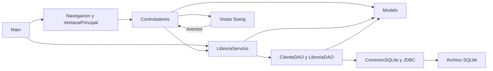
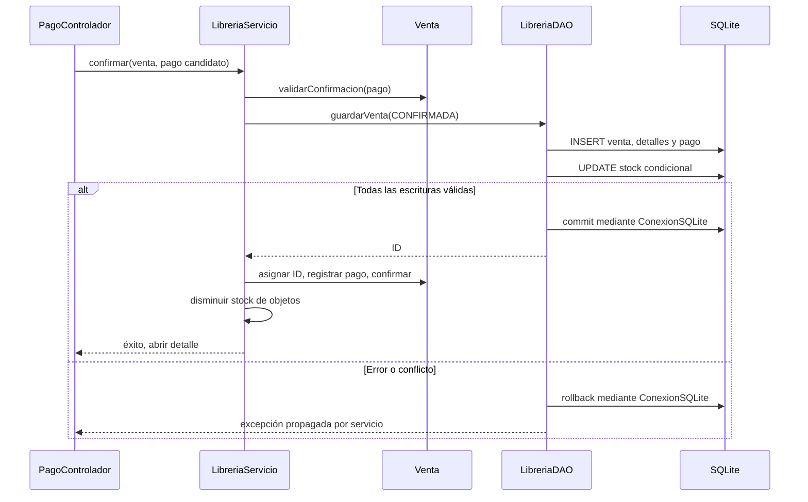
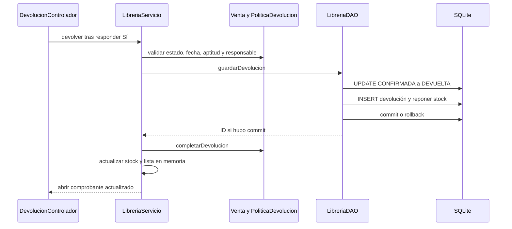
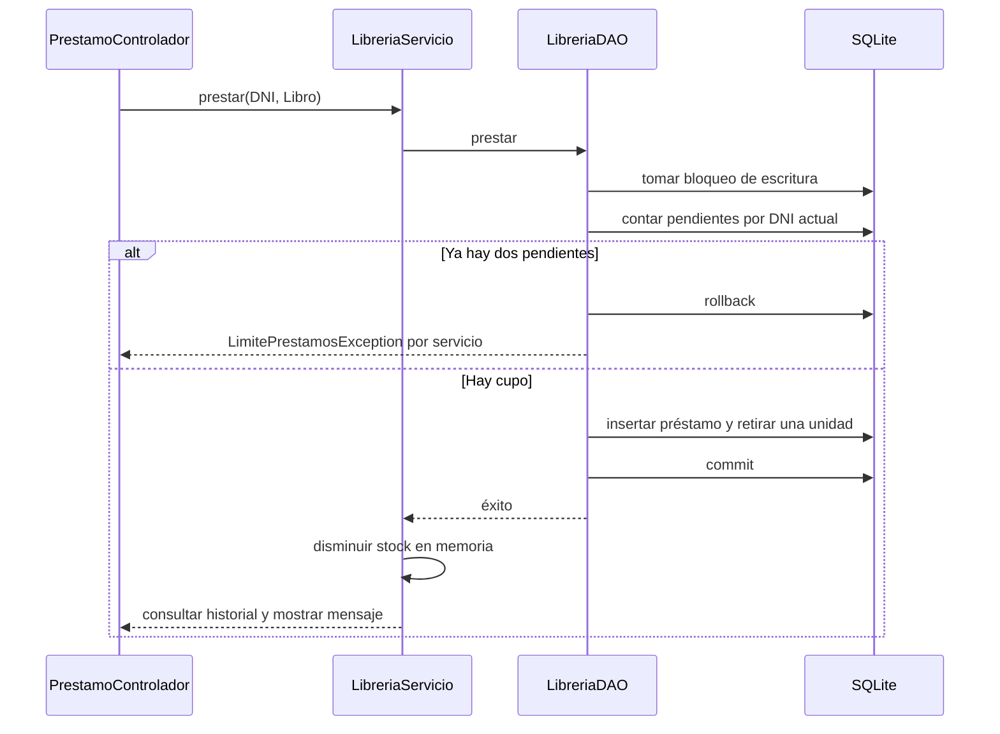

# Guía completa de estudio y defensa del TPO de librería — grupo 5

[Inicio](../README.md) · [Estado de entrega](ESTADO_Y_PENDIENTES.md) · [Pruebas y ensayo gráfico](PRUEBAS.md) · [Decisiones e informe de revisión general](HISTORIAL_DE_CAMBIOS.md#diagnostico-20261118)

Revisión de estudio: **19/11/2026**. Fuente principal: los archivos actuales de `src/` y `test/`, contrastados con consignas, propuesta, diagrama UML (Unified Modeling Language, lenguaje unificado de modelado), guía anterior, estado e historial. Los resultados de pruebas citados pertenecen a sus registros anteriores: para esta actualización documental no se ejecutaron Java, pruebas ni recorridos Swing. Los ejemplos siguientes son ejercicios y predicciones fundamentadas en el código, no resultados de clics realizados.

Esta guía está pensada para explicar una operación y encontrarla en IntelliJ. Primero entendé el problema, después identificá el objeto responsable y finalmente seguí el guardado. **POO** significa programación orientada a objetos: organizar datos y comportamientos en objetos que colaboran. **Swing** es la biblioteca gráfica de Java utilizada para ventanas y controles; **SQLite** es el motor de base de datos que guarda las operaciones en un archivo local.

Antes de entrar en las tablas de requisitos, tres nombres de arquitectura: **MVC** significa Modelo–Vista–Controlador y separa reglas, presentación y respuesta a eventos; **DAO** significa Data Access Object, objeto que concentra acceso a datos; **JDBC** significa Java Database Connectivity, la interfaz de programación de Java para conectarse a bases mediante un driver (biblioteca adaptadora). **SQL** es el lenguaje usado para consultar y modificar las tablas. Su aplicación concreta se desarrolla en el capítulo 4.

También vas a encontrar **transacción**, un grupo de escrituras que se confirma entero con **commit** o se deshace con **rollback**; **memoria**, los objetos que existen mientras corre el programa; e **historial persistido**, los datos guardados que se recuperan después de cerrarlo. **UI** significa interfaz de usuario. Una prueba **headless** funciona sin escritorio interactivo. Estos términos permiten leer el catálogo sin confundir un cambio en pantalla con un guardado.

## Índice navegable

1. [El sistema y su alcance](#negocio)
2. [Requisitos funcionales y reglas de negocio](#requisitos)
3. [Requisitos no funcionales y decisiones técnicas](#calidad)
4. [Arquitectura y estructura del proyecto](#estructura)
5. [Clases y relaciones](#clases)
6. [Teoría de POO aplicada](#teoria)
7. [Recorridos completos desde la interfaz hasta SQLite](#recorridos)
8. [Persistencia e integridad](#sqlite)
9. [Swing y eventos](#swing)
10. [Errores, pruebas y casos límite](#pruebas)
11. [Decisiones de diseño y límites](#decisiones)
12. [Preparación para la defensa, glosario y orden de estudio](#defensa)

Accesos de consulta: [identidad y DNI](#identidad) · [reglas del modelo](#modelo) · [administraciones](#administraciones) · [patrones](#practicas) · [material de clases](#material-clases) · [transacciones](#transacciones) · [pendientes de confirmación](#pendientes).

<a id="negocio"></a>
## 1. El sistema y su alcance

### 1.1. Qué problema resuelve y quién lo usa

El sistema permite llevar el catálogo y las existencias de una librería, registrar ventas y pagos, consultar lo vendido y devolver una compra completa. Evita tener que descontar a mano el stock y reconstruir de memoria cuánto se cobró. Como función adicional registra socios y préstamos sobre las mismas existencias de libros.

Lo utiliza un operador de la librería mediante una aplicación de escritorio. Existe un `Empleado` responsable de la operación; la interfaz utiliza el primer empleado activo devuelto por `empleadoPredeterminado()`. No hay inicio de sesión, elección de usuario autenticado ni permisos por rol. El cliente es una persona registrada, no una cuenta que accede al sistema. El nombre del empleado en un comprobante no prueba autenticación.

Un libro tiene título, ISBN (International Standard Book Number, identificador editorial), autores, editorial, categoría, precio, stock y actividad. El stock cuenta unidades disponibles del título; no hay objeto por ejemplar físico. Una venta reúne cantidades de libros en detalles, puede tener cliente y descuento, y requiere un pago para confirmarse. Una devolución de venta referencia esa venta y registra el reintegro total. Los préstamos también retiran unidades del stock y las recuperan al devolverlas.

**Cliente y socio no son sinónimos.** `Cliente` es la ficha con ID (identificador interno), nombre, DNI (Documento Nacional de Identidad, guardado como texto) y actividad. Ser socio significa que existe una fila adicional en `socios` vinculada a esa ficha. No existe una clase `Socio`, ni herencia `Socio extends Cliente`, ni cuota de membresía. Todo socio está vinculado a un cliente; un cliente puede no ser socio. Para comprar no necesita asociarse.

**Las dos devoluciones son operaciones diferentes.** Devolver una venta reintegra dinero, cambia el estado de la venta y repone todas sus cantidades; se registra en `devoluciones`. Devolver un préstamo no reintegra dinero: completa `prestamos.devuelto_en`, repone una unidad y libera un cupo de préstamo. No aplica el plazo comercial de siete días a los préstamos.

### 1.2. Alcance de la entrega y fuentes

La elección documentada del grupo es presentar **cuatro administraciones: Libros, Clientes, Categorías y Editoriales; y dos recorridos funcionales: Venta y Devolución**. ABM significa alta, baja y modificación; la consulta completa la administración. Socios y préstamos son funciones adicionales. [Estado vigente](ESTADO_Y_PENDIENTES.md) registra esta elección y las verificaciones pendientes.

| Fuente | Qué permite afirmar | Cómo usarla para estudiar |
|---|---|---|
| [Consigna final DOCX](TP_Final_Consignas.docx), apartados 1–3 | Java que resuelva un negocio, UML con mínimo 12 clases, al menos tres patrones/buenas prácticas de clase, excepción propia y tres manejos try/catch, seis interfaces Swing —cuatro administrativas y dos funcionales—, persistencia, tres diálogos e informe de aproximadamente diez páginas | Son mínimos académicos; no especifica HOTSALE, DNI ni siete días |
| [Teams](Consigna%20Teams.png) | El avance del 01/11 pide código, buenas prácticas, excepciones, pantallas administrativas y persistencia; posterga dos interfaces funcionales, diálogos e informe completo | Las dispensas son de esa instancia, no del final |
| [Propuesta comercial PDF](Sistema%20de%20gestión%20de%20una%20librería%20comercial.pdf), pp. 3–7 | Proponía productos/papelería, proveedores, compras, roles, pagos al contado y ninguna devolución; identifica Experto y Creador | Antecedente histórico, reemplazado en alcance según [registro del modelo](HISTORIAL_DE_CAMBIOS.md#modelo-20261031) |
| [UML histórico](UML%20-%20TPO.svg) | Representa esa propuesta anterior, con Persona y Producto | Contrastar con [diferencias actuales](#uml-historico); no memorizarlo como código vigente |
| [Informe de revisión general consolidado](HISTORIAL_DE_CAMBIOS.md#diagnostico-20261118) y [estado](ESTADO_Y_PENDIENTES.md) | Evidencias, decisiones, diagnósticos luego superados y pendientes de entrega | Las iteraciones posteriores prevalecen sobre el diagnóstico inicial |
| Código actual y [pruebas](#pruebas) | Qué hace hoy cada operación y qué casos comprueban los programas de prueba | Fuente principal del comportamiento implementado |

No están implementados compras/proveedores, papelería, administración de empleados, roles, facturación fiscal, envíos, pagos bancarios reales, multas, devoluciones parciales ni múltiples sucursales. No se convierten automáticamente en faltantes por aparecer en la propuesta vieja. La aceptación docente del cómputo de seis interfaces sigue pendiente. Esta guía de estudio extensa no reemplaza el informe académico de diez páginas con UML y capturas.

<a id="requisitos"></a>
## 2. Requisitos funcionales y reglas de negocio

Una **función** describe lo que el usuario puede hacer: registrar un préstamo. Una **regla de negocio** establece las condiciones de esa función: como máximo dos préstamos activos para el DNI considerado. Un requisito no funcional describe una propiedad de calidad, por ejemplo conservar los datos al reiniciar. Por eso el límite de dos préstamos pertenece a este capítulo.

### 2.1. Catálogo funcional trazable

En las tablas, **C** indica consigna explícita, **D** decisión/comportamiento documentado en el grupo y **I** comportamiento identificable en la implementación cuyo origen como pedido no se demuestra. Una regla puede tener antecedentes en el PDF y una implementación posterior diferente. “Verificación” identifica pruebas existentes o un ensayo propuesto; no implica ejecución nueva. Los enlaces de cada clase están en el [inventario](#clases) y los nombres de pruebas enlazan en el [capítulo 10](#pruebas).

| Función y origen | Condiciones, resultado y alternativas/errores | Dónde seguirla | Cómo verificar |
|---|---|---|---|
| F01 Consultar libros (C/D) | Administración lista activos e inactivos; busca título, autor o ISBN. Venta muestra activos; préstamos solo disponibles. Filtrar no borra registros | `CatalogoControlador.mostrar/configurarBusqueda`, `VentaControlador.catalogo`, `PrestamoControlador.actualizar` | PruebasServicio para datos; selección/filtrado real pendiente en PRUEBAS |
| F02 Crear y editar libro (C/D) | Campos obligatorios, autores válidos, precio positivo, stock entero no negativo, ISBN libre. Alta obtiene ID; edición lo conserva. Error conserva formulario y datos anteriores; cancelar no guarda | `CatalogoControlador.editar` → `LibreriaServicio.guardarLibro` → `LibreriaDAO.guardarLibro` | PruebasServicio: ISBN repetido, edición/reapertura; PruebasPrestamos: opciones reutilizadas |
| F03 Dar de baja/reactivar libro (C/D) | Editar Activo. No elimina filas ni comprobantes. Inactivo no se vende/presta; se puede reponer stock por devolución | Mismo formulario; `Libro.actualizarDesde`; también servicio `cambiarActividad` usado en pruebas | PruebasServicio: inactividad y devolución histórica; ensayo de checkbox pendiente |
| F04 Administrar categorías (C/D) | Alta/listado aunque no tenga libros, renombrar con mismo ID, eliminar solo sin referencias. Nombre vacío/duplicado o referencia activa/inactiva impide escritura | `CategoriaControlador.editar/eliminar` → servicio y DAO `guardarCategoria/eliminarCategoria` | PruebasCategorias: renombrado, duplicados, referencias y referencia tardía |
| F05 Administrar editoriales (C/D) | Igual regla que categorías; renombrar actualiza libros de la sesión. Cancelar baja no elimina | `EditorialControlador` → `guardarEditorial/eliminarEditorial` | PruebasEditoriales: dos libros, reasignación, otra sesión antes de baja |
| F06 Alta/consulta de clientes (C/D) | Nombre y DNI válido libre entre activos/inactivos. Alta administrativa no crea venta ni socio. Desde venta, Guardar y usar persiste cliente y lo asigna al borrador. DNI ocupado exige usar/reactivar ficha | `AdministrarClientesControlador.editar/mostrar`, `ClienteControlador.crearCliente/filtrarClientes` → `crearCliente` → `ClienteDAO.guardar` | PruebasClientesAlta y PruebasSQLite; listado administrativo no tiene campo de búsqueda, el selector de venta sí |
| F07 Editar cliente (C/D) | Por ID, activo o inactivo; nombre y DNI atómicos. DNI cambiado debe estar libre; mantener duplicado histórico permite corregir nombre. Conflicto con otra edición exige recarga | `modificarCliente` → `ClienteDAO.modificar` → `Cliente.actualizarDesde` | PruebasClientesEdicion: vínculos, duplicados, DNI ocupado y escritores simultáneos |
| F08 Baja/reactivación de cliente (C/D) | Cambia actividad, conserva ID/historia/socio, aun con préstamo abierto. Baja bloquea nueva venta/préstamo; devolución de préstamo sigue permitida. Reactivar recupera vínculo | `AdministrarClientesControlador.cambiar` → `cambiarActividadCliente` → `ClienteDAO.cambiarActividad` | PruebasClientesEstado: migración, otra sesión, devolución y reapertura |
| F09 Asociar socio (D) | DNI libre: nombre obligatorio y cliente+socio en una transacción. Una ficha activa: reutiliza ID. Inactiva: reactivar antes. Varias: rechaza ambigüedad. Ya socio: informa repetición | `InicioControlador.asociar` → servicio/DAO `asociar` | PruebasClientesAlta y PruebasServicio |
| F10 Preparar venta (D) | Empleado activo, carrito inicialmente vacío, cliente opcional. Agregar acumula por libro; modificar/quitar solo en preparación. UI limita cantidades, modelo revalida al confirmar; no reserva stock | `Navegacion.nuevaVenta` → `nuevaVenta`; `VentaControlador` → `Venta.agregarLibro/modificarCantidad/quitarLibro/cambiarCliente` | PruebasModelo: identidad, cantidades, estados; PruebasServicio: borradores |
| F11 Aplicar/quitar descuento (D) | Solo HOTSALE, 10%, una vez por borrador; quitar permite reaplicar. Código inválido no altera venta. No hay SQL hasta cerrar la operación | `VentaControlador.aplicarDescuento` → `Venta.aplicarDescuento` → `Descuento.desdeCodigo` | PruebasModelo: 10.05 − 1.01 = 9.04; doble descuento rechazado |
| F12 Cobrar efectivo (D) | Venta válida, recibido al menos total; cliente ausente permitido, elegido debe estar activo. Guarda pago y venta con stock; devuelve diferencia. Insuficiencia deja borrador corregible | `PagoControlador.crearPago/confirmar` → `Pago.enEfectivo` → `LibreriaServicio.confirmar` | PruebasModelo/Servicio: pago inválido, vuelto y rollback |
| F13 Cobrar tarjeta simulada (D) | Cliente activo y referencia ficticia no vacía; importe exacto, sin recibido y vuelto cero. No se consulta banco ni se solicitan datos de tarjeta | `Pago.conTarjeta`, `Venta.validarConfirmacion`, DAO `guardarVenta` | PruebasModelo/Servicio y ClientesEstado; probar controles Swing pendiente |
| F14 Cancelar venta (D) | Solo borrador propio sin ID. Sí persiste CANCELADA y detalles sin mover stock; No/cerrar diálogo deja borrador. Cerrar aplicación es descarte, no esta cancelación | `VentaControlador.cancelarVenta` → servicio `cancelar` → DAO `guardarVenta` → `Venta.cancelar` | PruebasModelo/Servicio; confirmación visual pendiente |
| F15 Consultar historial/detalle (D) | Lista ventas de la sesión, incluso borradores que sigan en memoria; al reabrir solo estados persistidos. Muestra detalle histórico, pago y devolución; cliente con nombre actual | `HistorialVentasControlador.mostrar/mostrarDetalle`, DAO `cargar` | PruebasServicio/ClientesEdicion: reapertura e identidad; formato visual pendiente |
| F16 Devolver venta total (D) | CONFIRMADA, fecha válida, motivo y aptitud de todos los libros, responsable activo. Reintegra pago original, repone todo una vez. Error/No conserva estado y stock | `DevolucionControlador.confirmarDevolucion` → servicio `devolver` → política/DAO | PruebasModelo: plazo/aptitud; Servicio: persistencia/repetición/stock |
| F17 Registrar préstamo (I para el límite actual; D para el recorrido) | Libro de sesión activo con stock, socio activo, menos de dos pendientes para DNI. Inserta préstamo y retira uno; error no deja fila parcial | `PrestamoControlador` listener `prestar` → servicio/DAO `prestar` | PruebasPrestamos: tercero rechazado y competencia por último cupo; ClientesEstado: inactivo |
| F18 Devolver préstamo (D/I) | Pendiente elegido, libro cargado, ID/libro coincidentes. No exige actividad del cliente ni plazo. Marca fecha y repone uno; no elimina historial | Listener `devolver` → `devolverPrestamo` servicio/DAO | PruebasPrestamos, Servicio y ClientesEstado: repetición/reapertura |
| F19 Guardar y recuperar datos (C) | SQLite conserva administraciones y operaciones terminadas; borradores solo en memoria. Fallo al cargar impide abrir la aplicación; fallo al guardar se informa | `Main`, constructor del servicio, `ConexionSQLite`, ambos DAO | PruebasSQLite/Servicio y estado de clientes; cierre/reapertura visual pendiente |
| F20 Ejemplo de consola (I, apoyo didáctico) | Cero argumentos lista; dos crean nombre/DNI; otros se rechazan. Usa ClienteDAO; no precarga librería completa | `EjemploSQLite.main`, `ejecutar-sqlite.sh` | Lectura; pruebas DAO verifican operaciones subyacentes, no el script interactivo |

<a id="modelo"></a>
### 2.2. Reglas, valores y transiciones

| Regla | Significado preciso, origen y punto de control |
|---|---|
| R01 Identificadores | `Validaciones.id`: `Long` positivo o `null` antes de persistir. `Venta.asignarIdPersistido` permite asignación una vez. Identidad interna por ID; ver [DNI](#identidad). I, descrito en guía anterior |
| R02 Textos y DNI | Se recortan espacios externos; nombres/título/ISBN/legajo no vacíos. DNI solo `[0-9]+`, sin longitud fija, puntos ni conversión a número; `00123` y `123` son textos distintos. `Cliente` valida formato; DAO controla disponibilidad. D: [alta](HISTORIAL_DE_CAMBIOS.md#alta-clientes) y [edición](HISTORIAL_DE_CAMBIOS.md#edicion-clientes) |
| R03 Catálogo único | ISBN único en SQLite y chequeado en `guardarLibro`; no se valida su dígito verificador. Categoría/editorial/autores se reutilizan por nombre exacto, sensible a mayúsculas y acentos. Alta/renombrado de categorías/editoriales rechaza duplicados; no hay índice UNIQUE de nombre. D: [categorías](HISTORIAL_DE_CAMBIOS.md#categorias) y [editoriales](HISTORIAL_DE_CAMBIOS.md#editoriales) |
| R04 Cantidades y stock | Cantidad positiva; stock entre 0 e Integer.MAX_VALUE. Disponibilidad = activo y stock suficiente (`Libro.hayDisponibilidad`). `Math.addExact` detecta desbordamiento. Venta y préstamo comparten unidades; carrito no reserva. Antecedente PDF reglas 2/4 y comportamiento actual |
| R05 Dinero | Precio mayor que cero después de redondear; dinero no negativo, dos decimales, HALF_UP. Detalle = cantidad × precio capturado; total = subtotal − descuento. `Validaciones`, `DetalleVenta`, `Venta`. D: [modelo](HISTORIAL_DE_CAMBIOS.md#modelo-20261031) |
| R06 Descuento | HOTSALE exacto tras trim; 10%, no acumulable, removible en preparación. Redondea descuento sobre subtotal total. `Descuento.desdeCodigo/calcularImporte`; mismo origen R05 |
| R07 Confirmación | Solo preparación, al menos un detalle, empleado activo, libros activos/disponibles, cliente activo si hay, pago exacto. Tarjeta exige cliente. `Venta.validarConfirmacion`; SQL vuelve a controlar cliente y stock. D/I: recorrido documentado, no regla textual del DOCX |
| R08 Pago | Efectivo recibido ≥ total y vuelto = recibido − total. Tarjeta con referencia no vacía y vuelto 0. Un pago por venta en BD. `Pago`, `pagos.venta_id`. No pagos parciales, cuotas ni varios medios en una venta. D: modelo/guía anterior |
| R09 Estados | EN_PREPARACION → CONFIRMADA o CANCELADA; CONFIRMADA → DEVUELTA. Sin camino de vuelta ni edición de operaciones terminadas. El modelo no mueve stock al transicionar; lo coordina el servicio. D: modelo, actualizado por integración |
| R10 Devolución comercial | Total, entre fecha de compra y +7 días calendario inclusive, motivo, aptitud y responsable activo. `PoliticaDevolucion.validar`, `Venta.validarDevolucion`. Reintegro = importe pagado con descuento y mismo medio, no efectivo entregado. D: modelo/guía anterior |
| R11 Actividad | Baja lógica de libros/clientes conserva referencias. Inactivo no participa en nuevas ventas/préstamos; no bloquea recuperar libros. Baja física de categoría/editorial requiere cero referencias, incluso inactivas. D: iteraciones administrativas |
| R12 Préstamos | Una unidad por operación; máximo dos pendientes agrupados por DNI actual; devuelto si `devuelto_en` no es NULL. No vencimiento, multa ni prohibición de prestar dos unidades del mismo título. I: `LibreriaDAO.prestar` y prueba actual; no atribuir número dos al DOCX |
| R13 Historia | Detalle conserva precio/título/ISBN capturados; persona conserva vínculo por ID y muestra datos actuales. Préstamo consulta título/nombre/DNI actuales por JOIN. D: modelo y edición de clientes, con [excepción de migración](#historia) |

Ejemplo de precisión: un precio ingresado como `20.125` se normaliza a `20.13`; `0.004` redondea a cero y se rechaza. En `10.05` con HOTSALE, descuento `1.005` redondea a `1.01`; total `9.04`. No se redondea primero a unidades enteras ni se calcula con `double`.

El plazo de devolución usa `LocalDate` obtenido de la fecha/hora de la venta y de la devolución. Compra del 10/10: hasta el 17/10 inclusive; 18/10 rechazado. Una hora anterior del mismo día pasa la política porque se comparan días, no horas. `Venta.fecha` se fija al crear el borrador; confirmar no la actualiza. Un borrador que cruza medianoche conserva esa fecha. No hay validación de orden temporal entre fecha de pago y venta.

<a id="identidad"></a>
### 2.3. Identidad, duplicados históricos y correcciones de DNI

Hay tres conceptos distintos: **identidad Java** (la misma instancia en memoria), **ID persistente** (la clave de la fila) y **DNI de negocio** (un dato editable usado en búsquedas y en el cupo). Las entidades no redefinen `equals/hashCode`: por ello `clientes.contains(cliente)` o `libros.contains(libro)` en el servicio exige la instancia perteneciente a esa sesión. Un objeto nuevo con igual ID no pasa automáticamente ese control. En cambio, `Venta.buscarLibro` compara referencia o ID no nulo para acumular el detalle. Dos libros nuevos distintos con ID null no se fusionan.

Alta normal no permite duplicar DNI entre activos ni inactivos. `ClienteDAO.guardar` adquiere bloqueo antes de consultar e insertar; dos altas simultáneas no pueden pasar ambas la comprobación. No hay UNIQUE global en `clientes.dni`: los duplicados históricos se conservan. Editar sin cambiar DNI permite corregir el nombre de una ficha duplicada por ID. Si se cambia DNI, debe estar libre en todas las otras fichas. No se fusionan personas ni se trasladan operaciones a otra ficha.

**El límite se cuenta por DNI, no por ID del socio seleccionado.** El DAO consulta `prestamos JOIN clientes ON clientes.id = prestamos.socio_id`, filtra `clientes.dni = ?` y `devuelto_en IS NULL`. Cuenta préstamos de todas las fichas coincidentes, incluso clientes ahora inactivos. Para insertar, selecciona el primer socio activo de ese DNI ordenado por `cliente_id`, con `LIMIT 1`. El controlador pasa `socio.getDni()`, no el ID seleccionado. Por eso dos socios históricos con el mismo DNI pueden compartir cupo y la fila insertada puede quedar vinculada al primer ID activo, aunque se seleccionó otro. La asociación nueva rechaza ambigüedad, pero no sanea asociaciones históricas.

Ejemplo razonado: ID 21 y 35 comparten DNI `00123`, con un préstamo pendiente cada uno. El conteo da dos y rechaza otro, sin importar a cuál se seleccionó. Si se corrige el DNI de ID 35 a `00456`, su préstamo conserva `socio_id = 35`, pero el JOIN ahora lo cuenta para `00456`: cada DNI pasa a tener uno. No se perdieron ni se devolvieron préstamos; se separó la agrupación. Una corrección del único cliente mantiene sus dos préstamos bajo el DNI nuevo, así que no libera cupo para esa ficha. Una sesión vieja que siga enviando el DNI anterior puede fallar o seleccionar otra ficha histórica coincidente; requiere recarga.

Al devolver por **ID de préstamo** se marca una fila concreta; deja de contar para el DNI actual de su cliente y repone una unidad una sola vez. La baja del cliente no libera cupo, pues no marca préstamos devueltos. La reactivación tampoco crea un cupo nuevo.

Estas consecuencias se deducen del SQL actual. Las pruebas de préstamos cubren cupo normal y concurrencia; las de edición cubren conservación de vínculos al cambiar DNI. No hay una prueba específica de todas las combinaciones de duplicados, cupo y corrección. Antes de defender “dos por persona real”, explicar esta aproximación y confirmar el criterio de identidad con el grupo/docente. Ver [límites pendientes](#pendientes).

<a id="calidad"></a>
## 3. Requisitos no funcionales y decisiones técnicas

La consigna exige persistencia y ciertas tecnologías/prácticas. Otros atributos de calidad se infieren de mecanismos concretos; no son garantías medidas. La integridad significa que los datos mantienen sus relaciones y reglas aun cuando una operación no puede terminar.

| Atributo y clasificación | Mecanismo/evidencia actual | Límites que hay que reconocer |
|---|---|---|
| Persistencia — explícito C | Archivo SQLite; escrituras al terminar cada operación y carga al arrancar. PruebasSQLite/Servicio comprueban reapertura | Borradores no persistidos; ruta depende de directorio de ejecución; sin copias de seguridad automáticas |
| Integridad/atomicidad — inferido | Transacción agrupa venta, pago, detalles y stock. Claves foráneas, CHECK, claves únicas y actualizaciones condicionales; pruebas de rollback | SQL directo puede eludir reglas no declaradas en esquema; no toda regla vive en BD |
| Precisión monetaria — decisión técnica | `BigDecimal`, escala 2/HALF_UP y TEXT decimal en SQLite; ejemplos en PruebasModelo | No hay cálculo fiscal ni múltiples monedas; cadenas malformadas externas pueden impedir la carga |
| Manejo de errores — explícito en mínimos y atributo inferido | Excepciones propias, tres bloques reales de captura y mensajes; causa SQL conservada | No hay sistema de recuperación universal ni registro central de errores; algunos errores inesperados escapan |
| Mantenibilidad/separación — buenas prácticas exigidas, calidad inferida | Modelo sin Swing/SQL; controladores de eventos; servicio; DAO. Pruebas del modelo sin base | Servicio y LibreriaDAO concentran muchas operaciones, DAO creados internamente; no hay intercambiabilidad por interfaz propia |
| Concurrencia — protección parcial inferida | Bloqueo previo al conteo/duplicados, comparación de valores anteriores, estado condicional y rollback. Pruebas de cupo/altas/ediciones simultáneas | Memoria de sesiones no sincronizada en vivo; no es un servicio seguro para mutación arbitraria por varios hilos; conflicto puede exigir reabrir |
| Usabilidad — inferida, parcialmente comprobada | Botones según selección, campos precargados, foco, error corregible, tablas ordenables; PruebasVistas mide geometría | Headless no acredita clics, legibilidad real, accesibilidad integral ni todos los tamaños/resoluciones |
| Portabilidad — decisión Java/SQLite | JDK, Swing y driver incluido, sin servidor. README da instrucciones Windows/Unix | No se acredita funcionamiento en todos los equipos; depende de JDK/driver y permisos locales |
| Protección de entradas — mecanismo concreto | `PreparedStatement` separa valores del SQL; PruebasSQLite conserva texto parecido a una inyección como texto | No equivale a seguridad integral: sin login, roles, cifrado de datos, auditoría ni autorización bancaria |
| Rendimiento/disponibilidad — no acreditados como requisitos cuantificados | `busy_timeout = 5000` espera bloqueo; datos cargados en listas y conexiones cerradas | No hay prueba de carga, acuerdo medido de nivel de servicio ni recuperación ante caída. SQL corre en hilo gráfico; puede congelar temporalmente la ventana |

No afirmar “sin errores”, “100% seguro” o “soporta cualquier cantidad de usuarios”. Sí se puede mostrar el fallo de un segundo movimiento de stock que revierte toda la venta y describir exactamente las condiciones cubiertas.

<a id="estructura"></a>
## 4. Arquitectura y estructura del proyecto

### 4.1. Carpetas, paquetes y arranque

Un paquete Java agrupa clases bajo un nombre (`modelo`, `vista`, etc.). Las carpetas de `src` corresponden a esos paquetes. `test/pruebas` contiene programas de prueba; `lib` contiene el JAR (archivo de biblioteca Java) del driver SQLite; `datos` contiene la base; `Documentacion` reúne materiales. `out`, si se crea al compilar, contiene clases generadas, no fuentes. Los metadatos `.git` son del control de versiones; configuraciones del IDE no son capas del negocio.

| Carpeta/paquete | Qué recibe, qué hace y qué devuelve |
|---|---|
| `src/aplicacion` | Punto de entrada. `Main.main` construye servicio, ventana y navegación; `EjemploSQLite` ofrece consola independiente |
| `src/vista` | Componentes y datos a mostrar. Construye paneles/campos/tablas; expone controles al controlador; no ejecuta SQL |
| `src/controlador` | Eventos y texto del usuario. Convierte entradas, selecciona objetos, llama modelo/servicio y presenta resultado/error |
| `src/servicio` | Objetos de sesión y parámetros ya interpretados. Coordina validación, persistencia y posterior actualización de memoria |
| `src/modelo` | Datos del dominio. Encapsula cantidades, importes, estados e invariantes: condiciones que siempre debe preservar un objeto |
| `src/persistencia` | Objetos/IDs y ruta de archivo. Consulta/escribe SQL, reconstruye objetos y establece transacciones |
| `src/excepciones` | Tipos de error del negocio; transportan el motivo del rechazo |
| `test/pruebas` | Escenarios artificiales sobre objetos o bases temporales; comprueban resultados mediante AssertionError |

`Main.main` programa una tarea con `SwingUtilities.invokeLater`. Dentro crea `LibreriaServicio()`, que resuelve `tpo.db`, crea los dos DAO, inicializa esquema, carga ejemplos y reconstruye objetos. Si ocurre un error de carga, Main imprime la traza, muestra un diálogo y retorna. Si carga bien, construye `VentanaPrincipal(servicio::hayVentaEnPreparacion)`, `Navegacion(ventana, servicio)`, abre Inicio y hace visible la ventana. No hay contenedor de inyección de dependencias: la construcción es explícita.

`Navegacion` conserva ventana y servicio y crea controladores para cada destino. `VentanaPrincipal.mostrar` cambia el panel de contenido mediante `setContentPane`, ajusta tamaño, revalida y repinta. No se crea una ventana principal distinta por cada operación. Los callbacks `Runnable volver` permiten regresar al mismo carrito desde cliente/pago.

### 4.2. MVC, DAO y JDBC en este proyecto

**MVC (Modelo–Vista–Controlador)** separa reglas/datos, presentación y respuesta a eventos. Ejemplo: `VentaVista` muestra carrito y botón; `VentaControlador` escucha agregar; `Venta` crea el detalle y calcula totales. El servicio coordina casos que necesitan guardar, y el DAO resuelve el acceso a la base. No se necesita que toda acción pase por SQL: aplicar descuento en un borrador llega directamente al modelo.

**DAO (Data Access Object, objeto de acceso a datos)** concentra el código que traduce entre objetos y filas. `ClienteDAO.guardar` recibe un Cliente sin ID, inserta datos y devuelve otro Cliente con ID. `LibreriaDAO.cargar` reconstruye el conjunto de objetos de la sesión. Esto evita SQL repetido en cada botón.

**JDBC (Java Database Connectivity)** es la API —interfaz de programación— estándar de Java para hablar con bases relacionales. El driver `sqlite-jdbc-3.50.3.0.jar` implementa esa conexión con SQLite. `DriverManager.getConnection("jdbc:sqlite:" + ruta)` devuelve una `Connection`; `PreparedStatement` ejecuta SQL parametrizado; `ResultSet` permite recorrer filas. DAO es una organización del código, JDBC es la tecnología con la que ese código accede a datos. SQL es el lenguaje de consulta y modificación de las tablas.

Diagrama compacto de dependencias y llamadas principales (una flecha significa “usa o llama a”; la flecha de eventos indica entrega del evento):



La ventaja es poder probar `Venta` sin ventana ni base. El límite es que no hay una interfaz propia para sustituir los DAO por otra implementación; el constructor de servicio instancia clases concretas. [DAO y Repository](#dao-repository) no son nombres intercambiables de clases existentes.

<a id="clases"></a>
## 5. Clases y relaciones

### 5.1. Cómo leer una clase central

Un atributo describe datos/estado; un constructor establece una instancia válida; un método expresa una consulta o cambio permitido. Leé primero atributos y constructor, después métodos que modifican estado y finalmente colaboradores. Los getters devuelven datos; no todos los objetos expuestos son inmutables.

| Clase | Atributos y construcción | Métodos, validaciones y colaboradores |
|---|---|---|
| [Libro](../src/modelo/Libro.java) | ID final; ISBN, título, autores, editorial, categoría, precio, stock y activo modificables. Constructor exige autores no vacíos/sin null, editorial/categoría, texto, precio positivo y stock no negativo; copia la lista | `hayDisponibilidad`, `aumentarStock`, `disminuirStock`, `cambiarPrecio`, `activar/desactivar`, `actualizarDesde`. Esta última exige mismo ID y copia datos de otro libro válido. Get de autores devuelve copia no modificable. Colabora con Autor/Editorial/Categoria y detalles |
| [Cliente](../src/modelo/Cliente.java) | ID final; nombre, DNI y activo. Constructor de tres argumentos delega al de cuatro con activo=true; valida nombre/DNI | `cambiarActividad`, `actualizarDesde` exige mismo ID. Unicidad de DNI pertenece al DAO porque necesita consultar otras filas; el constructor no puede saberlas |
| [Venta](../src/modelo/Venta.java) | ID asignable una vez; fecha y empleado finales; cliente opcional, lista interna de detalles, descuento, pago, estado inicial EN_PREPARACION | `agregarLibro` crea/acumula; `modificarCantidad/quitarLibro`, `cambiarCliente`, descuento/pago solo en preparación; `calcularSubtotal`, `calcularDescuento`, `calcularTotal`; `validarConfirmacion/confirmar`, `cancelar`, `validarDevolucion/completarDevolucion`. `rehidratar` recupera estado persistido sin repetir operación |
| [DetalleVenta](../src/modelo/DetalleVenta.java) | Campos finales: Libro, cantidad, precioUnitario, título e ISBN. Constructor de paquete captura libro actual; constructor público permite cargar instantánea histórica | `calcularSubtotal`; `conCantidad` crea otro detalle conservando precio/título/ISBN. No tiene setter; la referencia Libro sigue apuntando a un objeto mutable. Constructor histórico confía en título/ISBN recibidos |
| [Pago](../src/modelo/Pago.java) | ID, fecha, medio, importePagado, montoRecibido y referencia finales; constructor privado | Fábricas estáticas `enEfectivo` y `conTarjeta` validan la forma del pago. `calcularVuelto` de instancia o estático; no comunica con bancos |
| [Descuento](../src/modelo/Descuento.java) | Código y porcentaje finales; constructor privado | `desdeCodigo` solo HOTSALE; `calcularImporte` usa porcentaje; `rehidratar` acepta porcentaje guardado y no exige que coincida con promoción actual. No es un motor general de promociones |
| [Devolucion](../src/modelo/Devolucion.java) | ID, ventaOriginal, fecha, empleadoResponsable, motivo, importeReintegrado y medioReintegro finales. Constructor normal accesible al paquete | Se crea desde Venta confirmada con pago; captura importe/medio del pago. `rehidratar` espera venta DEVUELTA. No tiene métodos que muevan stock ni que procesen devolución bancaria |
| [PoliticaDevolucion](../src/modelo/PoliticaDevolucion.java) | Sin atributos de estado ni constructor propio declarado | `validar` consulta estado, fechas, motivo y aptitud; lanza DevolucionNoPermitidaException. Venta añade control del responsable. Es política concreta, no interfaz con estrategias intercambiables |
| [LibreriaServicio](../src/servicio/LibreriaServicio.java) | Dos DAO y listas de libros/clientes/empleados/ventas/devoluciones; constructor por defecto o con Path para aislar base | `confirmar/devolver/cancelar`, administraciones, `asociar/prestar/devolverPrestamo`. Guarda antes de mutar memoria. `exigirLibro/exigirVenta` controlan pertenencia a sesión. Listas devueltas con `List.copyOf`, elementos mutables |

### 5.2. Relaciones y multiplicidades reales

La multiplicidad indica cuántos objetos pueden participar en un vínculo. Una asociación es una referencia entre objetos; composición expresa propiedad de una parte cuyo significado depende del todo. Tener un campo de otro tipo no implica por sí solo herencia o composición.

| Relación | Multiplicidad y lectura correcta |
|---|---|
| Libro–Autor | Cada Libro tiene 1..* autores; un autor puede aparecer en 0..* libros. Asociación compartida, representada por `libro_autor` en BD |
| Libro–Editorial/Categoria | Exactamente una editorial y categoría por libro; cada una puede clasificar 0..* libros. No desaparecen al dar de baja el libro |
| Venta–Empleado/Cliente | Una venta tiene un empleado, y 0..1 cliente. Cada participante puede tener muchas ventas. Son asociaciones, no partes creadas y destruidas con la venta |
| Venta–DetalleVenta | Composición conceptual del comprobante: 0..* detalles en preparación/cancelación; al confirmar, 1..*. Venta crea y reemplaza detalles en el flujo normal; la BD usa clave `(venta_id, libro_id)`. Java no impide toda reutilización externa por el constructor histórico/rehidratar; no hay DELETE CASCADE que “pruebe” composición |
| DetalleVenta–Libro | Cada detalle referencia un Libro; un libro participa en muchos detalles. El libro existe antes y después de cada venta |
| Venta–Pago/Descuento | 0..1 de cada uno durante preparación; confirmada/devuelta tiene pago en el flujo válido. La tabla pagos permite como máximo uno por venta. El descuento puede faltar |
| Venta–Devolucion | 0..1 devolución total por venta; cada devolución referencia exactamente una venta y un responsable. No hay lista de devoluciones parciales |
| Cliente–Socio | Una fila cliente tiene 0..1 vínculo en socios; se implementa en BD, sin clase Socio |
| Socio–Préstamo–Libro | Cada fila de préstamo tiene un socio y un libro; ambos pueden tener muchos préstamos históricos. Dos es límite de pendientes por DNI, no límite de historial ni de cantidad total de filas |

### 5.3. Inventario de todos los tipos propios

Cada archivo enlazado tiene una responsabilidad concreta. Los métodos y estados de los tipos centrales se detallan arriba; los controladores se recorren en el [capítulo 7](#recorridos), las vistas en el [9](#swing) y las pruebas en el [10](#pruebas).

### Paquete aplicacion

| Tipo | Responsabilidad y recorrido |
|---|---|
| [EjemploSQLite](../src/aplicacion/EjemploSQLite.java) | Alta/listado por consola; consola |
| [Main](../src/aplicacion/Main.java) | Arranque Swing y dependencias; inicio |

### Paquete controlador

| Tipo | Responsabilidad y recorrido |
|---|---|
| [CatalogoControlador](../src/controlador/CatalogoControlador.java) | Buscar/crear/editar; catálogo |
| [ClienteControlador](../src/controlador/ClienteControlador.java) | Buscar/crear/asignar; cliente y tarjeta |
| [DevolucionControlador](../src/controlador/DevolucionControlador.java) | Confirmación y motivos; devolución |
| [EntradaFormulario](../src/controlador/EntradaFormulario.java) | Conversión de dinero, selección y búsqueda; formularios |
| [HistorialVentasControlador](../src/controlador/HistorialVentasControlador.java) | Listado y resumen; historial |
| [InicioControlador](../src/controlador/InicioControlador.java) | Menú y alta de socio; inicio/socios |
| [Navegacion](../src/controlador/Navegacion.java) | Abre pantallas y crea controladores; navegación |
| [PagoControlador](../src/controlador/PagoControlador.java) | Medio, vuelto y confirmación; pago |
| [PrestamoControlador](../src/controlador/PrestamoControlador.java) | Selección socio/libro y devolución; préstamos |
| [VentaControlador](../src/controlador/VentaControlador.java) | Carrito y descuento; venta |
| [AdministrarClientesControlador](../src/controlador/AdministrarClientesControlador.java) | Formulario nuevo/editar, confirmar estado y refrescar listado; Clientes |
| [CategoriaControlador](../src/controlador/CategoriaControlador.java) | Alta, edición y baja con confirmación; Categorías |
| [EditorialControlador](../src/controlador/EditorialControlador.java) | Alta, edición y baja con confirmación; Editoriales |

### Paquete excepciones

| Tipo | Responsabilidad y recorrido |
|---|---|
| [DevolucionNoPermitidaException](../src/excepciones/DevolucionNoPermitidaException.java) | Error de política; devolución |
| [LimitePrestamosException](../src/excepciones/LimitePrestamosException.java) | Rechazo de un tercer préstamo activo |
| [StockInsuficienteException](../src/excepciones/StockInsuficienteException.java) | Error de disponibilidad; venta |

### Paquete modelo

| Tipo | Responsabilidad y recorrido |
|---|---|
| [Autor](../src/modelo/Autor.java) | Autor del catálogo; catálogo y venta |
| [Categoria](../src/modelo/Categoria.java) | Clasificación del libro; catálogo |
| [Cliente](../src/modelo/Cliente.java) | ID, nombre, DNI y activo; ventas, administración y socios |
| [Descuento](../src/modelo/Descuento.java) | Regla HOTSALE y cálculo porcentual; descuento |
| [DetalleVenta](../src/modelo/DetalleVenta.java) | Instantánea de cantidad y precio/título/ISBN; venta e historial |
| [Devolucion](../src/modelo/Devolucion.java) | Registro del reintegro original; devolución |
| [Editorial](../src/modelo/Editorial.java) | Editorial del libro; catálogo |
| [Empleado](../src/modelo/Empleado.java) | Responsable activo y legajo; ventas y devoluciones |
| [EstadoVenta](../src/modelo/EstadoVenta.java) | Estados permitidos; venta, cancelación y devolución |
| [Libro](../src/modelo/Libro.java) | Datos editables y disponibilidad; catálogo, venta, préstamo |
| [MedioPago](../src/modelo/MedioPago.java) | EFECTIVO/TARJETA; pago y reintegro |
| [Pago](../src/modelo/Pago.java) | Fábricas de pago y vuelto; efectivo y tarjeta |
| [PoliticaDevolucion](../src/modelo/PoliticaDevolucion.java) | Reglas sin mutación; devolución |
| [Prestamo](../src/modelo/Prestamo.java) | Record de consulta del préstamo; préstamos |
| [Validaciones](../src/modelo/Validaciones.java) | Validaciones internas comunes; construcción del modelo |
| [Venta](../src/modelo/Venta.java) | Agregado, importes y estados; todos los recorridos de venta |

### Paquete persistencia

| Tipo | Responsabilidad y recorrido |
|---|---|
| [CatalogoEjemplo](../src/persistencia/CatalogoEjemplo.java) | Record de datos iniciales; arranque |
| [ClienteDAO](../src/persistencia/ClienteDAO.java) | Alta, consulta, estado y edición por ID; unicidad transaccional y compatibilidad histórica |
| [ConexionSQLite](../src/persistencia/ConexionSQLite.java) | Esquema, conexiones y transacciones; persistencia |
| [LibreriaDAO](../src/persistencia/LibreriaDAO.java) | Catálogo, agregados y transacciones; todos los casos persistidos |

### Paquete servicio

| Tipo | Responsabilidad y recorrido |
|---|---|
| [LibreriaServicio](../src/servicio/LibreriaServicio.java) | Coordinación SQL y memoria; todos los casos |

### Paquete vista

| Tipo | Responsabilidad y recorrido |
|---|---|
| [CatalogoVista](../src/vista/CatalogoVista.java) | Tabla y botones; catálogo |
| [ClienteVista](../src/vista/ClienteVista.java) | Pestañas de búsqueda/alta; cliente |
| [DevolucionVista](../src/vista/DevolucionVista.java) | Motivo y aptitud; devolución |
| [FormularioPanel](../src/vista/FormularioPanel.java) | Composición de campos; socio y formularios |
| [HistorialVentasVista](../src/vista/HistorialVentasVista.java) | Tabla de operaciones; historial |
| [IconoLibro](../src/vista/IconoLibro.java) | Dibuja iconos usados por VentanaPrincipal; arranque |
| [InicioVista](../src/vista/InicioVista.java) | Botones del menú; inicio |
| [LibroFormulario](../src/vista/LibroFormulario.java) | Campos de alta/edición; catálogo |
| [PagoVista](../src/vista/PagoVista.java) | Campos de medio/recibido/referencia; pago |
| [PanelVista](../src/vista/PanelVista.java) | Base común de paneles; todas las pantallas |
| [PrestamoVista](../src/vista/PrestamoVista.java) | Tablas de socios, libros y préstamos; préstamos |
| [ResumenVentaVista](../src/vista/ResumenVentaVista.java) | Texto de comprobante; historial |
| [VentanaPrincipal](../src/vista/VentanaPrincipal.java) | Contenedor y dialogs/cierre; navegación |
| [VentaVista](../src/vista/VentaVista.java) | Tablas y campos del carrito; venta |
| [AdministrarClientesVista](../src/vista/AdministrarClientesVista.java) | Tabla nombre/DNI/estado y acciones; Clientes |
| [CategoriaVista](../src/vista/CategoriaVista.java) | Listado independiente de libros y acciones; Categorías |
| [EditorialVista](../src/vista/EditorialVista.java) | Listado independiente de libros y acciones; Editoriales |

### Paquete pruebas

| Tipo | Responsabilidad y recorrido |
|---|---|
| [PruebasModelo](../test/pruebas/PruebasModelo.java) | 88 controles sin SQL; reglas de dominio |
| [PruebasServicio](../test/pruebas/PruebasServicio.java) | 86 controles de operaciones y reapertura; integración |
| [PruebasSQLite](../test/pruebas/PruebasSQLite.java) | 9 controles de DAO; persistencia de clientes |
| [PruebasVistas](../test/pruebas/PruebasVistas.java) | Geometría de 12 vistas, pestañas y formularios; UI headless |
| [PruebasCategorias](../test/pruebas/PruebasCategorias.java) | Alta, edición, restricciones de baja y reapertura |
| [PruebasEditoriales](../test/pruebas/PruebasEditoriales.java) | Renombrado compartido, baja y referencias concurrentes |
| [PruebasPrestamos](../test/pruebas/PruebasPrestamos.java) | Límite, concurrencia, devolución y opciones del catálogo |
| [PruebasClientesEstado](../test/pruebas/PruebasClientesEstado.java) | Migración, baja/reactivación, ventas y préstamos |
| [PruebasClientesEdicion](../test/pruebas/PruebasClientesEdicion.java) | Edición por ID, duplicados históricos y vínculos |
| [PruebasClientesAlta](../test/pruebas/PruebasClientesAlta.java) | Altas concurrentes, DNI y asociación transaccional |

### 5.4. Tipos pequeños, auxiliares y anidados

`Autor` es una ficha inmutable de ID/nombre. `Categoria` y `Editorial` tienen ID final y `cambiarNombre` validado; el servicio propaga renombrados a los libros por ID. `Empleado` contiene ID/legajo/nombre finales y actividad mutable con `activar/desactivar`; el modelo existe sin administración gráfica de empleados.

Los **enum** son conjuntos cerrados de valores: `EstadoVenta` enumera EN_PREPARACION, CONFIRMADA, CANCELADA y DEVUELTA; `MedioPago` enumera EFECTIVO y TARJETA. Reducen errores de escribir estados como cadenas arbitrarias. En SQL se guardan sus nombres y se reconstruyen con `valueOf`; una cadena externa inválida falla al cargar.

Un **record** es una declaración Java para transportar datos con componentes finales, accesores y métodos de igualdad generados. `Prestamo` transporta ID, libroId, título, socio, DNI, fecha y devueltoEn: sus accesores son `id()`, `fecha()`, etc., no getters convencionales; no contiene método prestar/devolver ni validaciones de constructor propias. `CatalogoEjemplo`, de visibilidad de paquete, contiene datos de precarga y la lista estática LIBROS. Los records anidados `LibreriaDAO.Datos` y `ClienteEjemplo` transportan respectivamente listas cargadas y nombres/DNI de migración. Un record con listas no las vuelve automáticamente inmutables: `Datos` no declara copia defensiva propia.

`ConexionSQLite.Operacion<T>` es la interfaz funcional propia: un único método abstracto `ejecutar(Connection)` que puede lanzar SQLException. Permite pasar una operación como lambda a `transaccion`. `T` representa el tipo del resultado: por ejemplo Libro, Cliente o Long. Tiene visibilidad de paquete, igual que el helper transaccional. No es una interfaz de repositorio.

`Validaciones` es final y de paquete, con constructor privado y métodos estáticos comunes. `EntradaFormulario` también es de paquete: convierte dinero, normaliza búsquedas y obtiene índice real de tabla. `IconoLibro` genera una BufferedImage con Graphics2D y libera su contexto gráfico en finally; no carga un archivo de imagen. `FormularioPanel` compone campos con GridBagLayout; `PanelVista` reúne utilidades y tamaños; `VentanaPrincipal` aloja paneles y controla cierre. Las excepciones propias se explican en el [capítulo 10](#errores).

Además hay clases anónimas: `DocumentListener`, `RowFilter`, `WindowAdapter` y el `DefaultTableModel` que redefine `isCellEditable`. Son implementaciones locales de comportamiento, no entidades faltantes en el catálogo de negocio.

<a id="teoria"></a>
## 6. Teoría de POO aplicada

<a id="material-clases"></a>
### 6.1. Qué material de la materia se encontró

Se revisó material disponible fuera de la carpeta de entrega, dentro del entorno de estudio. Los enlaces siguientes son relativos desde esta guía y funcionan en este árbol; al copiar solo `grupo 5` a otro equipo habrá que disponer también de esos materiales. La presencia en una presentación confirma que el tema está documentado en material de la materia; no acredita asistencia del alumno, explicación oral ni aceptación de esta defensa.

| Material consultado | Correspondencia demostrable |
|---|---|
| [Clase 1, presentación mejorada](../../../../CLASES/CLASE%201%2007-08/clase_1_POO_mejorada.pptx) y [clase 1 del entorno](../../../../../clase_1_POO.pptx) | Clases/objetos y pilares de POO; esta última desarrolla abstracción, encapsulamiento, herencia y polimorfismo en diapositivas 13–25 |
| [Clase 4](../../../../CLASES/CLASE%204%2028-08/clase%204%20POO.pptx) | Relaciones y diagramas; asociaciones, composición y herencia |
| [Clase 8: GRASP](../../../../../CLASE-8/Clase_08_POO_Sobrecarga_Sobreescritura_Protected_GRASP.pptx) | Experto y Creador, diapositivas de archivo 32, 33 y 37; algunos números impresos internos difieren del ordinal de archivo |
| [Clase 10: SOLID y GRASP](../../../../../CLASE-9-10/Clase%2010%20-%20Parte%20A%20-%20POO%20-%20SOLID%20y%20GRASP.pptx) | Principios de diseño, Experto y Creador en diapositivas 24 y 25 |
| [Clase 10: internas y anidadas](../../../../../CLASE-9-10/Clase%2010%20-%20POO%20-%20Clases%20Internas%20y%20Anidadas.pptx) | Tipos anidados, clases anónimas y lambdas |
| [Clase 11: colecciones](../../../../../CLASE-11/Clase_11_POO_Colecciones.pptx) | List/ArrayList, Map/HashMap, genéricos y lambdas; diapositivas 3–18 |
| [Excepciones, alojada en CLASE-13](../../../../../CLASE-13/Clase_POO_Excepciones.pptx) | Presentación rotulada Clase 12: try/catch/finally, throw/throws, checked/unchecked y excepciones propias |
| [Clase 13: entrada/salida y Swing](../../../../../CLASE-13/Clase_13_POO_Entrada_Salida_Entorno_Grafico.pptx) | Componentes gráficos y entrada/salida |
| [Clase 14: arquitectura y eventos](../../../../../CLASE-14/Clase_14_POO_Arquitectura_Eventos_Menues.pptx) | MVC, diapositiva 4; listeners/lambdas, 7; ventana y cierre, 8; integrador MVC, 20 |
| [Clase 14, 30/10](../../../../../CLASE-14/clase%2014%2030-10%20%20.pptx) | JDBC/MySQL y ejemplo SQLite, diapositivas 53 y 55; misma versión de JAR del ejemplo |

La guía anterior decía no disponer de un catálogo completo de clase. Ahora sí hay evidencia de estos temas. **DAO como patrón, la distinción formal DAO/Repository, records, BigDecimal, LocalDateTime y la estrategia transaccional concreta se explican por el código; no se confirmó su tratamiento específico en las diapositivas revisadas.** La clase 14 usa un `TurnoRepositorio`; eso no convierte al proyecto en una implementación de una interfaz Repository. Se debe cotejar con el docente la profundidad teórica esperada y las tres prácticas que se presentarán.

### 6.2. Conceptos, ejemplo y pregunta del profesor

| Concepto y significado | Dónde aparece y qué problema resuelve | Pregunta para ensayar |
|---|---|---|
| Abstracción: modelar lo relevante de una realidad | Libro guarda stock del título, sin representar cada ejemplar ni páginas físicas. Pago representa registro aprobado, no banco | ¿Qué decidieron dejar fuera del objeto Libro y por qué? |
| Encapsulamiento: controlar acceso a estado mediante comportamiento | `Venta.estado` privado, `exigirPreparacion`, lista de detalles protegida; evita editar cualquier estado directamente | ¿Por qué no hay `setEstado` público? |
| Identidad, estado y comportamiento | Cliente conserva ID; nombre/DNI/activo son estado; `actualizarDesde/cambiarActividad` comportamiento. DNI puede cambiar sin crear persona nueva en la BD | ¿Dos objetos con igual ID son `==`? ¿Qué hace contains? |
| Constructor: establecer una instancia válida | `Libro` valida autores, stock y precio; `Cliente` tiene sobrecarga y delegación `this(...)` | ¿Puede existir un libro válido con cero autores? |
| Visibilidad | `private` protege campos; sin modificador permite acceso al paquete; `protected` de PanelVista sirve a subclases; `public` expone API | ¿Por qué `DetalleVenta.conCantidad` es de paquete? |
| Métodos estáticos | `Pago.enEfectivo`, `Validaciones.dinero` y `ConexionSQLite.abrir` se llaman sobre clase; no requieren instancia receptora | ¿Una fábrica estática y un constructor son lo mismo? |
| Inmutabilidad | Pago/Descuento/Autor tienen datos finales y sin setters. Detalle conserva instantánea; `conCantidad` devuelve otro objeto | ¿`final Libro libro` impide que cambie el stock? No, fija la referencia |
| Colecciones/genéricos | `List<DetalleVenta>` limita tipos; ArrayList conserva orden y acceso por índice; `Map<Long,Libro>` resuelve vínculos por ID durante carga | ¿Por qué Map en la rehidratación y lista en carrito? |
| Asociación | Libro referencia Editorial/Categoria; objetos compartidos conceptualmente por ID | ¿Dar de baja un libro debería borrar su editorial? |
| Composición | Venta crea y administra sus detalles; sus líneas describen ese comprobante | ¿Por qué Libro no es una parte exclusiva de Venta? |
| Herencia | `CatalogoVista extends PanelVista extends JPanel`; excepciones especializan RuntimeException; no hay Persona/Producto | ¿Dónde está el `extends` real de este proyecto? |
| Polimorfismo de subtipo | Swing llama métodos de listeners/WindowAdapter/RowFilter; el tipo concreto decide el comportamiento. PanelVista[] en pruebas recibe diferentes subclases | ¿Qué objeto recibe `actionPerformed` sin que Swing conozca el controlador? |
| Interfaces | `List`, `Runnable`, `BooleanSupplier`, `Operacion<T>` definen contratos. Callbacks evitan fijar un destino único de retorno | ¿Qué recibe `transaccion` además de la ruta y por qué puede variar? |
| Excepciones | Un rechazo interrumpe la operación y se propaga al controlador; `throw` lanza y `throws` declara posibilidad | ¿Quién informa el error al usuario y quién revierte SQL? |

**Límites de aplicación.** No hay clase abstracta propia de dominio, jerarquía de medios de pago ni estrategia de descuentos polimórfica: los medios son enum y se eligen con condicional/switch. La sobrecarga de constructores no es lo mismo que la sobrescritura de métodos de Swing. Tampoco se implementa toda la familia SOLID por usar paquetes. Las listas no modificables protegen su estructura, no congelan los objetos que contienen. La composición es una interpretación de responsabilidad/propiedad, no una promesa de destrucción automática de objetos Java.

<a id="practicas"></a>
### 6.3. Patrones y buenas prácticas defendibles

**GRASP** significa General Responsibility Assignment Software Patterns: patrones para asignar responsabilidades a objetos. **Experto** propone asignar un cálculo a quien tiene sus datos. `DetalleVenta.calcularSubtotal` conoce cantidad y precio histórico; `Venta.calcularTotal` conoce los detalles y descuento. Así el controlador no duplica fórmulas ni depende del precio actual del catálogo para mostrar el pasado. Pregunta típica: “¿Por qué no calcular el total recorriendo la JTable?”. Respuesta: la tabla es presentación y puede estar filtrada; el modelo posee la operación completa y puede probarse sin interfaz.

**Creador** propone que un objeto cree las partes que contiene o para las que tiene información inicial. `Venta.agregarLibro` crea `DetalleVenta`; al acumular usa `conCantidad` para reemplazarlo preservando instantánea. En carga, el DAO usa el constructor histórico, porque allí reconstruye datos ya vendidos. Esto es una excepción justificada a la creación normal, no una operación nueva. Pregunta: “¿Por qué el botón no crea directamente el detalle?”. Porque Venta debe centralizar acumulación, estado y pertenencia de sus líneas.

**MVC** separa responsabilidades gráficas y del dominio como se mostró en [arquitectura](#estructura). Las tres prácticas elegidas tienen correspondencia con material de clases. La selección para la rúbrica requiere validación docente; no basta nombrarlas: mostrar los métodos y explicar el problema que resuelve cada una.

**SRP (Single Responsibility Principle, principio de responsabilidad única)** es una de las prácticas de SOLID: un módulo debe concentrar responsabilidades coherentes, evitando motivos de cambio ajenos. Separar PoliticaDevolucion de presentación y SQL favorece esa idea. Es un análisis del diseño, no afirmación de cumplimiento perfecto: LibreriaDAO acumula catálogo, operaciones y precarga, y LibreriaServicio coordina muchos casos de uso. Alta cohesión significa responsabilidades relacionadas dentro de un módulo; bajo acoplamiento, reducir dependencias entre módulos. Instanciar DAO concretos mantiene cierto acoplamiento técnico.

<a id="dao-repository"></a>
### 6.4. Diferencia entre DAO y Repository

DAO organiza acceso a una fuente de datos y su traducción técnica: consultas, sentencias y filas. Repository suele ofrecer al dominio una abstracción semejante a una colección de entidades/agregados, ocultando cómo se consultan y persisten. Los roles pueden solaparse, y una interfaz propia no es condición universal para llamar Repository a un diseño. En **este código** los tipos se llaman ClienteDAO y LibreriaDAO, exponen SQLException, contienen SQL y reconstrucción, y el servicio los instancia directamente. Por precisión conviene defenderlos como DAO; no existe `Repository`, `ClienteRepository` ni contrato propio inyectable. El `TurnoRepositorio` de la clase es una referencia teórica, no una clase de esta entrega.

### 6.5. Herramientas de Java para leer el código

`BigDecimal` representa decimales con escala explícita; se construye desde texto y se guarda con `toPlainString`. `compareTo` compara valor numérico sin exigir igual escala; `equals` sí considera escala. `RoundingMode.HALF_UP` redondea a la cifra más cercana y hacia arriba en un empate positivo. Estas decisiones hacen reproducible `10.05 → descuento 1.01 → total 9.04`.

`LocalDateTime` representa fecha y hora sin zona horaria; `LocalDate` solo día. `now()` usa el reloj del equipo; no hay reloj inyectado ni zona de negocio persistida. `toString/parse` permiten almacenar y recuperar fecha como texto. El formato `dd/MM/yyyy HH:mm` del historial de préstamos es visual, no el formato de almacenamiento.

`Long` admite null, útil antes del INSERT; `long` no. El desempaquetado permite comparar `Long` con `long`, como el libroId del record. No generalizar el uso de `==` entre dos wrappers: en las búsquedas se usan `equals` o comparación con primitivo según el caso. `Optional<Cliente>` comunica presencia/ausencia en `buscarPorId`; `Optional.empty()` no es una excepción.

Los genéricos (`List<Libro>`, `Map<Long,Libro>`, `Operacion<T>`) expresan tipos al compilar. Una lambda como `evento -> confirmar()` entrega comportamiento compatible con una interfaz funcional. Una referencia `this::mostrar` es otra forma de entregar un método; `Runnable.run()` no devuelve valor, `BooleanSupplier.getAsBoolean()` devuelve boolean. `DocumentListener` tiene tres métodos abstractos y por eso se implementa como clase anónima, no con una sola lambda.

Un stream permite filtrar/mapear una colección (`filter(Cliente::isActivo).toList()`); no es automáticamente un hilo paralelo. `Math.addExact` detecta overflow en vez de convertir silenciosamente un entero enorme en negativo. `try-with-resources` cierra Connection, PreparedStatement y ResultSet aunque falle la operación. Los bloques de texto `"""..."""` hacen legible el SQL; `var` infiere el tipo local, no vuelve dinámico el lenguaje.

<a id="recorridos"></a>
## 7. Recorridos completos desde la interfaz hasta SQLite

Seguí cada recorrido desde el texto del botón, su `addActionListener`, método del controlador y servicio. Los enlaces de archivos están en el [inventario](#clases). **Transacción** significa un grupo de cambios que se confirma completo (`commit`) o se revierte (`rollback`). La memoria de Java se actualiza después de que la operación persistente termina. Los cambios exclusivos del carrito no necesitan transacción.

<a id="administraciones"></a>
### 7.1. Alta, edición y actividad de un libro

1. Inicio → Administrar libros: `InicioControlador` llama `Navegacion.mostrarCatalogo`, que crea `CatalogoControlador`. `mostrar/actualizar` llenan la tabla con `servicio.libros()`.
2. Nuevo libro llama `editar(null)`; Editar libro usa `EntradaFormulario.seleccionado` para convertir la fila visual y recuperar el Libro. `editar` crea `LibroFormulario`, consulta opciones de autores/editoriales/categorías y precarga los datos si existe libro.
3. En el diálogo, OK ejecuta `stock.commitEdit`, separa autores por `;`, lee el editor del combo (incluye texto sin presionar Enter) y convierte precio con `EntradaFormulario.dinero`. Cancelar/cerrar sale del while sin servicio.
4. `LibreriaServicio.guardarLibro` exige pertenencia si edita, construye Autor/Editorial/Categoria y un Libro candidato con el mismo ID o null. Los constructores validan antes del SQL. Una lista con un autor vacío por escribir `Ana;` se rechaza.
5. `LibreriaDAO.guardarLibro` abre transacción, toma bloqueo, valida ISBN y busca/crea editorial/categoría. Inserta libro nuevo o actualiza por ID y valores previos; compara también autores previos. Actualiza vínculos `libro_autor`, evitando duplicarlos. Si falla una parte, revierte también las nuevas opciones auxiliares.
6. Tras commit devuelve un Libro persistido. El servicio agrega la nueva instancia o aplica `anterior.actualizarDesde(guardado)`; mantiene la referencia que usa la sesión. El controlador recarga filas y cierra el formulario.

Ejemplo: crear ISBN libre `DEFENSA-01`, título “Libro defensa”, autores “Ana; Luis”, precio `10.05`, stock 3 y activo. Es aceptable aunque ese ISBN no sea numérico: el modelo no verifica estándar editorial. Editar título y precio a `12.00` conserva ID. Baja: desmarcar Activo en el mismo formulario; reactivar: volver a marcar. Cancelar deja el libro anterior intacto. Error de precio/ISBN/conflicto muestra mensaje y permite corregir; ante conflicto externo puede requerirse reabrir.

Cambiar una categoría escrita en el formulario **reasigna ese libro** o crea otra categoría; no renombra globalmente la existente. Los métodos del servicio `cambiarPrecio/ingresarStock/cambiarActividad` también existen y se prueban, pero no son botones independientes del catálogo actual.

### 7.2. Renombrado y baja de categoría/editorial

1. Inicio → Administrar categorías/editoriales crea el controlador correspondiente. `actualizar` consulta tablas independientes: puede listar una entidad con cero libros.
2. Nueva o Modificar llama `editar`. OK → `guardarCategoria/guardarEditorial` del servicio → DAO homónimo. El candidato valida nombre; en transacción, bloqueo y consulta exacta rechazan duplicado. Alta obtiene ID; modificación usa ID y nombre esperado para detectar cambios externos.
3. Commit → servicio recorre todos los libros y cambia el nombre de cada instancia con ese ID, además de la instancia editada. La tabla se consulta otra vez. Si dos libros tenían objetos Editorial distintos pero mismo ID, ambos nombres se actualizan.
4. Eliminar → `validarBajaCategoria/Editorial` consulta referencias. Si hay libro activo o inactivo, informa error antes de pedir confirmación. Si no hay, muestra Sí/No; No o cerrar retorna.
5. Sí → `eliminarCategoria/Editorial` → DAO abre transacción, bloquea y **vuelve a comprobar referencias**; elimina condicionalmente por ID/nombre y confirma. Recarga tabla. Si apareció un libro entre consulta y Sí, rollback y mensaje; no se elimina esa referencia.

Ejemplo: “Sello prueba errado” ID 8, usado por dos libros con stock 3 y 0. Renombrar a “Sello prueba correcto” conserva ID 8 y ambos stocks. Dar de baja ambos libros no habilita eliminar la editorial: hay que reasignarlos. Una vez sin referencias, eliminar la fila sí es baja física. No se borran los libros. PruebasCategorias usa “Novlea”→“Novela” después de liberar ese nombre **solo en su base temporal**, porque la precarga ya incluye Novela; para practicar usar nombres nuevos.

### 7.3. Alta, edición, baja y reactivación de cliente

1. Inicio → Administrar clientes → `AdministrarClientesControlador.mostrar`. Lista nombre/DNI/estado; botones según selección y actividad. Nuevo llama `editar(null)`; Editar usa ficha seleccionada por índice real.
2. El diálogo captura nombre/DNI. OK → `crearCliente` o `modificarCliente`. Nombre “Ana defensa”, DNI `00123456`: constructor conserva ceros y valida dígitos. Cancelar/cerrar no guarda.
3. Alta → `ClienteDAO.guardar` inicializa esquema si hace falta; en transacción bloquea altas, consulta todo ese DNI y llama `insertarNuevo`. Si está libre, inserta activo y devuelve ID. Si hay activo, pide buscarlo; si solo inactivos, pide reactivar. No agrega una ficha parcial.
4. Edición → DAO `modificar` bloquea, lee por ID, compara nombre/DNI con el objeto anterior, valida DNI cambiado y actualiza ambos campos. Mantiene el activo actual de BD. No exige unicidad si el DNI no cambió, para permitir corregir nombre de duplicados heredados.
5. Commit → servicio agrega cliente nuevo o `actualizarDesde` sobre existente y referencias de ventas del mismo ID. `mostrar` refresca tabla. Error de validación/SQL se informa y mantiene formulario para corregir.
6. Baja/reactivación → `cambiar(false/true)` pide Sí/No. Sí → `cambiarActividadCliente` → DAO `cambiarActividad` hace un UPDATE por ID en una conexión con autocommit (confirmación automática de esa única sentencia). Comprueba una fila; después servicio cambia objeto y referencias de ventas. No hay transacción explícita con varias sentencias en esta ruta.

Si Ana tiene un préstamo abierto, baja conserva socio/préstamo; puede devolverlo desde pendientes. Reactivar usa el mismo ID. Si estaba elegida en un borrador, confirmar la venta con ella inactiva se rechaza; se puede elegir otra o quitar cliente y pagar efectivo. Desde Venta, `ClienteControlador.crearCliente` usa el mismo alta pero luego `asignarCliente` cambia el borrador, quita pago y ejecuta callback volver. Cancelar después esa venta no deshace el cliente ya guardado.

### 7.4. Asociación como socio

Inicio → Hacerse socio → `InicioControlador.asociar`: diálogo DNI y nombre solo necesario si aún no existe cliente. OK → servicio `asociar` valida DNI → DAO `asociar` construye una validación de DNI y abre transacción. `ClienteDAO.bloquearAltas` precede a `buscarPorDni`.

Cero coincidencias: valida nombre, inserta cliente y socio en la misma transacción. Una activa: reutiliza ID y nombre, aunque se haya escrito otro nombre; no es edición. Una inactiva: error que exige reactivar. Varias: error de ambigüedad, sin elegir la primera. `INSERT ... ON CONFLICT DO NOTHING` detecta asociación existente y se transforma en error. Tras commit, servicio agrega la ficha a su lista solo si no estaba ese ID; controlador muestra “Socio registrado: …”. Cancelar/cerrar sale; errores mantienen formulario.

Ejemplo: cliente ID 21 con DNI `00123456` pasa a tener fila `socios(cliente_id=21)`. No se crea una segunda persona ni se cobra. Repetir asociación informa que ya es socio y no duplica filas.

### 7.5. Venta en efectivo y tarjeta

1. Nueva venta → `Navegacion.nuevaVenta` obtiene empleado activo → `servicio.nuevaVenta` crea borrador con fecha actual y lo agrega a memoria, sin SQL.
2. Seleccionar libro y Agregar a la venta → `VentaControlador.agregarLibro`: convierte fila, confirma número del spinner, verifica stock disponible descontando lo ya puesto en el carrito. `Venta.agregarLibro` crea/acumula detalle. `actualizarVenta` quita pago anterior y redibuja totales. Modificar y quitar siguen la misma lógica de preparación. Stock persistente todavía no cambió.
3. Para tarjeta, Buscar/Nuevo cliente → `ClienteControlador`; busca activos por nombre/DNI o guarda nuevo. `asignarCliente` modifica borrador y vuelve. En efectivo se puede dejar sin cliente.
4. Ir al pago → `mostrarPago` rechaza carrito vacío. `PagoControlador.mostrar` muestra total/cliente; `PagoVista` alterna campos efectivo/tarjeta. Volver regresa sin confirmar; escribir recibido consulta vuelto pero no registra pago.
5. Confirmar pago y venta → `PagoControlador.confirmar` crea pago candidato con `crearPago`. Efectivo usa `Pago.enEfectivo`; tarjeta usa `Pago.conTarjeta` y exige cliente/referencia. Importe pagado es total, recibido puede ser mayor.
6. `servicio.confirmar` exige borrador propio sin ID, llama `venta.validarConfirmacion(pago)` y comprueba pertenencia de libros. El pago candidato aún no está asignado a Venta.
7. DAO `guardarVenta(..., CONFIRMADA)` controla actividad actual del cliente en SQL si lo hay, inserta venta/detalles/pago y retira stock con condiciones de actividad/stock previo/cantidad. `ConexionSQLite.transaccion` hace commit o rollback de todo.
8. Solo tras éxito: asigna ID persistido, `venta.registrarPago`, `venta.confirmar` y `libro.disminuirStock` por detalle. `navegacion.mostrarDetalle` presenta comprobante. La confirmación del modelo no descuenta por sí misma.

Ejemplo sin descuento: libro `10.05`, stock 3, cantidad 1, efectivo recibido `20.00` → total/pagado `10.05`, vuelto `9.95`, stock 2. Con tarjeta y cliente activo, referencia `DEMO-01` → pagado `10.05`, recibido null, vuelto `0.00`, stock 2. Son alternativas desde stock inicial 3, no dos ventas acumuladas del mismo ejemplo.



Si falla validación no se inicia guardado. Si el segundo libro falla en SQL después de descontar el primero, rollback revierte también el primer descuento y las filas insertadas. El controlador muestra el error en `vista.error`; permite corregir recibido/referencia o volver al carrito. Frente a datos de otra sesión, puede exigir reabrir para recargar; no existe refresco transaccional del borrador automático.

### 7.6. Descuento y cancelación

Aplicar descuento → `VentaControlador.aplicarDescuento` → `Venta.aplicarDescuento` → `Descuento.desdeCodigo`. `HOTSALE` aplica 10%; `hotsale` falla, espacios externos se toleran. `actualizarVenta` elimina pago y refresca totales. Quitar llama `quitarDescuento`. No hay DAO/transacción en este clic: se guarda código/porcentaje junto con la venta final.

Ejemplo con stock 3: precio `10.05`, una unidad, HOTSALE → descuento `1.01`, total `9.04`. Efectivo `20.00` daría vuelto `10.96`; si se confirma, stock 2. Reaplicar sin quitar falla sin sumar otro descuento.

Cancelar venta → `VentaControlador.cancelarVenta` pide confirmación. No/cerrar conserva borrador. Sí → `servicio.cancelar` exige borrador y llama `guardarVenta` con CANCELADA; DAO guarda venta, detalles y descuento (y pago si el objeto tuviera uno), **sin mover stock**. Tras commit asigna ID y `Venta.cancelar`; vuelve a Inicio. En el flujo gráfico normal, el pago candidato solo se asigna tras confirmar, así que cancelación no implica reintegrar dinero. Stock 3 continúa 3; historial conserva cancelación. Fallo al guardar deja borrador y se muestra error. Cerrar la ventana descartando borrador no llama este método y no crea CANCELADA.

### 7.7. Devolución de una venta

1. Historial → Ver detalle → `HistorialVentasControlador.mostrarDetalle`. Botón Devolver venta habilitado solo para CONFIRMADA (el plazo se verifica luego, no al habilitar).
2. `DevolucionControlador.mostrar` presenta importe pagado y medio. Usuario escribe motivo y marca aptitud; Confirmar devolución total abre Sí/No. No/cerrar retorna sin servicio.
3. Sí → `servicio.devolver`: exige venta de sesión, toma fecha actual, `Venta.validarDevolucion` usa política y valida responsable activo. Precomprueba overflow de reposición con `Math.addExact`.
4. DAO `guardarDevolucion`: transacción con UPDATE de estado solo si CONFIRMADA, INSERT devolución único por venta y reposición condicional de cada libro. No exige libro activo para recuperar existencias. Cualquier conflicto revierte todo.
5. Commit → `venta.completarDevolucion` valida y crea Devolucion, cambia estado a DEVUELTA; servicio aumenta stock en memoria y agrega devolución; controlador abre detalle actualizado.

Ejemplo: venta HOTSALE anterior pagó `9.04`, recibió `20.00` y dio vuelto `10.96`. Devolver dentro del plazo reintegra `9.04` por EFECTIVO y stock 2→3. No devuelve `20.00` ni `10.05`. Una segunda devolución falla por estado; otra sesión vieja también es detenida por el UPDATE condicional/UNIQUE. Motivo vacío, no aptos o día +8 mantienen venta/stock; error se muestra y se puede corregir motivo/aptitud. No existe devolución parcial ni cambio por otro título.



### 7.8. Préstamo, rechazo por cupo y devolución

1. Inicio → Préstamos y devoluciones → `PrestamoControlador.mostrar` consulta socios y filtra activos; `actualizar` muestra libros disponibles, pendientes e historial. Seleccionar socio/libro habilita Registrar préstamo.
2. Listener de prestar ejecuta `operar(Runnable, mensaje)`: recupera filas reales y llama `servicio.prestar(socio.getDni(), libro)`. Servicio exige libro de sesión, DNI y disponibilidad de una unidad.
3. DAO `prestar` abre transacción y toma bloqueo de escritura **antes de contar** pendientes por DNI. Si hay dos, lanza `LimitePrestamosException`; no inserta ni retira stock.
4. Si hay cupo, inserta préstamo seleccionando socio activo por DNI y llama `retirarStock`. Si no hay socio activo o stock esperado, rollback. Si está bien, commit → servicio disminuye uno en el Libro.
5. `operar` llama `actualizar` y muestra “Préstamo registrado.”. El catch de IllegalStateException también captura LimitePrestamosException por herencia. El mensaje permite entender que primero se debe devolver un libro.
6. Registrar devolución (pestaña) → seleccionar pendiente → listener llama `servicio.devolverPrestamo`. Busca Libro por libroId, precomprueba overflow; DAO actualiza `devuelto_en` solo para ID/libro y pendiente, repone uno en la misma transacción. No valida socio activo. Tras commit aumenta stock en memoria.
7. `actualizar` vuelve a consultar préstamos, lo quita de pendientes y conserva historial con fecha; muestra “Devolución registrada.”. Doble devolución no afecta stock y produce mensaje de error.

Ejemplo desde stock 3 y ningún pendiente: préstamo 1 → stock 2, cupo usado 1; préstamo 2 del mismo título → stock 1, cupo usado 2; intento 3 → stock sigue 1 y dos filas; devolver préstamo 1 → stock 2, un pendiente; nuevo préstamo → stock 1, dos pendientes y tres filas históricas. No se borra la fila devuelta.



El bloqueo serializa dos solicitudes de sesiones distintas cuando queda un solo cupo. No significa que ambas sesiones tengan datos gráficos actualizados después. La regla exacta ante DNI duplicado se estudia en [identidad](#identidad), no se debe simplificar como “siempre se presta al ID de la fila seleccionada”.

<a id="sqlite"></a>
## 8. Persistencia e integridad

### 8.1. De objetos Java a filas

Una **clave primaria** identifica una fila única; una **clave foránea** referencia una clave de otra tabla y evita vínculos inexistentes. `JOIN` combina filas relacionadas para recuperar, por ejemplo, el nombre de un cliente cuyo ID guarda un préstamo. **NULL** representa dato ausente; no es cero ni cadena vacía.

| Tabla | Clave y vínculos | Qué almacena y cómo se reconstruye |
|---|---|---|
| `clientes` | `id` primaria | Nombre, DNI TEXT, activo. `ClienteDAO.leer` crea Cliente; no UNIQUE DNI |
| `empleados` | `id`, legajo UNIQUE | Nombre/legajo/actividad; `listarEmpleados` crea responsables |
| `autores`, `editoriales`, `categorias` | `id` en cada una | Nombre; entidades independientes del libro, sin UNIQUE nombre |
| `libros` | `id`, ISBN UNIQUE; editorial_id/categoria_id foráneas | Precio TEXT, stock entero y activo; JOIN recupera nombres y crea Libro |
| `libro_autor` | Primaria compuesta `(libro_id, autor_id)`, ambas foráneas | Relación muchos a muchos; consulta por libro reconstruye lista de autores |
| `socios` | `cliente_id` primaria y foránea a clientes | Solo asociación; los datos personales siguen en clientes |
| `prestamos` | `id`; socio_id→socios(cliente_id), libro_id→libros | Fecha y devuelto_en opcional; JOIN cliente/libro crea record Prestamo |
| `ventas` | `id`; empleado_id obligatorio, cliente_id opcional | Fecha, estado terminado, código/porcentaje de descuento. No admite EN_PREPARACION en CHECK |
| `detalles_venta` | Primaria `(venta_id, libro_id)` y foráneas | Cantidad, precio_unitario, título e ISBN históricos; constructor histórico de DetalleVenta |
| `pagos` | `venta_id` primaria/foránea; columna `id` adicional nullable | Fecha, medio, importe, recibido/referencia según medio. La columna id no es la clave del vínculo; UI crea Pago con id null |
| `devoluciones` | `id`; venta_id UNIQUE/foránea, empleado_id foránea | Fecha/motivo/responsable; importe y medio se reconstruyen desde el pago original, no hay columnas duplicadas para ellos |
| `inicializaciones` | `nombre` primaria | Marcador de precarga del catálogo |

Ejemplo conceptual: Venta ID 40, Libro ID 9 y Cliente ID 21 se guardan como `ventas(40, cliente_id=21, ...)`, `detalles_venta(venta_id=40, libro_id=9, cantidad=1, precio_unitario='10.05', ...)`, `pagos(venta_id=40, importe='9.04', ...)`. El objeto Venta tiene referencias; SQLite guarda números que permiten reconstruirlas. No se serializa todo el objeto como un bloque binario.

`LibreriaDAO.cargar` trabaja en una transacción de lectura: carga libros, empleados y clientes; los indexa en `Map<Long,...>`; lee ventas con **LEFT JOIN pagos** para conservar también las canceladas sin pago; consulta detalles por venta y usa `Venta.rehidratar`. Después carga devoluciones con la referencia a la misma Venta del mapa. `rehidratar` significa reconstruir desde datos guardados: no llama confirmar, no cobra ni vuelve a mover stock. Los métodos de rehidratación confían parcialmente en datos persistidos y no equivalen a validar una operación nueva desde cero.

<a id="transacciones"></a>
### 8.2. Commit, rollback, bloqueos y condiciones

`ConexionSQLite.abrir` normaliza la ruta, crea directorios si faltan, abre una conexión y ejecuta `PRAGMA foreign_keys = ON` y `PRAGMA busy_timeout = 5000`. Hay una conexión por operación, cerrada por quien la usa. El timeout es espera por bloqueo, no promesa de que la operación dure menos de cinco segundos.

`transaccion` hace `setAutoCommit(false)`, ejecuta `Operacion<T>`, confirma con `commit` y devuelve resultado. Ante SQLException o RuntimeException intenta `rollback` y vuelve a lanzar el error; si también falla rollback, agrega esa excepción como suprimida. `try-with-resources` cierra conexión. La transacción no atrapa todo Throwable: no prometer reversión controlada ante cualquier fallo imaginable del proceso.

Ejemplo de actualización condicional usado al retirar stock:

```sql
UPDATE libros SET stock = stock - ?
WHERE id = ? AND stock = ? AND activo = 1 AND stock >= ?;
```

Los signos `?` se rellenan con cantidad, ID, stock que la sesión esperaba y cantidad mínima. Si otra sesión cambió stock de 3 a 2 y esta esperaba 3, afecta cero filas. `exigirActualizacion` exige exactamente una y lanza “Los datos cambiaron…”; el grupo completo revierte. Es control optimista mediante valores esperados, sin columna de versión. También se usa para edición de libro, nombre de categoría/editorial, devoluciones y reposición.

Para decisiones que dependen de una consulta previa, el DAO ejecuta primero un UPDATE que no cambia filas (`UPDATE prestamos SET id = id WHERE 0` o equivalente sobre clientes/catálogo). Su finalidad es iniciar escritura y tomar el bloqueo antes de leer/contar. Así dos escritores no concluyen simultáneamente “queda un cupo” o “DNI libre”. Esto se complementa con condiciones, no sustituye las claves foráneas.

No todas las operaciones tienen el mismo mecanismo: `ClienteDAO.cambiarActividad` y `LibreriaDAO.actualizarLibro` usan una sola sentencia con autocommit; la segunda compara valores previos, la primera actualiza por ID y verifica existencia. No se detecta como conflicto toda combinación posible de escrituras de actividad. Servicio no tiene sincronización general de sus listas: se pensó para hilo de Swing y sesiones separadas.

### 8.3. Qué permanece y qué se pierde

Se guarda inmediatamente el alta/edición/baja/reactivación, asociación, préstamo/devolución de préstamo, venta confirmada/cancelada y devolución comercial. No existe un botón global Guardar al cerrar. Borradores, selección, filtros y contenido de formularios son memoria; cerrar descarta borradores tras confirmación y no los transforma en cancelaciones persistidas. La lista de ventas de sesión puede contener borradores; al reabrir se recuperan solo filas guardadas.

Libros/clientes/empleados/ventas/devoluciones se cargan en listas del servicio; categorías/editoriales/autores/socios/préstamos se consultan por métodos DAO. Las copias devueltas por el servicio contienen referencias a los objetos de esa sesión. Otra aplicación abierta puede conservar datos viejos: los controles críticos se repiten en BD y algunos conflictos piden reiniciar. No hay suscripción a cambios ni actualización automática entre procesos.

### 8.4. Migraciones y datos de ejemplo

Una migración adapta datos o esquema anterior conservando su continuidad. `ConexionSQLite.inicializar` crea tablas faltantes, inspecciona `PRAGMA table_info(clientes)` y agrega `activo` con DEFAULT 1 si no existe. No vuelve a activar clientes ya migrados, ni instala UNIQUE sobre DNI, ni reconstruye todas las restricciones faltantes de cualquier esquema arbitrario anterior.

El constructor de servicio llama `cargarEjemplos`. Una base nueva recibe un empleado, trece clientes ficticios y 56 libros (seis títulos iniciales y cincuenta de CatalogoEjemplo, con precios/stock de demostración). El marcador `inicializaciones('catalogo')` evita repetir la carga/migración del catálogo. Empleados y clientes de ejemplo se revisan **antes** de ese marcador: pueden migrarse nombres anteriores o reinsertarse ejemplos ausentes por DNI en aperturas posteriores. Por eso no conviene describir toda la precarga como “se ejecuta una sola vez”. No se inventarió ni se alteró aquí el contenido de `datos/libreria.db`.

<a id="historia"></a>
### 8.5. Historia comercial e identidad actual

Los detalles preservan precio, título e ISBN desde la primera incorporación al carrito. Modificar cantidad conserva esa instantánea; cambiar después el catálogo no actualiza esos campos en una venta guardada. Descuento guarda código/porcentaje; pago guarda importe/medio. La devolución reconstruye el reintegro desde ese pago, no desde el precio actual.

La identidad del cliente no es instantánea: ventas guardan cliente_id; al corregir nombre/DNI se conserva el vínculo y se muestra el nombre actual. HistorialVentasControlador no imprime DNI en el comprobante; socios/préstamos sí lo consultan. Préstamos también muestran título actual del libro. No afirmar que todos los textos históricos quedan congelados.

**Excepción técnica de migración:** `agregarLibroEjemplo` transforma ISBN antiguos `DEMO-...` y también actualiza `detalles_venta.isbn` asociados cuando corre esa migración de ejemplos. PruebasServicio la ejercita. Por tanto la frase “jamás se reescribe un comprobante” sería demasiado fuerte: la edición normal preserva instantáneas, pero esa migración deliberadamente modifica identificadores ficticios anteriores.

### 8.6. Consultas de lectura para una base de práctica

Usar el archivo de práctica configurado por `tpo.db`. Estas consultas solo leen; no corrigen ni migran datos. Las columnas de importes son TEXT: para estudiar totales exactos seguir BigDecimal en Java, no suponer que SUM sobre texto replica su redondeo.

```sql
-- Pendientes con identidad actual; cada fila corresponde a un préstamo.
SELECT p.id, p.socio_id, l.titulo, l.isbn, c.nombre, c.dni, p.fecha
FROM prestamos p
JOIN libros l ON l.id = p.libro_id
JOIN clientes c ON c.id = p.socio_id
WHERE p.devuelto_en IS NULL
ORDER BY p.id DESC;

-- Agrupación que explica el cupo: no filtra clientes inactivos.
SELECT c.dni, COUNT(*) AS pendientes
FROM prestamos p JOIN clientes c ON c.id = p.socio_id
WHERE p.devuelto_en IS NULL
GROUP BY c.dni;

-- Comparar instantánea vendida y título/precio actuales.
SELECT d.venta_id, d.libro_id, d.titulo AS titulo_vendido,
       d.precio_unitario, l.titulo AS titulo_actual, l.precio AS precio_actual
FROM detalles_venta d JOIN libros l ON l.id = d.libro_id;

-- El LEFT JOIN conserva ventas que no tienen pago.
SELECT v.id, v.estado, c.nombre, p.medio, p.importe, p.recibido
FROM ventas v LEFT JOIN clientes c ON c.id = v.cliente_id
LEFT JOIN pagos p ON p.venta_id = v.id
ORDER BY v.id;

-- Diagnóstico de duplicados heredados, sin borrarlos.
SELECT dni, COUNT(*) AS fichas FROM clientes GROUP BY dni HAVING COUNT(*) > 1;
```

Ejercicio: anotar ID de un préstamo, devolverlo y volver a consultar pendientes. Ya no aparecerá; consultar sin WHERE e incluir devuelto_en permite verlo en historial. No confundir desaparición del filtro con eliminación de la fila.

### 8.7. Comandos y configuración operativa

Requisitos y comandos Windows actuales: [README](../README.md). La configuración local histórica usaba OpenJDK 26.0.2.1; cada compañero puede seleccionar su propio JDK 17+ compatible. No se requiere servidor SQLite ni Maven/Gradle/JUnit. Agregar lib/sqlite-jdbc-3.50.3.0.jar al módulo; marcar src/test como fuentes/pruebas. En Windows classpath usa punto y coma; en Unix dos puntos.

Alternativa Unix desde la raíz, conservada del manual SQLite y ajustada para una base de práctica:

~~~sh
mkdir -p out
find src test -name '*.java' > out/fuentes.txt
javac -encoding UTF-8 -cp 'lib/*' -d out @out/fuentes.txt
java --enable-native-access=ALL-UNNAMED -Dtpo.db=datos/practica.db -cp 'out:lib/*' aplicacion.Main
~~~

La opción de JVM -Dtpo.db=/ruta/absoluta/otra.db permite separar la base del directorio de trabajo. En rutas con espacios, pasar toda la opción entre comillas. En JDK recientes --enable-native-access=ALL-UNNAMED evita la advertencia de acceso nativo del driver. Los comandos se verificaron contra archivos y entradas reales, no se ejecutaron en esta actualización de la guía.

### 8.8. Consola, pruebas y problemas habituales

[ejecutar-sqlite.sh](../ejecutar-sqlite.sh) compila src y test y ejecuta [EjemploSQLite](../src/aplicacion/EjemploSQLite.java), no Main. Acepta cero argumentos (listado) o nombre y DNI (alta). El ejemplo inicializa esquema, no todo el catálogo del servicio; ante error sale con código 1.

Los comandos originales son sh ejecutar-sqlite.sh y sh ejecutar-sqlite.sh 'Juan de prueba' '00123456'. **Sin configuración adicional usan la base del proyecto.** Para practicar en shell Unix conservando el script:

~~~sh
JAVA_TOOL_OPTIONS='-Dtpo.db=datos/consola-prueba.db' sh ejecutar-sqlite.sh
JAVA_TOOL_OPTIONS='-Dtpo.db=datos/consola-prueba.db' sh ejecutar-sqlite.sh 'Juan de prueba' '00123456'
~~~

Su classpath con dos puntos requiere entorno Java Unix; no se garantiza ejecutarlo con Java Windows en Git Bash. En PowerShell, después de compilar como en README:

~~~powershell
java '-Dtpo.db=datos/consola-prueba.db' -cp 'out;lib/*' aplicacion.EjemploSQLite 'Juan de prueba' '00123456'
~~~

Las pruebas y comandos por plataforma tienen su ubicación principal en [PRUEBAS](PRUEBAS.md#automatizadas). Ante clase no encontrada revisar salida de compilación/classpath; ante driver ausente revisar JAR/dependencia; ante datos inesperados revisar tpo.db y directorio de trabajo antes de crear otra base. No borrar una base para resolver un conflicto: corregir selección o reabrir según el error. Los duplicados históricos de DNI se corrigen por ID desde edición, no eliminando historia.
<a id="swing"></a>
## 9. Swing y eventos

### 9.1. Componentes y organización visual

Un componente es una pieza de la interfaz; un layout es el administrador que decide posición y tamaño de los componentes. La vista construye esas piezas y el controlador conecta el comportamiento. La tabla gráfica tiene un “modelo de tabla”, que no debe confundirse con el modelo de negocio `Venta` o `Libro`.

| Pieza usada | Para qué sirve | Ejemplo del proyecto |
|---|---|---|
| `JFrame` / `JPanel` | Ventana y contenedor de componentes | VentanaPrincipal aloja una vista; PanelVista hereda JPanel |
| `BorderLayout` | Distribuye norte, sur, centro, este y oeste | PanelVista coloca encabezado arriba y acciones abajo; el centro recibe la pantalla |
| `FlowLayout` | Alinea controles consecutivos a su tamaño natural | `PanelVista.barra` compone botones/campos |
| `GridLayout` | Distribuye celdas iguales | Dos zonas de selección en PrestamoVista y grupos de InicioVista |
| `GridBagLayout` | Permite restricciones de posición/expansión | FormularioPanel agrega filas y conserva altura natural; `alineadoArriba` deja espacio extra debajo |
| `CardLayout` | Alterna paneles en una misma zona | PagoVista muestra efectivo o tarjeta; no es la navegación principal |
| `JLabel` / `JTextField` / `JTextArea` | Etiqueta, entrada breve y texto multilínea | Total/motivo/referencia; comprobante no editable en ResumenVentaVista |
| `JButton` | Dispara una acción | Confirmar pago y venta; Registrar devolución |
| `JComboBox<String>` | Seleccionar opción o escribir si es editable | Medio de pago; autores/editorial/categoría editables en LibroFormulario |
| `JSpinner` / `SpinnerNumberModel` | Editar número con límites | Cantidad mínima 1 en venta; stock mínimo 0 en libro; `commitEdit` confirma texto escrito |
| `JCheckBox` | Valor booleano | Libro activo y libros aptos para devolución |
| `JTable` / `DefaultTableModel` | Presentación tabular y almacenamiento de filas visuales | Catálogo, carrito, clientes administrativos e historiales; tabla no editable por celda |
| `JList<String>` / `DefaultListModel` | Lista de opciones | ClienteVista muestra coincidencias de nombre/DNI |
| `JScrollPane` | Desplazamiento de tabla/lista/texto | Tablas y comprobante |
| `JTabbedPane` | Alterna pestañas | ClienteVista: Buscar/Nuevo; PrestamoVista: Nuevo préstamo/Registrar devolución/Historial |
| `JOptionPane` | Diálogo modal de entrada, confirmación o mensaje | Formularios administrativos, asociación, cancelación, devolución, cierre, errores |

Las vistas exponen referencias `public final` a muchos controles para que los controladores las conecten. `final` evita reemplazar el campo, pero el JButton/JTextField sigue siendo mutable. Es una decisión simple de colaboración; no es encapsulamiento total de la interfaz gráfica.

### 9.2. Hilo de eventos y listeners

**EDT (Event Dispatch Thread)** es el hilo de Swing que procesa eventos y actualiza componentes. `Main` usa `invokeLater` para crear la interfaz allí; las pruebas de vistas usan `invokeAndWait` para esperar que esa tarea termine. Un **listener**, u oyente, es el objeto registrado para reaccionar a un evento. `addActionListener` conecta clic/Enter; `DocumentListener` detecta cambios del documento de texto; `ListSelectionListener` cambia botones según selección; `ChangeListener` observa pestañas.

El recorrido real de un clic de pago es: Swing entrega ActionEvent → lambda registrada en `PagoControlador.conectarEventos` → `confirmar` → crear Pago → servicio → DAO/SQLite → actualización de objetos → `mostrarDetalle`. Ante error, la captura modifica `vista.error` y queda en pago. La vista no calcula ni persiste un total por su cuenta. El Enter de recibido/referencia también llama confirmar; por eso la validación debe existir aunque un botón se deshabilite.

Las consultas y escrituras se ejecutan sincrónicamente desde esos callbacks, incluyendo espera por bloqueo SQLite. No se utiliza SwingWorker ni trabajo de base en segundo plano. Esto simplifica el orden de actualización de la sesión, pero una operación lenta puede bloquear dibujo y respuesta temporalmente. No confundir EDT con las pruebas concurrentes, que crean hilos y sesiones independientes para comprobar reglas de base.

### 9.3. Filtrado, ordenamiento e índices

`PanelVista.configurar` establece selección única y creación de un ordenador de filas. `TableRowSorter` puede mostrar filas en un orden distinto del `DefaultTableModel`. `RowFilter` oculta filas que no cumplen una condición. El índice de pantalla no identifica necesariamente el objeto en la lista del controlador.

Ejemplo: modelo `[Ana, Bruno, Carla]`, orden descendente muestra `[Carla, Bruno, Ana]`. Seleccionar fila visual 0 debe obtener Carla (fila modelo 2). `EntradaFormulario.seleccionado` comprueba selección y llama `convertRowIndexToModel`; luego el controlador hace `lista.get(indice)`. Usar directamente `getSelectedRow` para indexar esa lista podría editar otra ficha. La conversión también importa cuando solo se ven filas filtradas.

No todos los buscadores se implementan igual:

- Catálogo administrativo usa `RowFilter.regexFilter` con `Pattern.quote` para tratar lo escrito como texto literal, en columnas ISBN/título/autores y con comparación sin distinguir mayúsculas. No elimina diacríticos: buscar “ficcion” no se garantiza equivalente a “ficción”.
- Préstamos usa un RowFilter propio y `EntradaFormulario.normalizarBusqueda`: recorta, elimina diacríticos y pasa a minúsculas. Busca socio por nombre/DNI y devolución por título/ISBN; limpia selección al filtrar.
- Cliente de venta reconstruye `visibles` y el DefaultListModel, normalizando nombre y consultando DNI; excluye inactivos. JList usa el índice de esa lista paralela, no la conversión de JTable.
- Venta reconstruye la tabla y `visibles` con `catalogo`, buscando título/ISBN en minúsculas y mostrando libros activos; disponibilidad mostrada resta cantidades del carrito. No hay reserva SQL.
- Administración de clientes muestra todos los estados y permite ordenar, pero no trae un campo de búsqueda. La consulta no implica que toda pantalla tenga idénticos filtros.

Los modelos de tabla no redefinen `getColumnClass` para tipar cada columna; no prometer orden numérico especializado para todas ellas. La prueba de fila correcta en clic real sigue pendiente.

### 9.4. Aceptar, cancelar, cerrar y recuperarse

| Situación | Efecto observado por lectura del código |
|---|---|
| OK en alta/edición | Intenta validar y guardar; éxito refresca/cierra; error muestra mensaje y reitera el mismo formulario con valores ingresados |
| Cancelar o X del diálogo de alta/edición/asociación | Sale del while; no llama al servicio con los campos no aceptados |
| No o X al cancelar venta/eliminar/devolver/cambiar actividad | Retorna antes de la operación persistente |
| Volver desde pago/cliente | Ejecuta callback para mostrar el carrito; no confirma venta ni descuenta stock. Un cliente ya guardado permanece |
| Error de pago | Se queda en el formulario y muestra texto de error; permite corregir o volver |
| Error de devolución | Muestra diálogo y conserva pantalla; corregir motivo/aptitud y reintentar si la regla lo permite |
| Cerrar ventana con borrador | `WindowAdapter.windowClosing` consulta BooleanSupplier; Sí descarta al hacer dispose, No/X conserva ventana |
| Cerrar sin borrador | Hace dispose directamente; lo previamente persistido se conserva |
| Conflicto de datos externos | Mensaje puede pedir reabrir; conservar los datos de práctica necesarios para reconstruir el intento. No borrar base ni asumir que reintentar sobre memoria vieja lo resuelve |

Hay más de tres usos reales de diálogos: libro, cliente administrativo, socio, categoría/editorial, cancelación, devolución y cierre. Cumplir el requisito se demuestra con rutas concretas y un ensayo; contar varias llamadas dentro de una única pantalla no sustituye verificar su uso correcto. Los recorridos de aceptación gráfica están en [PRUEBAS](PRUEBAS.md#recorrido-swing).

<a id="pruebas"></a>
## 10. Errores, pruebas y casos límite

<a id="errores"></a>
### 10.1. Excepciones y propagación

Una excepción es un objeto que interrumpe el flujo normal y puede ser capturado por un bloque `catch`. `throw` la lanza; `throws` declara que un método puede propagar una excepción comprobada. Las excepciones **checked**, como SQLException, obligan a declarar o capturar; las **unchecked**, derivadas de RuntimeException, no requieren esa declaración. Eso no significa que deban ignorarse.

| Error | Dónde se origina | Cómo se trata |
|---|---|---|
| [StockInsuficienteException](../src/excepciones/StockInsuficienteException.java) extends RuntimeException | `Libro.disminuirStock` o `Venta.validarConfirmacion` | PagoControlador la captura explícitamente y muestra mensaje. Un rechazo previo de cantidad en UI puede ser IllegalArgumentException; un conflicto SQL es IllegalStateException, no siempre esta excepción |
| [DevolucionNoPermitidaException](../src/excepciones/DevolucionNoPermitidaException.java) extends RuntimeException | Política, responsable inválido o constructor de Devolucion con estado/pago incompatible | DevolucionControlador la captura; no se mueve stock si falla validación previa |
| [LimitePrestamosException](../src/excepciones/LimitePrestamosException.java) extends IllegalStateException | `LibreriaDAO.prestar` al contar dos pendientes | `ConexionSQLite.transaccion` revierte y propaga; `PrestamoControlador.operar` captura por su supertipo IllegalStateException y usa `ventana.error` |
| IllegalArgumentException | Texto/formato/cantidad/código inválido, DNI/ISBN duplicado, selección ausente | Capturas de formularios muestran explicación; el usuario puede corregir |
| IllegalStateException | Estado comercial incorrecto, cliente inactivo, datos externos cambiados, falta de empleado, error SQL envuelto | Se comunica desde controlador; conflictos pueden requerir recarga |
| ArithmeticException | `Math.addExact` en suma de cantidades/stock | Capturas en recorridos de agregado/devolución/préstamo; no se debe prometer cobertura de todo error numérico inesperado |
| SQLException | Driver, archivo, restricción o sentencia | Helper revierte transacción; servicio envuelve con causa en IllegalStateException. Al iniciar, Main captura RuntimeException; consola captura SQLException directamente |
| ParseException / NumberFormatException | Spinner o texto monetario mal formado | CatalogoControlador informa stock inválido; EntradaFormulario traduce error de dinero a IllegalArgumentException |

Tres bloques independientes defendibles: `PagoControlador.confirmar`, `CatalogoControlador.editar` y `DevolucionControlador.confirmarDevolucion`. Cada uno protege una operación real y permite informar/recuperar; tres tipos en un mismo multi-catch no equivalen a tres bloques distintos. `ConexionSQLite.transaccion` aporta otro manejo con finalidad distinta: integridad persistente. `Main` no abre una ventana vacía si no puede cargar la base.

Un fallo entre escritura confirmada y posterior refresco visual no implica que SQLite haya revertido: por ejemplo, `PrestamoControlador.operar` refresca consultando historial después del commit, y esa consulta podría fallar. Antes de repetir ciegamente una operación cuya respuesta gráfica fue ambigua, consultar su historia/reabrir. El diseño protege la transacción de BD; no contiene una transacción distribuida que incluya la pintura de Swing ni compensación de toda falla posterior al commit.

### 10.2. Las diez clases de pruebas actuales

No se usa JUnit. Cada clase tiene `main` y verificaciones que lanzan `AssertionError`; no dependen de habilitar `-ea`. Las pruebas de persistencia crean bases temporales y las eliminan. “Integración” significa que ejercitan juntas varias capas; “headless” significa sin escritorio gráfico interactivo.

| Clase | Qué comprueba por lectura de los escenarios actuales | Evidencia registrada y límite |
|---|---|---|
| [PruebasModelo](../test/pruebas/PruebasModelo.java) | Totales, redondeo, instantánea, identidad, cantidades/overflow, efectivo/tarjeta, estados, política de siete días, listas defensivas; confirmar/devolver modelo no mueven stock | Registro de 88 controles aprobados; no incluye SQL ni clics |
| [PruebasSQLite](../test/pruebas/PruebasSQLite.java) | Alta/búsqueda/listado ClienteDAO, ID generado, ceros DNI, texto parametrizado parecido a SQL, claves foráneas habilitadas y reapertura | 9 registrados; no prueba seguridad integral ni toda la base |
| [PruebasServicio](../test/pruebas/PruebasServicio.java) | Venta/pago/devolución/cancelación, stock, catálogos, migraciones de ejemplos, asociaciones, préstamos, edición e historia. Provoca fallo en segundo libro y comprueba rollback completo | 86 registrados; usa operaciones/objetos, no botones. Algunos helpers aceptan cualquier RuntimeException como rechazo, por lo que no verifican siempre el tipo/mensaje preciso |
| [PruebasCategorias](../test/pruebas/PruebasCategorias.java) | Alta, nombres, renombrado/ID, baja con referencia activa/inactiva, reasignación, prevalidación sin escritura y referencia tardía | 14 registrados; referencia tardía secuencial, no prueba manual del diálogo |
| [PruebasEditoriales](../test/pruebas/PruebasEditoriales.java) | Dos libros comparten ID y actualizan nombre; bloqueo de baja, reasignación y referencia desde otra sesión después de prevalidar | 20 registrados; no acredita concurrencia arbitraria ni interacción visual |
| [PruebasClientesEstado](../test/pruebas/PruebasClientesEstado.java) | Migra columna activo, conserva historia, baja desde otra sesión rechaza venta de objeto viejo, permite devolver, reactiva mismo socio y conserva bajas al reabrir | 20 registrados; no abre formularios |
| [PruebasClientesEdicion](../test/pruebas/PruebasClientesEdicion.java) | Nombre/DNI por ID, vínculos actuales, ocupado activo/inactivo, duplicados históricos insertados directamente en base temporal, dos ediciones por un DNI libre | 20 registrados; no recorre todas las combinaciones de duplicados y cupo |
| [PruebasClientesAlta](../test/pruebas/PruebasClientesAlta.java) | Alta activa sin asociación, rechazo de DNI ocupado, asociación nueva/existente/inactiva/repetida/ambigua, dos altas simultáneas | 17 registrados; no prueba selección visual ordenada |
| [PruebasPrestamos](../test/pruebas/PruebasPrestamos.java) | Dos préstamos, tercero rechazado desde otra sesión, devolución única, cupo liberado, reapertura; dos hilos compiten por último cupo con libros distintos; opciones de catálogo reutilizadas | Archivo actual revisado. No figura en la tabla de nueve ejecuciones de cierre del 18/11; no atribuirle resultado de esa suite ni ejecución nueva |
| [PruebasVistas](../test/pruebas/PruebasVistas.java) | Construye 12 PanelVista, distribuye tamaño inicial/ampliado, pestañas cliente/préstamo, medio de pago y LibroFormulario; verifica campos con espacio y catálogo mayor que carrito | Registro headless aprobado; no crea VentanaPrincipal ni opera controladores/dialogs como usuario |

Los conteos anteriores son **resultados documentados**, no una medición nueva de cobertura ni porcentajes de corrección. El [registro de cierre del alta](HISTORIAL_DE_CAMBIOS.md#alta-clientes) contiene nueve clases, aunque el árbol actual tiene diez. [PRUEBAS](PRUEBAS.md#automatizadas) conserva ese listado histórico y debe leerse con esta salvedad. Para estudiar o ejecutar la suite actual incluir también `pruebas.PruebasPrestamos`.

Después de compilar según [instrucciones de persistencia](#sqlite), se puede ejecutar cada `main` desde IntelliJ. Para una ejecución Unix completa propuesta (no realizada en esta actualización):

```sh
for caso in PruebasModelo PruebasSQLite PruebasServicio PruebasCategorias PruebasEditoriales PruebasClientesEstado PruebasClientesEdicion PruebasClientesAlta PruebasPrestamos PruebasVistas
do
  java --enable-native-access=ALL-UNNAMED -Djava.awt.headless=true -cp 'out:lib/*' "pruebas.$caso" || exit 1
done
```

Las bases temporales se eligen en las clases con `Files.createTempDirectory`; cambiar `tpo.db` no sustituye revisar esa preparación. No ejecutar Main con headless para probar ventanas. Si falla una prueba, guardar su salida exacta y separar fallo del entorno, de compilación y de una aserción.

### 10.3. Casos límite para comprender y ensayar

| Caso | Resultado esperado por código | Evidencia/pendiente |
|---|---|---|
| Dos libros con el mismo ID en una Venta | Una línea acumulada, precio de primera incorporación. Dos objetos nuevos con ID null no se fusionan | PruebasModelo |
| ISBN repetido o nombre administrativo repetido | Rechazo, sin alta parcial; nombre se compara exactamente | Servicio/Categorias/Editoriales; mensajes visuales pendientes |
| DNI repetido en alta | Se usa/reactiva ficha, no nueva persona; dos altas simultáneas dan una sola inserción | ClientesAlta |
| Duplicado histórico y edición de nombre | Se permite conservando DNI/ID; asociación ambigua se rechaza | ClientesEdicion/Alta; préstamo ambiguo analizado por SQL, falta caso específico |
| Stock insuficiente o desactualizado | Rechazo antes de guardar o rollback por condición SQL; no venta parcial | Modelo/Servicio |
| Carrito con pago de total anterior | Validación rechaza importe distinto; controladores quitan pago al cambiar carrito/cliente/descuento | Modelo y lectura de controladores |
| Cliente dado de baja en otra sesión después de seleccionarlo | SQL rechaza nueva venta; efectivo sin cliente puede continuar tras quitarlo | ClientesEstado |
| Cancelar venta tras crear cliente | Cliente permanece; venta CANCELADA persistida sin movimiento stock | Flujo deducido; no prueba específica completa de esa interacción |
| Devolución comercial en +7 / +8 días | +7 inclusive permitido, +8 rechazado; calendario, no 168 horas exactas | Modelo |
| Venta devuelta dos veces, incluso sesión vieja | Modelo o UPDATE condicional detiene segunda reposición | Servicio |
| Préstamo devuelto dos veces | UPDATE por ID/libro y pendiente afecta cero filas; no repone de nuevo | Prestamos/Servicio/ClientesEstado |
| Dos solicitudes con un solo cupo | Un éxito, un rechazo; conteo dentro de bloqueo | Prestamos, escenario automatizado presente sin resultado nuevo acreditado |
| Categoría/editorial recibe libro después de prevalidar baja | Segunda verificación dentro de transacción impide DELETE | Categorias/Editoriales |
| Reposición supera máximo entero | Prevalidación con addExact/ restricción stock impide operación | Modelo/Servicio; combinaciones concurrentes adicionales no exhaustivas |
| Cerrar con borrador o cancelar un diálogo | Ruta de descarte/retorno descrita en [Swing](#swing); sin escritura de campos no aceptados | Lectura y plan manual, no clics acreditados |

### 10.4. Qué falta acreditar gráficamente

La documentación vigente registra bloqueo del control de escritorio antes de observar Inicio, no un fallo demostrado de la aplicación. No hay clics de aceptación aprobados. Para el ensayo pendiente usar una base de práctica, registrar datos/IDs y seguir las tablas de [PRUEBAS](PRUEBAS.md#recorrido-swing): venta con stock 3→2, rechazo/cancelación de devolución conserva 2, devolución válida 2→3 y reapertura conserva historia/stock. Completar también administraciones, selección con tabla ordenada, errores recuperables y al menos tres diálogos. No usar una prueba de geometría como sustituto de ese recorrido.

<a id="decisiones"></a>
## 11. Decisiones de diseño y límites

### 11.1. Qué justificar y con qué respaldo

| Decisión | Motivo documentado o análisis técnico (distinguidos) | Consecuencia y límite |
|---|---|---|
| Alcance Libros/Clientes/Categorías/Editoriales + Venta/Devolución | **Documentado** en [Estado](ESTADO_Y_PENDIENTES.md) y [cierre de Clientes](HISTORIAL_DE_CAMBIOS.md#alta-clientes) | Cuatro administraciones completas; aceptación del cómputo pendiente. Socios no se cuenta como otra administración completa |
| Reemplazar propuesta comercial inicial | **Documentado** en [modelo del 31/10](HISTORIAL_DE_CAMBIOS.md#modelo-20261031) | No estudiar compras/proveedores como código actual; actualizar propuesta/UML final |
| IDs estables, baja lógica de clientes y devolución permitida | **Documentado** en [estado de clientes](HISTORIAL_DE_CAMBIOS.md#estado-clientes) | Conserva vínculos e impide que una baja deje sin resolver préstamos abiertos |
| DNI libre en altas/cambios, conservar duplicados heredados | **Documentado** en [edición](HISTORIAL_DE_CAMBIOS.md#edicion-clientes) y [alta](HISTORIAL_DE_CAMBIOS.md#alta-clientes) | No UNIQUE global ni limpieza automática; ambigüedad en préstamos históricos requiere reconocer límites |
| Categorías/editoriales eliminables solo sin libros | **Documentado** en [categorías](HISTORIAL_DE_CAMBIOS.md#categorias) y [editoriales](HISTORIAL_DE_CAMBIOS.md#editoriales) | Mantiene referencias incluso de inactivos; exige reasignación antes de borrar |
| Precio/título/ISBN históricos en detalle | **Documentado** en modelo y antecedente PDF, regla de precios históricos | Evita recalcular comprobante con catálogo actual; migración de ejemplos es excepción específica |
| Modelo sin movimientos persistentes de stock | **Documentado** en comentarios de Venta e integración vigente | Servicio coordina BD y memoria; llamar solo Venta.confirmar no completa operación comercial persistida |
| SQLite local y DAO separados | **Análisis técnico:** evita servidor y concentra SQL, útil para entrega de escritorio | No hay sincronización automática de sesiones, respaldo, servicio remoto ni interfaces DAO intercambiables |
| BigDecimal y decimal textual | **Documentado** en Validaciones/guía previa; **análisis:** evita representación binaria del dinero y hace explícito redondeo | Requiere respetar formatos al leer/escribir; no acredita contabilidad fiscal |
| Enum para medio/estado, fábricas estáticas de Pago | **Análisis técnico:** conjunto pequeño y cerrado, construcción controlada | Agregar otro medio exige modificar condiciones/switch; no presumir estrategia polimórfica |
| Actualizar memoria después del commit | **Documentado** en código del servicio; **análisis:** evita adelantar éxito sobre una escritura fallida | No resuelve caída o error entre commit y refresco; reabrir recupera verdad persistida |
| Máximo dos préstamos por DNI | **Comportamiento I** en DAO/test actual; no origen docente demostrado | No es autenticación de identidad real ni límite independiente por cada ID. Ver [identidad](#identidad) |

La elección de una técnica se puede justificar por su ventaja sin atribuirle al grupo una conversación que no está documentada. Por ejemplo: “Separar SQL permite cambiar el acceso a datos sin tocar la vista” es un análisis razonable; “el grupo lo hizo por tal motivo” requiere un registro.

<a id="uml-historico"></a>
### 11.2. UML histórico frente al código vigente

UML significa Unified Modeling Language, lenguaje unificado de modelado. El SVG existente representa una etapa anterior. Para defender implementación, los nombres y multiplicidades del código prevalecen.

| Antecedente del SVG/PDF | Implementación vigente |
|---|---|
| Persona con Cliente/Empleado derivados | Cliente y Empleado son clases finales independientes, sin Persona |
| Producto con Libro/ArticuloPapeleria derivados | Solo Libro en catálogo; no herencia de productos ni papelería |
| Autor como String de Libro | Lista de objetos Autor y tabla intermedia libro_autor |
| Compra/DetalleCompra/Proveedor y RolEmpleado | No existen en src; no hay login ni permisos dueño/empleado |
| SistemaLibreria como coordinador único | Main/Navegacion/controladores/LibreriaServicio/DAO distribuyen responsabilidades |
| Venta con boolean confirmada y agregarDetalle | EstadoVenta con cuatro estados; métodos `agregarLibro`, `confirmar`, `cancelar`, `completarDevolucion` |
| Cliente obligatorio en venta | Opcional en efectivo, obligatorio en tarjeta; si elegido, activo |
| Sin descuentos/devoluciones | Descuento HOTSALE, PoliticaDevolucion, Devolucion y operación transaccional |
| Solo operaciones confirmadas en listas | Servicio también mantiene borradores y canceladas; BD guarda canceladas/confirmadas/devueltas |
| Categorías/editoriales inicialmente cargadas | Administración independiente con alta, renombrado y baja física condicionada |
| Código inmutable y tipos int en IDs | Libro permite editar ISBN/título; IDs Long/null para nuevos y Venta asigna ID al persistir |
| Pago solo número/fecha/importe | Medio, recibido, referencia ficticia y vuelto; un pago por venta |
| Sin arquitectura persistente ni préstamos en diagrama | SQLite/JDBC/DAO, socios como vínculo y Prestamo record |

No dibujar una flecha de herencia porque dos clases “son personas” en el mundo real: se requiere un `extends` o relación de generalización efectivamente implementada. Tampoco reemplazar el UML histórico durante este estudio: la escritura autorizada se limita a esta guía.

<a id="pendientes"></a>
### 11.3. Contradicciones y confirmaciones pendientes

1. **Número de pruebas.** PRUEBAS/Estado dicen nueve entradas en la última suite; existen diez archivos, incluido PruebasPrestamos. Se preserva el resultado histórico de nueve y se identifica la décima sin inventar una ejecución. Efecto en estudio: incluirla al recorrer reglas de préstamos y en una futura suite actual.
2. **Material de clase.** La guía anterior indicaba falta de material suficiente. Se encontraron presentaciones del entorno que acreditan MVC, Experto, Creador, colecciones, excepciones y eventos. Efecto: preparar ejemplos apoyados en esas clases; todavía confirmar aceptación concreta de las tres prácticas y temas técnicos adicionales.
3. **“Por persona” versus DNI actual.** El conteo agrupa por DNI, los vínculos se conservan por ID y el alta de préstamo elige primer socio activo coincidente. Efecto: no prometer identidad real única ni selección por ID en históricos ambiguos. Falta decisión explícita sobre ese caso y prueba combinada de cupo/duplicado/corrección; esta guía no cambia implementación.
4. **Historia inmutable como afirmación absoluta.** La edición normal conserva instantáneas, pero la migración DEMO modifica ISBN de detalles; nombre de cliente y datos de préstamo son actuales. Efecto: explicar exactamente qué se congela y qué no.
5. **Alcance y UML.** PDF y SVG no reflejan entrega elegida. No son requerimientos funcionales acumulativos, según decisiones posteriores. Falta UML final e informe con capturas; no son reemplazados por esta guía.
6. **Calendario.** El DOCX enumera defensa 04/12/2026; material de Clase 11 menciona primera defensa 20/11 y hay discordancias históricas en nombres de días. Efecto: confirmar calendario vigente con cátedra; esta guía no anuncia una fecha actual de defensa ni valida agenda.
7. **Evidencia interactiva y paquete.** Siguen pendientes clics, mensajes, reapertura visual y prueba de entrega en otro equipo. Las pruebas registradas de lógica y geometría no acreditan esos puntos.

Otros límites concretos: sin vencimientos de préstamo, descuentos configurables, control bancario, ejemplares individualizados, autenticación, auditoría de ediciones de clientes o sincronización en vivo. La fecha comercial es la del borrador. Un libro inactivo puede recibir una devolución, y el stock editable permite correcciones administrativas sin un historial específico de ajustes. No presentar estos límites como funciones ya previstas o requisitos nuevos aceptados.

<a id="defensa"></a>
## 12. Preparación para la defensa

### 12.1. Preguntas y respuestas de dificultad creciente

**1. ¿Qué resuelve el sistema y qué entregaron?**
Administra catálogo y clientes, registra venta/pago y devolución total preservando existencias e historia. Presentamos Libros, Clientes, Categorías y Editoriales como administraciones, y Venta/Devolución como recorridos; asociación y préstamos son adicionales. La elección está documentada, pero el cómputo docente y la aceptación visual siguen pendientes.

**2. ¿Cuál es la diferencia entre clase y objeto en este proyecto?**
Libro es una clase: define atributos y operaciones comunes. El libro con ID 9, título y stock 3 es una instancia concreta. Dos objetos Java pueden representar la misma fila sin ser la misma referencia; por eso importa distinguir `==`, ID y DNI. El servicio exige ciertos objetos propios de sesión.

**3. ¿Un cliente se convierte en otra clase cuando se hace socio?**
No. Se agrega una fila socios con su cliente_id. La misma persona conserva ID, ventas y préstamos; no hay subclase Socio. Un alta administrativa no asocia automáticamente. Una asociación nueva con DNI libre crea cliente y vínculo juntos.

**4. ¿Dónde están encapsulamiento, Experto y Creador?**
Encapsulamiento: estado privado de Venta y métodos que exigen preparación. Experto: DetalleVenta calcula cantidad por precio y Venta suma detalles/descuento. Creador: Venta crea sus detalles al agregar un libro. Abrir esos métodos permite demostrar comportamiento en vez de limitarse a definir patrones.

**5. ¿Hay herencia y polimorfismo aunque no exista Persona?**
Sí, las vistas heredan PanelVista/JPanel, las excepciones especializan tipos de error y los callbacks implementan interfaces que Swing invoca. No hay polimorfismo de medios de pago: se usa enum y condicionales. Herencia de la interfaz gráfica no implica una jerarquía de entidades comerciales.

**6. ¿Por qué BigDecimal en vez de double?**
Necesitamos importes decimales y redondeo explícito a dos cifras. Con texto `10.05`, HOTSALE produce `1.01` de descuento y `9.04` total. `compareTo` permite verificar igualdad de valor sin depender de escala; SQLite recibe texto decimal para reconstruirlo sin pasarlo por double.

**7. ¿Por dónde empieza el programa y quién construye los colaboradores?**
Main programa arranque en el EDT, construye servicio (esquema, precarga y carga), ventana con callback para consultar borradores y navegación; abre Inicio. Navegacion crea controladores y estos sus vistas. Servicio instancia DAO concretos. No hay framework de inyección ni servidor externo.

**8. ¿Cómo se sigue “Confirmar pago y venta” hasta el archivo?**
PagoVista contiene botón; PagoControlador.conectarEventos lo conecta con confirmar; crearPago construye candidato; servicio.confirmar valida y llama DAO.guardarVenta; ConexionSQLite.transaccion confirma filas/stock. Tras commit servicio asigna ID/pago/estado y actualiza Libro; navegación muestra resumen. Nombrar este orden explica por qué un error de SQL no debe marcar anticipadamente el borrador como confirmado.

**9. ¿Quién descuenta stock? ¿Por qué no alcanza Venta.confirmar?**
El DAO descuenta stock persistente en la transacción que guarda venta/pago. Después el servicio actualiza el stock del objeto. Venta.confirmar solo valida y cambia estado; sus pruebas verifican que no mueve stock. Si también descontara, la coordinación actual duplicaría el movimiento.

**10. ¿Qué pasa si falla el segundo libro de una venta?**
La transacción incluye todos los detalles y movimientos: rollback revierte el primer descuento y las filas insertadas. El servicio no asignó aún ID/pago/estado al borrador. PruebasServicio reproduce el conflicto modificando stock desde otra sesión antes de confirmar. El usuario conserva un intento corregible, aunque recargar datos puede exigir reabrir.

**11. ¿Por qué tarjeta exige cliente y efectivo puede no tenerlo?**
Es el alcance implementado: PagoControlador restringe acción y Venta.validarConfirmacion vuelve a exigirlo. Si hay cliente, debe estar activo también en efectivo; DAO comprueba actividad actual. La propuesta vieja exigía cliente en todas las ventas, pero no describe esta versión. La tarjeta es simulada, con referencia no vacía, sin consulta bancaria.

**12. ¿Qué devuelve una compra de 10.05 con HOTSALE y 20.00 recibidos?**
El total pagado es 9.04 y ya se entregó 10.96 de vuelto. La devolución reintegra 9.04 por el mismo medio, repone unidades y deja constancia de motivo/responsable. No reintegra el recibido ni el subtotal anterior al descuento.

**13. ¿Puedo devolver al octavo día? ¿Y exactamente siete días después?**
La política compara fechas calendario: desde fecha de venta hasta +7 inclusive, +8 no. No cuenta horas exactas; la fecha de venta es la creación del borrador. Una compra iniciada antes de medianoche y cobrada después conserva el día inicial. Esto es un límite a explicar, no una garantía legal o de reloj externo.

**14. ¿Cómo evitan doble devolución?**
La política exige CONFIRMADA; DAO cambia a DEVUELTA con WHERE estado='CONFIRMADA' y la tabla devoluciones tiene venta_id UNIQUE. La reposición forma parte de esa transacción. En préstamos, el UPDATE exige devuelto_en IS NULL y el ID/libro correspondiente; otra llamada no repone de nuevo.

**15. ¿Qué pasa con un cliente inactivo que debe un libro?**
Puede devolverlo: pendientes se consultan independientemente del selector de socios activos y devolverPrestamo no exige actividad. No puede iniciar nuevo préstamo ni confirmar venta con esa ficha. Baja conserva asociación e historia; reactivación usa mismo ID. Dar de baja no libera el cupo de los préstamos pendientes.

**16. ¿Dos fichas con el mismo DNI tienen dos préstamos cada una?**
No. El COUNT agrupa pendientes por DNI actual mediante JOIN, incluso de fichas inactivas. Con uno por ficha ya se llega a dos. Además la inserción elige primer socio activo de ese DNI, no necesariamente la ficha seleccionada. Hay que reconocer esta ambigüedad histórica: altas/asociaciones nuevas la evitan, pero no la reparan en datos heredados.

**17. ¿Corregir DNI borra o libera préstamos?**
No borra ni cambia socio_id de préstamos. El JOIN usa el DNI nuevo, así que los pendientes de esa ficha se cuentan con él. En una sola ficha con dos pendientes siguen siendo dos; si existían fichas duplicadas, separarlas en DNI distintos separa los grupos. Esa consecuencia requiere confirmación de criterio y prueba combinada específica.

**18. ¿Por qué no poner UNIQUE a DNI directamente?**
Las decisiones documentadas preservan duplicados históricos para poder corregirlos por ID sin perder historia. La unicidad se impone en alta y cambio de DNI, dentro de transacciones con bloqueo. Mantener DNI repetido para cambiar solo nombre se permite. SQL directo puede eludir esa regla porque no hay restricción global; es una limitación consciente de compatibilidad, no unicidad absoluta del archivo.

**19. ¿Por qué borrar categoría está prohibido si el libro está inactivo?**
Inactivo sigue siendo una fila que referencia esa categoría. La consulta de baja no filtra actividad y la clave foránea debe mantenerse. Reasignar el libro antes de borrar preserva esa relación. La prevalidación visual se repite dentro de transacción para cubrir cambios antes de aceptar el diálogo.

**20. ¿Rehidratar es volver a confirmar?**
No. Confirmar aplica reglas y coordina una nueva operación persistente. Rehidratar reconstruye el estado ya guardado y referencias mediante mapas por ID. Si se descontara stock al cargar, cada reinicio vendería otra vez los mismos libros. El pago se reconstruye con fábricas, sin transacción bancaria.

**21. ¿Todo el historial es inmutable?**
No en un sentido absoluto. Detalles de venta preservan precio/título/ISBN en edición normal; nombres de clientes e información de préstamos muestran datos actuales. La migración de códigos DEMO puede cambiar ISBN de detalles antiguos. Explicar esos límites es más preciso que decir que todo lo histórico queda congelado.

**22. ¿Qué diferencia hay entre DAO, JDBC y Repository?**
DAO organiza acceso y reconstrucción; JDBC es la API que permite ejecutar SQL mediante el driver; Repository es una posible abstracción de acceso orientada a colecciones de dominio. Aquí existen DAO concretos, no una interfaz Repository propia. Separar nombres y responsabilidades evita atribuir código que no está.

**23. ¿Las transacciones solucionan toda concurrencia?**
Protegen operaciones persistentes concretas. El bloqueo serializa conteo de cupos/DNI, los UPDATE con valores esperados detectan conflictos y rollback evita escrituras parciales. No sincronizan en vivo listas de otras sesiones, no hacen thread-safe todo el servicio ni garantizan que un refresco gráfico posterior al commit no falle.

**24. ¿Por qué convertir el índice visual de una tabla?**
Ordenar/filtrar cambia el orden mostrado. La lista de objetos sigue el modelo de tabla; `convertRowIndexToModel` permite editar/devolver el objeto seleccionado realmente. Sin esa conversión, seleccionar la primera fila visible podría operar sobre otra persona o préstamo.

**25. ¿Qué se pierde al cerrar y qué prueba realmente PruebasVistas?**
Se pierden borradores/formularios/filtros de memoria. Confirmadas/canceladas/devoluciones y administraciones ya se guardaron. PruebasVistas comprueba geometría de paneles en modo headless; no verifica ventanas, diálogos ni acciones humanas. La aceptación gráfica sigue pendiente aunque sus pruebas hayan aprobado.

**26. ¿Qué cambiaría al agregar un tercer medio de pago?**
Habría que revisar MedioPago, fábricas/validación de Pago, la elección en PagoVista/PagoControlador, switch de leerPago y CHECK del esquema, además de pruebas. No está preparado como plug-in de estrategias. Es una oportunidad para discutir abstracciones futuras, sin afirmar que ya existen.

### 12.2. Ejercicios breves en IntelliJ por capítulo

Preparación: abrir `grupo 5`, marcar src/test, agregar JAR según [README](../README.md) y configurar `-Dtpo.db=datos/practica-defensa.db`. Usar un archivo de práctica nuevo; no cambiar la base del proyecto. Las siguientes son actividades propuestas, no ejecutadas para esta guía.

| Capítulo | Ejercicio | Qué deberías poder explicar al terminar |
|---|---|---|
| 1 Alcance | Abrir InicioVista y rastrear los ocho botones hasta InicioControlador | Qué rutas existen realmente y cuáles pertenecen a entrega/adicionales |
| 2 Reglas | Buscar `COUNT(*) FROM prestamos`, seguir JOIN y luego `ClienteDAO.modificar` | Por qué el cupo depende de DNI actual y la historia sigue por ID |
| 3 Calidad | Abrir `PruebasServicio.probarPersistencia` y localizar el cambio desde otra sesión | Qué evidencia respalda atomicidad y qué no mide esa prueba |
| 4 Arquitectura | Poner puntos de interrupción en Main, constructor de servicio y Navegacion.mostrarInicio; leer orden antes de ejecutar | Quién crea cada dependencia y cuándo se carga SQLite |
| 5 Clases | Dibujar en papel una Venta con dos DetalleVenta y un Pago, anotando referencias/IDs | Diferencia entre parte de comprobante y libro compartido |
| 6 Teoría | Usar Find Usages en `calcularSubtotal` y `new DetalleVenta` | Experto y Creador con métodos reales, incluyendo reconstrucción histórica |
| 7 Recorridos | Seguir `PagoControlador.confirmar` con Step Into en base de práctica, observar antes/después del DAO | Cuándo se asignan ID, pago, estado y stock; no confundir candidato con pago registrado |
| 8 Persistencia | Abrir ESQUEMA y `cargar`; ejecutar las consultas de lectura sobre práctica si se dispone de visor SQLite | Cómo claves/joins permiten reconstruir los mismos vínculos sin revender |
| 9 Swing | Ordenar una tabla de práctica y observar índices en `EntradaFormulario.seleccionado` | Por qué visual y modelo pueden diferir; demostrar selección correcta |
| 10 Pruebas | Ejecutar un main de pruebas tras leer su preparación de temporales, guardar salida real | Qué caso pasó, cuántos controles informó y qué queda fuera |
| 11 Límites | Comparar SVG histórico con las declaraciones actuales de Cliente/Libro/Venta | Cinco diferencias sin inventar herencia ni responsabilidades |
| 12 Defensa | Explicar oralmente una venta y una devolución en tres minutos, mostrando métodos clave | Relacionar intención, regla, estado, transacción y resultado visible |

Desafíos adicionales: predecir total/vuelto con `10.05` y HOTSALE antes de ejecutar; cancelar un diálogo y consultar que no apareció fila; devolver un préstamo de cliente inactivo; probar rechazo por tercero; cerrar y reabrir práctica para distinguir memoria de persistencia. Registrar acciones reales en el ensayo del grupo cuando se hagan; no marcar tareas visuales como aprobadas solo por leer estos pasos.

### 12.3. Glosario de consulta

| Término | Significado en esta guía |
|---|---|
| ABM / consulta | Alta, baja, modificación y lectura de entidades administrativas |
| Abstracción | Selección de datos/comportamientos relevantes del problema |
| Agregado | Grupo de objetos que se entiende como unidad de dominio, como Venta y detalles; no implica framework ni aislamiento completo garantizado |
| API | Contrato de programación de una biblioteca, por ejemplo JDBC o Swing |
| Asociación / composición | Vínculo entre objetos / propiedad conceptual fuerte de partes respecto de un todo |
| Atomicidad | Confirmar todo un grupo de escrituras o revertirlo completo |
| Autocommit | Confirmación automática de cada sentencia fuera de una transacción explícita |
| Baja lógica / física | Marcar inactivo conservando fila / eliminar fila |
| BigDecimal / escala | Decimal de precisión explícita / cantidad de cifras decimales |
| Callback / listener | Comportamiento entregado para invocarlo después / oyente de eventos |
| CHECK / UNIQUE | Restricción de valores válidos / de ausencia de claves o valores repetidos según columnas declaradas |
| Clave primaria / foránea | Identificador de fila / referencia controlada a otra fila |
| Classpath / JAR | Lugares donde Java busca clases / archivo que empaqueta clases y recursos |
| Commit / rollback | Confirmar / deshacer cambios de una transacción |
| Concurrencia | Operaciones que se solapan, por ejemplo dos sesiones intentando usar el último cupo |
| DAO | Data Access Object: clase que concentra acceso a datos y conversión de filas/objetos |
| DNI / ID / ISBN | Documento textual de persona / identificador interno / identificador editorial del libro |
| EDT | Event Dispatch Thread: hilo que atiende eventos y componentes Swing |
| Encapsulamiento | Protección de datos y control de cambios mediante métodos |
| Enum / record | Conjunto cerrado de valores / tipo Java de transporte de componentes finales con métodos generados |
| Estado / transición | Situación actual del objeto / cambio permitido de esa situación |
| Excepción checked / unchecked | Error que obliga a declarar/capturar / error de ejecución que no impone esa obligación al compilar |
| Fábrica estática | Método de clase que construye un objeto con nombre e intención explícitos |
| Genérico | Tipo parametrizado como List<Libro> o Operacion<T> |
| GRASP | Principios/patrones de asignación de responsabilidades a objetos, como Experto y Creador |
| HALF_UP | Política de redondeo al más cercano con empate hacia arriba para los importes positivos usados |
| Headless | Ejecución sin escritorio gráfico interactivo |
| Herencia / polimorfismo | Especialización de un tipo / respuesta a un contrato según implementación concreta |
| Inmutable | Sin modificaciones de sus propios datos tras construirlo; no implica congelar objetos referenciados |
| Invariante | Condición que debe preservarse, como cantidad positiva o prohibición de editar venta terminada |
| JDBC / driver | API Java de acceso a bases / biblioteca que la implementa para un motor |
| JOIN / LEFT JOIN | Combinar filas relacionadas / conservar también filas izquierdas sin coincidencia derecha |
| Lambda | Expresión breve que implementa un comportamiento de interfaz funcional |
| Layout | Administrador de distribución de componentes visuales |
| Migración | Adaptación de esquema/datos anteriores manteniendo continuidad |
| MVC | Modelo–Vista–Controlador, separación de dominio, presentación y eventos |
| NULL | Ausencia de valor en SQL; por ejemplo préstamo todavía no devuelto |
| Optimista, control | Verificar valores esperados al escribir para detectar cambios externos |
| PreparedStatement | Sentencia SQL con valores parametrizados; no concatenar texto de usuario como instrucciones |
| Rehidratación | Reconstrucción de objetos persistidos sin repetir efectos de negocio |
| Repository | Abstracción de acceso orientada a entidades/agregados como colección; no clase/interfaz propia existente aquí |
| ResultSet | Resultado JDBC recorrido fila por fila |
| Snapshot / instantánea | Copia de datos de un momento, como precio/título/ISBN del detalle |
| SOLID / SRP | Cinco principios de diseño / principio de responsabilidad única |
| SQL / SQLite | Lenguaje de consultas/modificaciones / motor local usado por el proyecto |
| Stock / disponibilidad | Unidades disponibles registradas / condición de libro activo y cantidad suficiente |
| Transacción | Unidad de trabajo persistente con commit o rollback |
| Try-with-resources | Construcción Java que cierra recursos al salir del bloque |
| UML | Lenguaje unificado de modelado; aquí, diagramas de clases y relaciones |

### 12.4. Orden recomendado de estudio

1. **Capítulos 1 y 2:** poder contar el negocio y diferenciar cliente/socio, venta/préstamo y función/regla.
2. **Capítulos 4 y 5:** ubicar paquetes, arranque, clases centrales y vínculos; abrir los archivos enlazados.
3. **Capítulo 6:** asociar vocabulario de POO a métodos reales y a las presentaciones consultadas.
4. **Capítulo 7 y luego 8:** recorrer una venta con error y éxito, una devolución y un préstamo, siguiendo SQL y memoria.
5. **Capítulos 9 y 10:** entender eventos, selección y recuperación; distinguir prueba automatizada de ensayo visual.
6. **Capítulos 3 y 11:** justificar calidad y decisiones con evidencia, sin prometer garantías ausentes.
7. **Capítulo 12:** responder en voz alta, practicar navegación en IntelliJ y revisar [pendientes de confirmación](#pendientes) antes de presentar.
