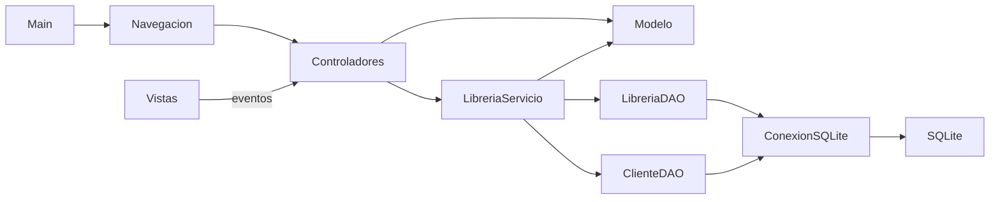

# Guía de estudio y defensa del TPO de librería

[Inicio](../README.md) · [Estado](ESTADO_Y_PENDIENTES.md) · [Pruebas](PRUEBAS.md) · [Historial](HISTORIAL_DE_CAMBIOS.md)

Referencia documental: 19/11/2026, árbol de trabajo de la rama tpo-grupo5, commit ba6bebcc79403c977a0231c59b3dee2ed9755394 más cambios locales de Clientes. Esta guía explica el código actual; la aprobación de los recorridos visuales se registra exclusivamente en PRUEBAS.

## Primera lectura · cómo ubicarse en el código

La librería es una aplicación de escritorio escrita en Java. La interfaz usa **Swing**. SQLite conserva los datos cuando cerrás el programa. Para seguir una operación en IntelliJ, empezá por el texto del botón en la vista, buscá su `addActionListener` en el controlador y entrá en el método del servicio que llama ese listener.

| Si querés entender… | Empezá acá | Qué buscar |
|---|---|---|
| Qué se ejecuta primero | [Main](../src/aplicacion/Main.java) | `main` prepara el servicio y la ventana en el hilo de Swing y abre Inicio. |
| A dónde lleva cada botón del menú | [InicioControlador](../src/controlador/InicioControlador.java) y [Navegacion](../src/controlador/Navegacion.java) | Seguí, por ejemplo, el botón de catálogo hasta `mostrarCatalogo()`. |
| Cómo se dibuja una pantalla | [PrestamoVista](../src/vista/PrestamoVista.java) | Mirá cómo se construyen las tres pestañas y qué tabla contiene cada una. |
| Qué pasa al escribir o hacer clic | [PrestamoControlador](../src/controlador/PrestamoControlador.java) | `configurarBusqueda` filtra filas. El listener de `devolver` toma el préstamo seleccionado. |
| Qué reglas tiene un objeto | [Libro](../src/modelo/Libro.java) y [Venta](../src/modelo/Venta.java) | Un libro conoce su disponibilidad. Una venta agrupa detalles, calcula el total y controla sus cambios de estado. |
| Quién coordina una operación completa | [LibreriaServicio](../src/servicio/LibreriaServicio.java) | `devolverPrestamo` encuentra el libro, pide que se guarde la devolución y actualiza el stock en memoria. |
| Qué tablas existen y quién escribe en ellas | [ConexionSQLite](../src/persistencia/ConexionSQLite.java), [LibreriaDAO](../src/persistencia/LibreriaDAO.java) y [ClienteDAO](../src/persistencia/ClienteDAO.java) | `ESQUEMA` define las tablas. Los DAO son objetos que consultan y guardan datos mediante SQL. |
| Dónde ver ejemplos que se pueden ejecutar | [PruebasPrestamos](../test/pruebas/PruebasPrestamos.java) | Seguí un préstamo hasta su devolución y el intento de devolverlo dos veces. |

### Swing en las pantallas del proyecto

| Pieza | Qué hace | Ejemplo para recordar |
|---|---|---|
| `SwingUtilities.invokeLater` | Programa el arranque en el hilo que procesa los eventos gráficos. | En `Main`, ahí se crea y muestra la ventana. |
| `JFrame`, `JPanel`, `JTabbedPane` | Representan la ventana, una parte de su contenido y un grupo de pestañas. | `VentanaPrincipal` aloja las vistas. `PrestamoVista` agrupa nuevo préstamo, devolución e historial. |
| `BorderLayout`, `GridLayout`, `GridBagLayout` | Distribuyen componentes por regiones, en celdas iguales o en una grilla con restricciones. | En préstamos, dos tablas van lado a lado. En `FormularioPanel`, las etiquetas y los campos quedan uno debajo del otro. |
| `JLabel`, `JTextField`, `JButton` | Identifican un campo, reciben texto y permiten ejecutar una acción. | La etiqueta indica que podés buscar por título o ISBN. El botón registra la devolución seleccionada. |
| `JComboBox`, `JSpinner`, `JCheckBox` | Permiten elegir o escribir una opción, ingresar un número y marcar un estado. | En `LibroFormulario` se usan para editorial, categoría y autores, cantidad en stock y libro activo. |
| `JTable`, `DefaultTableModel`, `JScrollPane` | Muestran una tabla, mantienen sus filas en memoria y permiten desplazarse por ellas. | El controlador llena la tabla de pendientes con los resultados de la consulta de préstamos. |
| `DocumentListener`, `TableRowSorter`, `RowFilter` | Detectan cambios de texto, ordenan filas y deciden cuáles se ven. | Al escribir parte del título, el buscador oculta las filas que no coinciden. La base conserva todos los préstamos. |
| `ActionListener`, `JOptionPane` | Responden a un botón y muestran diálogos de entrada, confirmación o error. | Al intentar el tercer préstamo, el controlador recibe la excepción y la ventana muestra el mensaje. |

**Por qué importa el índice de la fila.** Si filtrás por ISBN, el primer resultado visible puede corresponder al quinto préstamo pendiente. El controlador usa `EntradaFormulario.seleccionado`, que llama a `convertRowIndexToModel`. Así recupera el préstamo que elegiste aunque hayas filtrado u ordenado la tabla.

### SQLite paso a paso con una devolución

1. **Al abrir la aplicación**, `ConexionSQLite.rutaPredeterminada()` lee la propiedad `tpo.db`. Por defecto usa `datos/libreria.db`, relativa al directorio de ejecución. El driver JDBC incluido en `lib/` permite a Java abrir ese archivo con una dirección que empieza con `jdbc:sqlite:`. SQLite se ejecuta dentro del proceso de la aplicación.
2. **Al iniciar el servicio**, se crean las tablas faltantes, se preparan los ejemplos y se reconstruyen objetos Java con los datos guardados. Cada conexión habilita las claves foráneas. Por ejemplo, `prestamos.libro_id` debe identificar una fila existente en `libros`.
3. **Al prestar**, el DAO toma el bloqueo de escritura y cuenta las filas pendientes para el DNI. Con dos activas lanza `LimitePrestamosException`. Si corresponde prestar, inserta una fila en `prestamos` y resta una unidad a `libros.stock` dentro de la misma transacción.
4. **Al devolver**, el DAO actualiza `devuelto_en` con la fecha y hora, comprobando el ID del préstamo, el libro y que la fecha anterior sea `NULL`. Luego suma una unidad al stock. Si había tres ejemplares antes del préstamo, quedan dos durante el préstamo y vuelven a ser tres al devolver.
5. **Al confirmar**, JDBC hace `commit` y ambas escrituras quedan guardadas. Si falla la reposición de stock, se hace `rollback` y el préstamo sigue pendiente. El servicio actualiza el objeto Java después del guardado. El controlador consulta los préstamos y vuelve a llenar las tablas.
6. **Al reabrir**, el historial recupera la fecha guardada. Una devolución de **venta** sigue otro recorrido y deja una fila en `devoluciones`, vinculada a `ventas`. La devolución de **préstamo** queda en la propia fila de `prestamos`.

Para ver estos datos con SQLite, abrí la base de práctica indicada en el README. Esta consulta de lectura muestra un renglón por préstamo pendiente. `JOIN` conecta los identificadores guardados con los nombres que reconocés en pantalla.

```sql
SELECT p.id, l.titulo, l.isbn, c.nombre AS socio, p.fecha
FROM prestamos AS p
JOIN libros AS l ON l.id = p.libro_id
JOIN clientes AS c ON c.id = p.socio_id
WHERE p.devuelto_en IS NULL
ORDER BY p.id DESC;
```

**Ejercicio para comprobarlo.** En una base de práctica, prestá un libro y ejecutá la consulta. Anotá el ID que aparece. Buscá el libro por ISBN en Registrar devolución y devolvelo. Al ejecutar la consulta otra vez, ese ID desaparece de los pendientes. Para encontrar el movimiento en el historial, incluí `p.devuelto_en` en el `SELECT` y quitá la condición `WHERE`.

## Índice

1. [Problema de negocio y fuentes](#negocio)
2. [Estructura, MVC y servicio](#estructura)
3. [Modelo y reglas](#modelo)
4. [Persistencia y operación SQLite](#sqlite)
5. [Recorridos completos](#recorridos)
6. [Administraciones e identidad](#administraciones)
7. [Patrones, excepciones y diálogos](#practicas)
8. [Índice de clases](#clases)
9. [Preguntas y respuestas de defensa](#defensa)

<a id="negocio"></a>
## 1. Problema de negocio y fuentes

La librería administra libros y clientes, vende unidades del stock y registra devoluciones totales. Categorías y editoriales clasifican los libros. Como operación adicional permite asociar clientes y prestar/devolver libros. El historial registra estados, importes y responsables; los cambios de stock se guardan junto con la operación que los causa.

Las cuatro administraciones elegidas son Libros, Clientes, Categorías y Editoriales. Venta y Devolución son los dos recorridos funcionales para la entrega. Es una decisión de cómputo del grupo, cuya aceptación se debe confirmar con la cátedra; no se cuentan alta/edición del mismo formulario como entidades diferentes.

- [Consigna final](TP_Final_Consignas.docx): fuente de mínimos académicos. El relevamiento previo registró entrega 18/11/2026 y defensa 04/12/2026; confirmar calendario con la cátedra por inconsistencias de días escritos.
- [Captura de Teams](Consigna%20Teams.png): instrucciones de avance del 01/11. Sus excepciones temporales no eliminan obligaciones finales.
- [Propuesta comercial anterior](Sistema%20de%20gestión%20de%20una%20librería%20comercial.pdf): antecedente anecdótico por decisión del grupo; compras, proveedores, papelería y roles no generan trabajo funcional obligatorio.
- [UML original](UML%20-%20TPO.svg): se preserva. Persona, Producto, Compra, DetalleCompra, Proveedor, ArticuloPapeleria, RolEmpleado y SistemaLibreria no corresponden al código actual. Libro y Cliente son independientes; se agregaron descuento, devolución, préstamo y arquitectura MVC/DAO. El informe y diagrama se actualizarán al cerrar las pruebas.
- Las notas históricas de modelo, MVC y SQLite se consolidaron aquí. Su contexto y resultados originales están en [historial](HISTORIAL_DE_CAMBIOS.md).

Para abrir y ejecutar en IntelliJ consultar [README](../README.md); para practicar usar exclusivamente una base de prueba. Esta guía no sustituye automáticamente el informe académico de aproximadamente diez páginas.
<a id="estructura"></a>
## 2. Estructura, MVC y servicio



`vista` construye formularios y tablas; `controlador` conecta eventos, convierte entradas y muestra errores. `modelo` concentra estados, cantidades, dinero e invariantes. `servicio` coordina operaciones y mantiene los objetos de la sesión. `persistencia` transforma filas en objetos y escribe transacciones. `aplicacion` ensambla dependencias; `excepciones` expresa errores de negocio.

MVC se evidencia en VentaVista → VentaControlador → Venta. El servicio realiza el rol de coordinador de casos de uso. LibreriaDAO y ClienteDAO cumplen el acceso y reconstrucción típicos de Repository, pero **no hay interfaz Repository ni implementación desacoplada por contrato**: son DAO concretos. No presentar ese nombre como una clase existente.

GRASP Experto: DetalleVenta calcula subtotal y Venta suma y descuenta, porque poseen los datos. GRASP Creador: Venta crea sus detalles. Separación de responsabilidades: Swing no ejecuta SQL y el modelo no importa Swing ni JDBC. Encapsulación: estados sin setter libre y listas defensivas; detalle, pago y devolución preservan datos históricos. Composición: Venta contiene detalles; Libro referencia autores, editorial y categoría. Herencia real: vistas extienden PanelVista/JPanel y excepciones extienden RuntimeException. No existe la herencia Persona/Producto del UML original. Polimorfismo: listeners Swing, Runnable y Operacion<T> permiten ejecutar comportamientos a través de contratos; no hay jerarquía de medios de pago, se usa enum y fábricas estáticas.

Dinero: BigDecimal, escala 2 y HALF_UP; comparar por compareTo. Ejemplo histórico vigente: 10.05 − HOTSALE 1.01 = 9.04. DNI es texto de dígitos (conserva ceros), sin restricción de longitud. No hay UNIQUE global en clientes para preservar duplicados históricos; las altas y cambios de DNI controlan disponibilidad en transacción. ISBN no valida dígito verificador; SQLite exige unicidad. Se controla overflow con Math.addExact. Los IDs pueden ser null antes de persistir; Venta admite asignación única del ID retornado por SQL.

<a id="modelo"></a>
## 3. Modelo y reglas de negocio

### Relaciones e identidad

Libro tiene uno o más Autor, una Editorial y una Categoria. Venta tiene un Empleado, cero o un Cliente, detalles y opcionalmente descuento/pago; Devolucion referencia la venta y al responsable. PoliticaDevolucion consulta sin mutar.

Los IDs son Long positivos o null para objetos no persistidos. La descripción inicial de “todos finales” ya no aplica a Venta: asignarIdPersistido acepta el ID SQL una vez; rehidratar reconstruye sin repetir cobro ni stock. La persistencia actual es SQLite, no el SQL Server contemplado en octubre.

Venta.agregarLibro compara ID no nulo o identidad de objeto si no está persistido. Dos libros distintos con ID null no se acumulan; con el mismo ID se conserva la primera referencia y precio. DetalleVenta es una instantánea: cambiar cantidad reemplaza el detalle mediante conCantidad conservando título, ISBN y precio. Libro.actualizarDesde permite editar título/ISBN, a diferencia del modelo inicial. No reescribe comprobantes históricos. List y ArrayList se encapsulan mediante copias no modificables; Libro también copia autores recibidos.

### Dinero y validaciones

BigDecimal normaliza a dos decimales con HALF_UP; un precio que redondea a cero se rechaza. No usar double ni equals para comparar importes: compareTo compara valores sin depender de escala. Los subtotales usan el precio normalizado; el descuento se redondea sobre el subtotal completo: 10.05 − 1.01 = 9.04.

HOTSALE es el único código, en mayúsculas, con 10.00%; tolera espacios externos, no acumula descuentos y puede quitarse/reaplicarse durante preparación. Nombre, título, ISBN, legajo y motivo requieren texto no vacío. ISBN es texto sin validación de checksum (la base controla duplicados). DNI contiene dígitos sin longitud fija y conserva ceros: la validación de formato pertenece al modelo; disponibilidad/duplicados se resuelven en persistencia según el capítulo 6. Math.addExact rechaza desbordamientos de cantidad/stock sin cambiar el valor anterior.

### Estados, pago y tiempo

Venta pasa EN_PREPARACION → CONFIRMADA o CANCELADA; CONFIRMADA → DEVUELTA. No hay setter libre de estado. Solo se edita el borrador. El modelo permite preparar cantidades mayores al stock, pero la UI limita agregados y la confirmación vuelve a comprobar disponibilidad; no reserva unidades. Si cambia el carrito, el pago debe coincidir con el nuevo total.

Pago representa aprobaciones mediante enEfectivo/conTarjeta. El efectivo puede exceder el total y genera vuelto; tarjeta guarda referencia ficticia no vacía, montoRecibido null y vuelto 0.00. No hay autorización/rechazo de un banco real. Efectivo permite no elegir cliente; si se elige debe estar activo. Tarjeta requiere cliente activo. Empleado y libros deben estar activos al confirmar.

El modelo recibe LocalDateTime; el servicio aporta el reloj. Venta.fecha sigue siendo la creación del borrador, no una fecha nueva de cobro: cruzar medianoche es un límite conocido que conviene explicar. No se exige otra relación temporal entre fecha de pago y venta. La devolución compara fechas de calendario: compra hasta compra +7 inclusive; una hora anterior del mismo día es admisible. Todos los libros deben estar sin uso/aptos y el responsable activo.

PoliticaDevolucion.validar no cambia estados; completarDevolucion valida antes de construir el registro, cuyo constructor no es público. No se puede devolver desde preparación/cancelación ni por segunda vez. El reintegro deriva del importe efectivamente pagado con descuento y del medio original, nunca del efectivo entregado ni del subtotal.

**confirmar, cancelar y completarDevolucion del modelo no mueven stock.** La integración que faltaba en octubre ya existe: servicio → transacción DAO → commit → actualización de objetos. Evita duplicar movimientos en el modelo y el controlador. Las actualizaciones condicionales permiten rollback frente a conflictos; el carrito continúa en memoria si no se pudo confirmar.

<a id="sqlite"></a>
## 4. Persistencia y operación SQLite

[ConexionSQLite](../src/persistencia/ConexionSQLite.java) usa tpo.db y, si se omite, datos/libreria.db. Abrir crea directorios necesarios, habilita claves foráneas y busy_timeout de 5000 ms. inicializar crea tablas faltantes; si clientes no tiene activo, lo agrega con DEFAULT 1, sin cambiar IDs ni DNI. Reabrir no vuelve a activar bajas previas. No se impone UNIQUE global al DNI para conservar duplicados históricos.

| Datos | Tablas y relación |
|---|---|
| Clientes/participantes | clientes (DNI TEXT, activo), empleados; socios(cliente_id) conserva asociación por PK/FK |
| Catálogo | libros → categorias/editoriales; libro_autor une libros y autores |
| Préstamos | prestamos → socio/libro; devolución marca devuelto_en |
| Ventas | ventas → cliente opcional/empleado; detalles_venta preserva cantidad/precio/título/ISBN |
| Pago/reintegro | pagos y devoluciones enlazan venta; importe decimal textual convertido a BigDecimal |
| Precarga | inicializaciones evita repetir migraciones de ejemplos |

[LibreriaDAO](../src/persistencia/LibreriaDAO.java) carga agregados al arrancar. En una base nueva el servicio precarga 13 clientes ficticios, 56 libros ISBN-13 (50 títulos conocidos en español, datos comerciales ficticios) y un empleado. Las migraciones de ejemplos anteriores conservan IDs; el marcador evita sobrescribir posteriores ediciones de catálogo. No asumir que el contenido particular de datos/libreria.db coincide: no se inventarió ni se abrió para estas pruebas.

El alta/edición guarda autores y stock; préstamo y devolución de préstamo mueven una unidad con el movimiento en la misma transacción. Confirmar venta guarda venta/detalles/pago y descuenta stock. Cancelar guarda estado/detalles sin descontarlo. Devolución guarda motivo/responsable/estado y repone stock. Los borradores no se guardan al cerrar. Si otra sesión altera datos necesarios, las comprobaciones rechazan la operación y el mensaje puede pedir reabrir; la memoria se actualiza después del commit.

### Comandos y configuración operativa

Requisitos y comandos Windows actuales: [README](../README.md). La configuración local histórica usaba OpenJDK 26.0.2.1; cada compañero puede seleccionar su propio JDK 17+ compatible. No se requiere servidor SQLite ni Maven/Gradle/JUnit. Agregar lib/sqlite-jdbc-3.50.3.0.jar al módulo; marcar src/test como fuentes/pruebas. En Windows classpath usa punto y coma; en Unix dos puntos.

Alternativa Unix desde la raíz, conservada del manual SQLite y ajustada para una base de práctica:

~~~sh
mkdir -p out
find src test -name '*.java' > out/fuentes.txt
javac -encoding UTF-8 -cp 'lib/*' -d out @out/fuentes.txt
java --enable-native-access=ALL-UNNAMED -Dtpo.db=datos/practica.db -cp 'out:lib/*' aplicacion.Main
~~~

La opción de JVM -Dtpo.db=/ruta/absoluta/otra.db permite separar la base del directorio de trabajo. En rutas con espacios, pasar toda la opción entre comillas. En JDK recientes --enable-native-access=ALL-UNNAMED evita la advertencia de acceso nativo del driver. Los comandos se verificaron contra archivos y entradas reales, no se ejecutaron en esta reorganización.

### Consola, pruebas y problemas habituales

[ejecutar-sqlite.sh](../ejecutar-sqlite.sh) compila src y test y ejecuta [EjemploSQLite](../src/aplicacion/EjemploSQLite.java), no Main. Acepta cero argumentos (listado) o nombre y DNI (alta). El ejemplo inicializa esquema, no todo el catálogo del servicio; ante error sale con código 1.

Los comandos originales son sh ejecutar-sqlite.sh y sh ejecutar-sqlite.sh 'Juan de prueba' '00123456'. **Sin configuración adicional usan la base del proyecto.** Para practicar en shell Unix conservando el script:

~~~sh
JAVA_TOOL_OPTIONS='-Dtpo.db=datos/consola-prueba.db' sh ejecutar-sqlite.sh
JAVA_TOOL_OPTIONS='-Dtpo.db=datos/consola-prueba.db' sh ejecutar-sqlite.sh 'Juan de prueba' '00123456'
~~~

Su classpath con dos puntos requiere entorno Java Unix; no se garantiza ejecutarlo con Java Windows en Git Bash. En PowerShell, después de compilar como en README:

~~~powershell
java '-Dtpo.db=datos/consola-prueba.db' -cp 'out;lib/*' aplicacion.EjemploSQLite 'Juan de prueba' '00123456'
~~~

Las pruebas y comandos por plataforma tienen su ubicación principal en [PRUEBAS](PRUEBAS.md#automatizadas). Ante clase no encontrada revisar salida de compilación/classpath; ante driver ausente revisar JAR/dependencia; ante datos inesperados revisar tpo.db y directorio de trabajo antes de crear otra base. No borrar una base para resolver un conflicto: corregir selección o reabrir según el error. Los duplicados históricos de DNI se corrigen por ID desde edición, no eliminando historia.
<a id="recorridos"></a>
## 5. Recorridos completos

Los siguientes pasos de interfaz se comprobaron leyendo listeners y destinos. Las pruebas ejecutadas validan modelo/servicio/persistencia y geometría de paneles; **no se realizó un recorrido manual de botones**. Ver resultados y pasos manuales en [PRUEBAS](PRUEBAS.md).

### Efectivo sin cliente

Inicio → [InicioControlador](../src/controlador/InicioControlador.java) → [Navegacion.nuevaVenta](../src/controlador/Navegacion.java) → [LibreriaServicio.nuevaVenta](../src/servicio/LibreriaServicio.java). Se elige el primer empleado activo y se agrega un borrador a la lista de memoria, sin SQL. [VentaControlador.agregarLibro](../src/controlador/VentaControlador.java) valida selección y disponibilidad, llama a Venta.agregarLibro y refresca totales; el modelo acumula por ID o identidad y conserva el precio de primera incorporación. No reserva stock.

Pagar → [PagoControlador.confirmar/crearPago](../src/controlador/PagoControlador.java) → Pago.enEfectivo → servicio.confirmar → Venta.validarConfirmacion → [LibreriaDAO.guardarVenta](../src/persistencia/LibreriaDAO.java). Valida detalles, empleado/libros activos, stock y pago exacto. La transacción inserta ventas/detalles_venta/pagos y descuenta libros.stock con condición sobre el stock previo. Solo después del commit asigna ID, registra pago, confirma y descuenta stock en los objetos. Abre el resumen.

Si falla validación no persiste; si falla SQL o una actualización condicional, ConexionSQLite.transaccion hace rollback y el controlador muestra el error. No se cambia el borrador antes de guardar. El efectivo entregado puede superar el total, pero el importe pagado es el total y el resto es vuelto.

Práctica: en base de práctica, elegir un libro activo con stock, cantidad 1, dejar «Sin cliente», pagar efectivo con el total + 100. Esperar vuelto 100, stock −1 y venta en historial tras reiniciar.

### Tarjeta con DNI

Desde venta → Buscar cliente / Nuevo cliente → [ClienteControlador](../src/controlador/ClienteControlador.java). Buscar filtra nombre/DNI y excluye inactivos; seleccionar llama Venta.cambiarCliente. Crear valida nombre y DNI, servicio.crearCliente → ClienteDAO.guardar comprueba DNI libre entre activos/inactivos dentro de la transacción e inserta cliente activo con su ID; luego lo incorpora a memoria y asigna a la venta. Cancelar la venta no elimina ese cliente.

PagoControlador deshabilita confirmar tarjeta sin cliente. Pago.conTarjeta exige referencia no vacía; servicio y Venta vuelven a validar cliente; DAO comprueba que siga activo al confirmar. Si fue dado de baja durante la preparación se rechaza la venta y se puede corregir la selección, sin perder el borrador. Continúa por la misma transacción anterior, con cliente_id y medio TARJETA, recibido null, vuelto cero. No existe autorización bancaria ni rechazo simulado por emisor.

Práctica: nuevo cliente «Prueba Defensa», DNI `00123456`, tarjeta y referencia `DEMO-01`. Probar primero sin cliente y referencia vacía. No se valida identidad contra un organismo.

### HOTSALE

VentaControlador.aplicarDescuento → [Venta.aplicarDescuento](../src/modelo/Venta.java) → [Descuento.desdeCodigo](../src/modelo/Descuento.java): único código HOTSALE, 10%, sin acumulación; admite espacios externos. Se puede quitar en preparación. Los cambios limpian el pago previo. Se guarda código/porcentaje con la venta al confirmar; no hay escritura al aplicar en el carrito. Un código inválido deja el descuento sin aplicar y muestra error.

Práctica: agregar un libro, aplicar HOTSALE, comparar subtotal/descuento/total; aplicar de nuevo debe rechazar. Para reproducir 10.05/9.04 crear antes un libro de precio 10.05.

### Devolución total

Historial → [HistorialVentasControlador.mostrarDetalle](../src/controlador/HistorialVentasControlador.java) → [DevolucionControlador.confirmarDevolucion](../src/controlador/DevolucionControlador.java) → servicio.devolver → Venta.validarDevolucion → [PoliticaDevolucion.validar](../src/modelo/PoliticaDevolucion.java). Requiere confirmada no devuelta, fecha desde compra hasta +7 días inclusive, motivo, todos los libros aptos y responsable activo. La fecha de compra es la de creación del borrador, no una nueva fecha al cobrar.

DAO.guardarDevolucion cambia CONFIRMADA a DEVUELTA condicionalmente, inserta devoluciones y repone stock en una transacción. Luego el servicio completa la devolución y aumenta stock en memoria. Reintegra importe realmente pagado con descuento y mismo medio, nunca el efectivo entregado. Fallos dejan venta/stock sin cambios; devolución repetida se rechaza. Práctica: devolver la venta recién creada, motivo «Compra equivocada», marcar aptos; probar antes motivo vacío. No hay devolución parcial ni transferencia bancaria real.

### Cancelación e historial

VentaControlador.cancelarVenta pide confirmación → servicio.cancelar → guardarVenta con CANCELADA → Venta.cancelar. Persiste detalles sin descontar stock; no puede reconfirmarse. Historial muestra la lista del servicio y el resumen, con precios históricos. Al reiniciar, DAO.cargar usa rehidratar: no vuelve a cobrar ni a descontar. Práctica: agregar un libro y cancelar, reiniciar y consultar estado/stock. Cerrar la ventana con borrador pide confirmación y lo descarta sin persistirlo.

### Catálogo, alta, edición y baja lógica

Inicio → [CatalogoControlador.editar](../src/controlador/CatalogoControlador.java) → LibroFormulario → servicio.guardarLibro → DAO.guardarLibro. Valida campos, autores separados por `;`, precio positivo, stock entero no negativo y unicidad de ISBN en SQL. Guarda catálogo y relaciones; después actualiza el mismo objeto Libro con actualizarDesde o agrega uno nuevo. Baja lógica: editar y desmarcar activo. No existe pantalla independiente de baja. Los detalles ya vendidos mantienen título/ISBN/precio históricos. Los errores se muestran y el formulario permanece abierto.

Práctica: alta «Libro defensa», ISBN `9781234567897` libre, autores «Ana; Luis», precio 10.05, stock 3; editar precio y desactivar. Confirmar que no aparece para nueva venta y que persiste tras reinicio.

### Socios y préstamos

InicioControlador.asociar → servicio.asociar → DAO.asociar: valida DNI y consulta todas las fichas coincidentes en una transacción. Cero coincidencias: crea cliente con nombre válido y asociación de forma atómica. Una activa: asocia su ID o informa que ya es socio. Una inactiva: exige reactivar desde Administración. Varias: informa ambigüedad y no asocia automáticamente. No reactiva fichas ni cambia IDs; actualiza memoria después de guardar. Práctica: asociar el cliente de tarjeta por DNI.

Inicio → [PrestamoControlador](../src/controlador/PrestamoControlador.java) → servicio.prestar → DAO.prestar: exige libro de catálogo disponible y socio activo; transacción registra prestamos y retira 1 de stock, luego disminuye el objeto. Devolver selecciona préstamo pendiente → servicio.devolverPrestamo → DAO.devolverPrestamo, marca devuelto_en y repone 1, luego actualiza memoria. Repetición/conflicto se rechazan. Práctica: prestar un libro al socio y devolverlo; verificar stock inicial y persistencia al reiniciar. La selección para nuevos préstamos excluye inactivos; la pestaña Registrar devolución sigue mostrando los pendientes incluso después de la baja del cliente. La devolución no exige cliente activo y repone una sola vez. No hay multas, vencimientos ni ejemplares individualizados.

### Consola y límites de conexión

[EjemploSQLite.main](../src/aplicacion/EjemploSQLite.java) inicializa esquema y usa ClienteDAO.guardar/listar, sin cargar todos los ejemplos ni abrir Swing. Acepta cero o dos argumentos; error imprime mensaje y sale 1.

Los métodos servicio.cambiarPrecio/ingresarStock/cambiarActividad se ejercitan en PruebasServicio, pero la UI de catálogo utiliza guardarLibro; no confundir métodos disponibles con botones directos. Compras/proveedores/roles/papelería no tienen punto de entrada ni continuación en código. Los recorridos descritos tienen listeners conectados; su aceptación visual sigue pendiente.


<a id="administraciones"></a>
## 6. Administraciones e identidad

### Libros, categorías y editoriales

Inicio → Administrar libros abre CatalogoControlador/CatalogoVista. Alta y modificación comparten LibroFormulario. La baja es lógica: editar y desmarcar Activo; el catálogo administrativo incluye inactivos. El formulario admite nombres de categoría/editorial existentes o crea uno al guardar. Los autores se separan con punto y coma. El selector de una venta no reemplaza esta consulta administrativa.

Inicio → Administrar categorías/editoriales conecta [CategoriaControlador](../src/controlador/CategoriaControlador.java) / [EditorialControlador](../src/controlador/EditorialControlador.java) con guardarCategoria/guardarEditorial y eliminarCategoria/eliminarEditorial de [LibreriaServicio](../src/servicio/LibreriaServicio.java). Sus listados consultan las tablas, incluso sin libros. Los nombres se validan y recortan; la comparación de nombres es exacta, sensible a mayúsculas/acentos, igual que buscarOCrear en el catálogo. No prometer normalización insensible a mayúsculas.

Renombrar conserva el ID y actualiza las referencias de libros en la sesión después de escribir. Baja física solo si ningún libro, activo o inactivo, referencia la entidad. El controlador preconsulta, pide confirmación y retorna ante No/cerrar. El DAO repite la comprobación dentro de la transacción: cubre referencias creadas después de abrir el diálogo. No se eliminan libros ni se cambian sus vínculos automáticamente.

Ejemplo para estudiar: crear «Novlea» y corregir a «Novela» con el mismo ID; si «Novela» ya está precargada, el duplicado debe rechazarse. Para una prueba aislada usar nombres únicos como «Novlea prueba»/«Novela prueba». Asociar un libro, intentar baja activo/inactivo, reasignar y recién entonces eliminar. Procedimiento y resultados en [PRUEBAS](PRUEBAS.md#administraciones).

### Clientes, socios e historia

Inicio → Administrar clientes → [AdministrarClientesControlador](../src/controlador/AdministrarClientesControlador.java). mostrar lista nombre/DNI/estado de activos e inactivos; seleccionado usa EntradaFormulario.seleccionado (convierte índice de vista ordenada a modelo). Nuevo cliente llama editar(null); Editar cliente precarga la ficha seleccionada. El formulario reutiliza validaciones y solo guarda ante OK; cancelar/cerrar no escribe. El alta crea únicamente cliente activo. Desde Venta, ClienteControlador conserva «Guardar y usar», que además lo asigna al borrador.

Cliente contiene ID, nombre, DNI textual y activo. [ClienteDAO.guardar](../src/persistencia/ClienteDAO.java) toma bloqueo de escritura (UPDATE clientes SET id = id WHERE 0), consulta coincidencias e inserta en la misma transacción. Todas las rutas de alta comparten disponibilidad entre activos e inactivos. DNI activo: buscar ficha existente; inactivo: reactivar en Administración. Altas concurrentes no crean dos fichas. La unicidad es regla transaccional de estas operaciones, no restricción UNIQUE sobre registros históricos.

modificarCliente → ClienteDAO.modificar actualiza por ID. Cambiar DNI exige que esté libre entre todos los demás clientes; mantener un DNI históricamente duplicado permite corregir solo el nombre. El cambio de nombre y DNI es atómico: un conflicto no aplica ninguno. Se conserva activo, asociación y vínculos; se detecta edición concurrente de nombre/DNI. Cliente.actualizarDesde y las referencias de ventas se actualizan después del commit. Los préstamos se consultan nuevamente con datos del cliente.

cambiarActividadCliente guarda baja/reactivación con el mismo ID. Se permite baja con préstamo abierto; no borra ventas, socios ni préstamos. Un inactivo no puede iniciar préstamo ni participar de nueva venta, incluso si el borrador lo tenía seleccionado antes de la baja; hay controles en modelo/servicio y SQL. Sí puede devolver un préstamo previo: el historial es independiente del selector de socios activos y la devolución no exige actividad. Reactivar recupera la asociación original.

Socios no tiene clase de dominio ni datos de persona independientes: socios(cliente_id) registra el vínculo; ventas.cliente_id y préstamos conservan referencias por ID. «Hacerse socio» no es un alta administrativa de socios completa ni una quinta administración elegida. Sus casos libre/activo/inactivo/ambiguo están explicados en el recorrido del capítulo 5 y comprobados automáticamente; ensayos con clics siguen pendientes.

<a id="practicas"></a>
## 7. Patrones, buenas prácticas, excepciones y diálogos
### Prácticas implementadas

| Práctica | Código concreto | Problema que resuelve |
|---|---|---|
| GRASP Experto | [DetalleVenta.calcularSubtotal](../src/modelo/DetalleVenta.java); [Venta.calcularSubtotal/calcularDescuento/calcularTotal](../src/modelo/Venta.java) | Calcula donde se conocen cantidades, precios y detalles; evita repetir fórmulas en Swing |
| GRASP Creador | Venta.agregarLibro crea DetalleVenta; conCantidad reemplaza detalles al acumular | Mantiene composición y reglas del detalle dentro de la venta |
| MVC y separación de responsabilidades | [VentaVista](../src/vista/VentaVista.java) → [VentaControlador](../src/controlador/VentaControlador.java) → Venta/servicio → DAO | Separa presentación, eventos, reglas y SQL; permite probar reglas sin abrir ventanas |

Listas defensivas, BigDecimal y transacciones aportan otras buenas prácticas. Experto/Creador/SRP ya aparecían en el material histórico, pero no se dispone de un catálogo completo de contenidos vistos en clase: confirmar cuáles tres se presentarán. Los DAO realizan acceso/reconstrucción de datos; **no hay interfaz Repository propia ni repositorio intercambiable inyectado**. No presentar ese nombre como clase existente.

### Excepciones y tres bloques independientes

[StockInsuficienteException](../src/excepciones/StockInsuficienteException.java) y [DevolucionNoPermitidaException](../src/excepciones/DevolucionNoPermitidaException.java) extienden RuntimeException y representan reglas del negocio.

| Bloque concreto | Qué protege y cómo maneja el error | Prueba de aceptación visible |
|---|---|---|
| [PagoControlador.confirmar](../src/controlador/PagoControlador.java) | try crea pago, llama servicio.confirmar y muestra detalle; catch IllegalArgumentException, IllegalStateException y StockInsuficienteException escribe el mensaje en vista.error | Efectivo insuficiente no confirma ni descuenta stock; muestra error y permite corregir |
| [CatalogoControlador.editar](../src/controlador/CatalogoControlador.java) | try confirma spinner y guarda; catch ParseException informa stock inválido; catch IllegalArgumentException/IllegalStateException muestra error | ISBN duplicado no crea registro; informa error y mantiene formulario |
| [DevolucionControlador.confirmarDevolucion](../src/controlador/DevolucionControlador.java) | try confirma diálogo y llama servicio.devolver; catch incluye DevolucionNoPermitidaException y ArithmeticException | Motivo vacío o no aptos no cambia venta/stock y muestra error |

Son tres sitios try/catch independientes, no tres tipos de excepción en un solo catch. ConexionSQLite.transaccion también hace rollback ante SQLException o RuntimeException. Los errores se probaron a nivel de reglas/servicio; falta observar estos mensajes desde UI.

### Diálogos y rutas de entrada

| Uso | Acción que lo abre | Código |
|---|---|---|
| Alta/edición libro | Inicio → Administrar libros → Nuevo libro / Editar libro | CatalogoControlador.editar → JOptionPane.showConfirmDialog con LibroFormulario |
| Alta socio | Inicio → Hacerse socio | [InicioControlador.asociar](../src/controlador/InicioControlador.java) → showConfirmDialog con FormularioPanel |
| Cancelación | Inicio → Nueva venta → Cancelar | VentaControlador.cancelarVenta → showConfirmDialog YES/NO |
| Devolución total | Historial de ventas → detalle de confirmada → Devolver → Confirmar | DevolucionControlador.confirmarDevolucion → showConfirmDialog YES/NO |
| Cierre con borrador | Cerrar ventana con venta en preparación | [VentanaPrincipal.confirmarCierre](../src/vista/VentanaPrincipal.java) → showConfirmDialog |

También hay showMessageDialog en VentanaPrincipal.error/informar. Estas rutas se verificaron por lectura; no se contabilizan como pruebas interactivas.


<a id="clases"></a>
## 8. Índice de clases

Cada enlace apunta al archivo propio; las clases auxiliares anidadas se enumeran debajo. Los recorridos refieren al capítulo 5 y a las administraciones del capítulo 6.


### Paquete aplicacion

| Tipo | Responsabilidad y recorrido |
|---|---|
| [EjemploSQLite](../src/aplicacion/EjemploSQLite.java) | Alta/listado por consola; consola |
| [Main](../src/aplicacion/Main.java) | Arranque Swing y dependencias; inicio |

### Paquete controlador

| Tipo | Responsabilidad y recorrido |
|---|---|
| [CatalogoControlador](../src/controlador/CatalogoControlador.java) | Buscar/crear/editar; catálogo |
| [ClienteControlador](../src/controlador/ClienteControlador.java) | Buscar/crear/asignar; cliente y tarjeta |
| [DevolucionControlador](../src/controlador/DevolucionControlador.java) | Confirmación y motivos; devolución |
| [EntradaFormulario](../src/controlador/EntradaFormulario.java) | Conversión de dinero, selección y búsqueda; formularios |
| [HistorialVentasControlador](../src/controlador/HistorialVentasControlador.java) | Listado y resumen; historial |
| [InicioControlador](../src/controlador/InicioControlador.java) | Menú y alta de socio; inicio/socios |
| [Navegacion](../src/controlador/Navegacion.java) | Abre pantallas y crea controladores; navegación |
| [PagoControlador](../src/controlador/PagoControlador.java) | Medio, vuelto y confirmación; pago |
| [PrestamoControlador](../src/controlador/PrestamoControlador.java) | Selección socio/libro y devolución; préstamos |
| [VentaControlador](../src/controlador/VentaControlador.java) | Carrito y descuento; venta |
| [AdministrarClientesControlador](../src/controlador/AdministrarClientesControlador.java) | Formulario nuevo/editar, confirmar estado y refrescar listado; Clientes |
| [CategoriaControlador](../src/controlador/CategoriaControlador.java) | Alta, edición y baja con confirmación; Categorías |
| [EditorialControlador](../src/controlador/EditorialControlador.java) | Alta, edición y baja con confirmación; Editoriales |

### Paquete excepciones

| Tipo | Responsabilidad y recorrido |
|---|---|
| [DevolucionNoPermitidaException](../src/excepciones/DevolucionNoPermitidaException.java) | Error de política; devolución |
| [LimitePrestamosException](../src/excepciones/LimitePrestamosException.java) | Rechazo de un tercer préstamo activo |
| [StockInsuficienteException](../src/excepciones/StockInsuficienteException.java) | Error de disponibilidad; venta |

### Paquete modelo

| Tipo | Responsabilidad y recorrido |
|---|---|
| [Autor](../src/modelo/Autor.java) | Autor del catálogo; catálogo y venta |
| [Categoria](../src/modelo/Categoria.java) | Clasificación del libro; catálogo |
| [Cliente](../src/modelo/Cliente.java) | ID, nombre, DNI y activo; ventas, administración y socios |
| [Descuento](../src/modelo/Descuento.java) | Regla HOTSALE y cálculo porcentual; descuento |
| [DetalleVenta](../src/modelo/DetalleVenta.java) | Instantánea de cantidad y precio/título/ISBN; venta e historial |
| [Devolucion](../src/modelo/Devolucion.java) | Registro del reintegro original; devolución |
| [Editorial](../src/modelo/Editorial.java) | Editorial del libro; catálogo |
| [Empleado](../src/modelo/Empleado.java) | Responsable activo y legajo; ventas y devoluciones |
| [EstadoVenta](../src/modelo/EstadoVenta.java) | Estados permitidos; venta, cancelación y devolución |
| [Libro](../src/modelo/Libro.java) | Datos editables y disponibilidad; catálogo, venta, préstamo |
| [MedioPago](../src/modelo/MedioPago.java) | EFECTIVO/TARJETA; pago y reintegro |
| [Pago](../src/modelo/Pago.java) | Fábricas de pago y vuelto; efectivo y tarjeta |
| [PoliticaDevolucion](../src/modelo/PoliticaDevolucion.java) | Reglas sin mutación; devolución |
| [Prestamo](../src/modelo/Prestamo.java) | Record de consulta del préstamo; préstamos |
| [Validaciones](../src/modelo/Validaciones.java) | Validaciones internas comunes; construcción del modelo |
| [Venta](../src/modelo/Venta.java) | Agregado, importes y estados; todos los recorridos de venta |

### Paquete persistencia

| Tipo | Responsabilidad y recorrido |
|---|---|
| [CatalogoEjemplo](../src/persistencia/CatalogoEjemplo.java) | Record de datos iniciales; arranque |
| [ClienteDAO](../src/persistencia/ClienteDAO.java) | Alta, consulta, estado y edición por ID; unicidad transaccional y compatibilidad histórica |
| [ConexionSQLite](../src/persistencia/ConexionSQLite.java) | Esquema, conexiones y transacciones; persistencia |
| [LibreriaDAO](../src/persistencia/LibreriaDAO.java) | Catálogo, agregados y transacciones; todos los casos persistidos |

### Paquete servicio

| Tipo | Responsabilidad y recorrido |
|---|---|
| [LibreriaServicio](../src/servicio/LibreriaServicio.java) | Coordinación SQL y memoria; todos los casos |

### Paquete vista

| Tipo | Responsabilidad y recorrido |
|---|---|
| [CatalogoVista](../src/vista/CatalogoVista.java) | Tabla y botones; catálogo |
| [ClienteVista](../src/vista/ClienteVista.java) | Pestañas de búsqueda/alta; cliente |
| [DevolucionVista](../src/vista/DevolucionVista.java) | Motivo y aptitud; devolución |
| [FormularioPanel](../src/vista/FormularioPanel.java) | Composición de campos; socio y formularios |
| [HistorialVentasVista](../src/vista/HistorialVentasVista.java) | Tabla de operaciones; historial |
| [IconoLibro](../src/vista/IconoLibro.java) | Dibuja iconos usados por VentanaPrincipal; arranque |
| [InicioVista](../src/vista/InicioVista.java) | Botones del menú; inicio |
| [LibroFormulario](../src/vista/LibroFormulario.java) | Campos de alta/edición; catálogo |
| [PagoVista](../src/vista/PagoVista.java) | Campos de medio/recibido/referencia; pago |
| [PanelVista](../src/vista/PanelVista.java) | Base común de paneles; todas las pantallas |
| [PrestamoVista](../src/vista/PrestamoVista.java) | Tablas de socios, libros y préstamos; préstamos |
| [ResumenVentaVista](../src/vista/ResumenVentaVista.java) | Texto de comprobante; historial |
| [VentanaPrincipal](../src/vista/VentanaPrincipal.java) | Contenedor y dialogs/cierre; navegación |
| [VentaVista](../src/vista/VentaVista.java) | Tablas y campos del carrito; venta |
| [AdministrarClientesVista](../src/vista/AdministrarClientesVista.java) | Tabla nombre/DNI/estado y acciones; Clientes |
| [CategoriaVista](../src/vista/CategoriaVista.java) | Listado independiente de libros y acciones; Categorías |
| [EditorialVista](../src/vista/EditorialVista.java) | Listado independiente de libros y acciones; Editoriales |

### Paquete pruebas

| Tipo | Responsabilidad y recorrido |
|---|---|
| [PruebasModelo](../test/pruebas/PruebasModelo.java) | 88 controles sin SQL; reglas de dominio |
| [PruebasServicio](../test/pruebas/PruebasServicio.java) | 86 controles de operaciones y reapertura; integración |
| [PruebasSQLite](../test/pruebas/PruebasSQLite.java) | 9 controles de DAO; persistencia de clientes |
| [PruebasVistas](../test/pruebas/PruebasVistas.java) | Geometría de 12 vistas, pestañas y formularios; UI headless |
| [PruebasCategorias](../test/pruebas/PruebasCategorias.java) | Alta, edición, restricciones de baja y reapertura |
| [PruebasEditoriales](../test/pruebas/PruebasEditoriales.java) | Renombrado compartido, baja y referencias concurrentes |
| [PruebasPrestamos](../test/pruebas/PruebasPrestamos.java) | Límite, concurrencia, devolución y opciones del catálogo |
| [PruebasClientesEstado](../test/pruebas/PruebasClientesEstado.java) | Migración, baja/reactivación, ventas y préstamos |
| [PruebasClientesEdicion](../test/pruebas/PruebasClientesEdicion.java) | Edición por ID, duplicados históricos y vínculos |
| [PruebasClientesAlta](../test/pruebas/PruebasClientesAlta.java) | Altas concurrentes, DNI y asociación transaccional |

Tipos anidados propios: [ConexionSQLite.Operacion<T>](../src/persistencia/ConexionSQLite.java) es la interfaz funcional de transacciones; [LibreriaDAO.Datos y ClienteEjemplo](../src/persistencia/LibreriaDAO.java) transportan el agregado cargado y la migración de clientes de ejemplo. Los listeners anónimos implementan contratos de Swing; no son entidades del negocio. No se hallaron tipos propios sin conexión evidente: se revisaron declaraciones, instanciaciones y listeners de src y las nueve entradas de test. La existencia de uso no equivale a cobertura exhaustiva.

<a id="defensa"></a>
## 9. Preguntas de defensa

1. ¿Quién descuenta stock y por qué no lo hace Venta.confirmar?
2. ¿Por qué tarjeta exige Cliente y efectivo no?
3. ¿Qué ocurre si falla el segundo libro al guardar una venta?
4. ¿Por qué usar BigDecimal y no double?
5. ¿Cómo se preserva un precio histórico después de editar un libro?
6. ¿Qué diferencia hay entre rehidratar y confirmar?
7. ¿Dónde están MVC, Experto y Creador en este proyecto?
8. ¿Hay una interfaz Repository? ¿Hay herencia Producto/Libro?
9. ¿Qué se devuelve con HOTSALE y efectivo entregado de más?
10. ¿Cómo se impide una segunda devolución?
11. ¿Qué se pierde al cerrar? ¿Qué prueba realmente PruebasVistas?
12. ¿En qué discrepan la propuesta y el programa actual?

### Respuestas para corregirse

1. Servicio coordina: DAO modifica stock SQL junto a venta/pago en una transacción; tras commit actualiza objetos. El modelo solo valida/cambia estado, evitando doble descuento.
2. Es la regla implementada en Venta.validarConfirmacion y PagoControlador. El PDF original exigía cliente para toda venta, pero es un antecedente sin carácter de requisito vigente. El DOCX no impone esa regla.
3. Rollback de toda la transacción; el borrador sigue sin ID/pago ni descuento de stock en memoria. PruebasServicio provoca ese conflicto.
4. Representación decimal y redondeo explícito a dos decimales; compareTo compara valor sin depender de escala.
5. DetalleVenta guarda precio, título e ISBN propios; modificar catálogo no modifica esa instantánea.
6. Rehidratar reconstruye estado sin repetir efectos comerciales; confirmar valida y transiciona una operación nueva.
7. VentaVista/Controlador/Venta; DetalleVenta y Venta conocen importes; Venta crea detalles. Servicio coordina y DAO separa SQL.
8. No: DAO concretos. Tampoco existen Producto ni Persona; la herencia comprobable está en vistas y excepciones.
9. El importe pagado con descuento, por el medio original; el vuelto no forma parte del reintegro.
10. Estado CONFIRMADA exigido en modelo y UPDATE condicional, además de UNIQUE venta_id en devoluciones.
11. Borradores solo en memoria; operaciones confirmadas/canceladas quedan en SQLite. PruebasVistas verifica distribución de paneles, no los clics de un usuario.
12. El programa no implementa compras, proveedores, roles ni papelería; sí implementa tarjeta simulada, descuentos, devoluciones y préstamos. Es una diferencia histórica, no un faltante contra el DOCX. La nueva propuesta y el nuevo UML se redactarán sobre el programa terminado.

